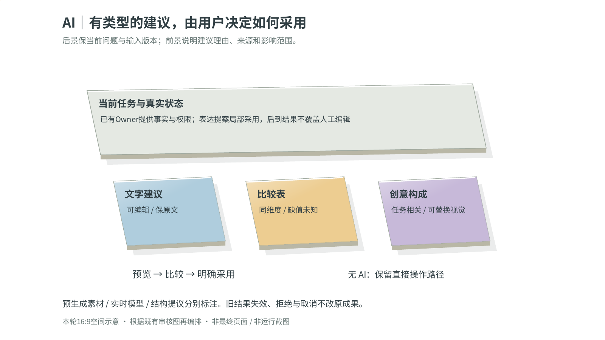
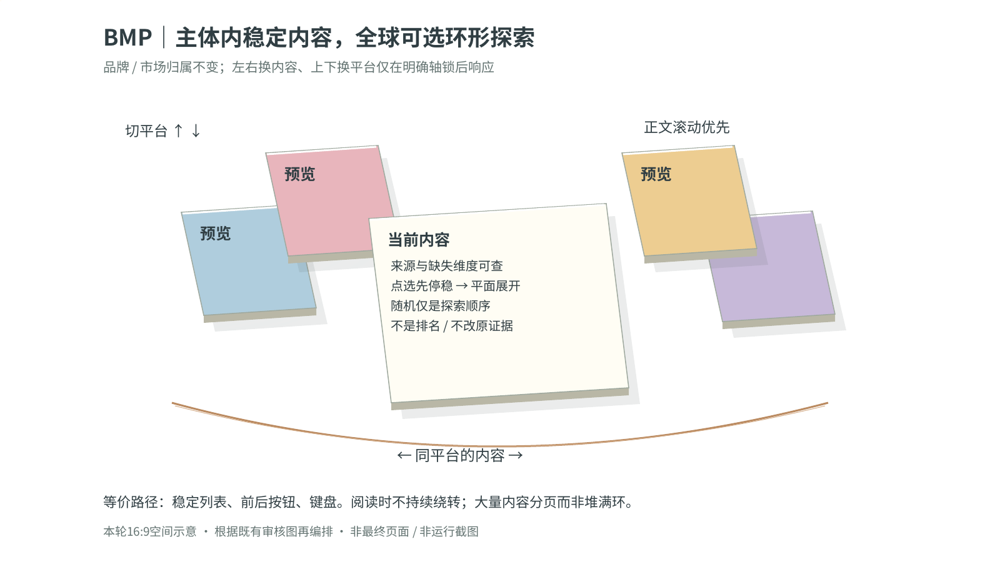
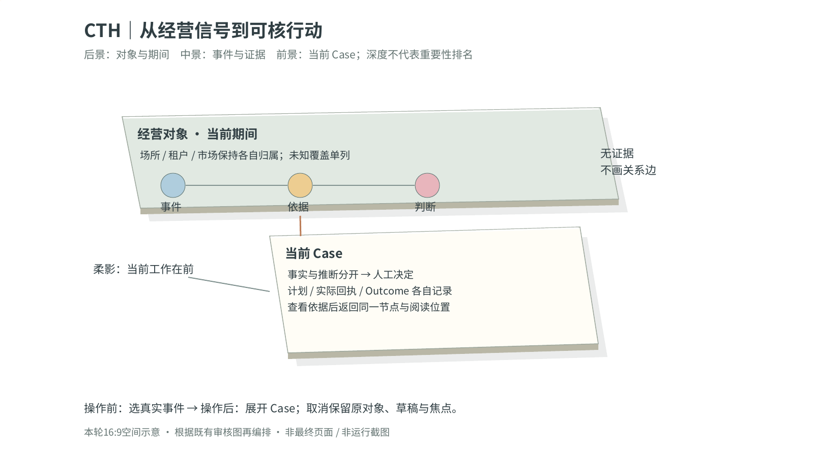
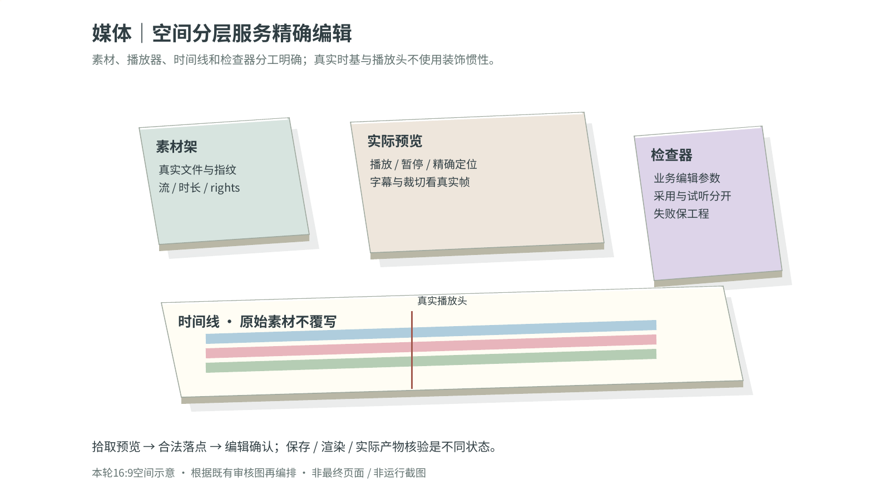
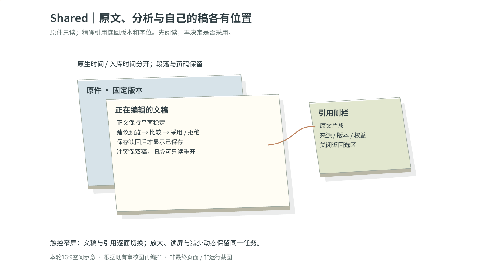
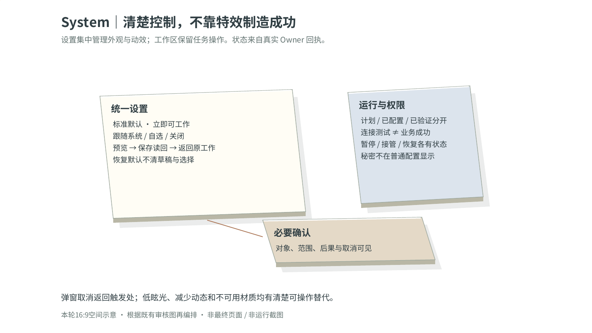

# 寰意 / OEVIRA 唯一完整视觉文字草图

**视觉文字草图基线已纳入主线；整体前端仍未获用户验收。** 本稿保留完整产品的逐工作面布局、交互、素材、动效及四表面要求；2026-10-21内容校准沿CURRENT及原合并证据追溯，不再把已发布草图列为待合并。已取得研究继续用于对应实现与效果校准，历史原件/实听限制不虚报为完成。实现必须遵循完整规划、Experience及实际屏幕合同，不能用现有不合格界面、概括称呼或通用页面模板替代本稿要求。源码、构建、实际效果和用户验收分别取证，不因文字完整而升级。

2026-10-21研究状态对齐：30JPEG/1PNG逐图阅读、35候选分类去重、13指定原件字节确认及三份正文采用已由后续回执补齐；原声音指定正文与26稿数学全文/官方版本观察也有后续证据。此前缺原件/部分阅读不是这些已核范围的当前状态；275条恢复材料的有效行为已接续唯一规划及原19屏合同。精确来源、仍待核底层材料及实施/运行分账见[研究状态勘误](../../evidence/round-15/RESEARCH_SCOPE_CORRECTION_20261019.md#2026-10-21-当前入口与后续证据对齐)；本稿不据此升级整体设计或产品验收，取消的315MB研究及本人声音制作专项不恢复。

待项按[完整规划开篇的现有未闭项接续表](../product-plan-full.md#现有未闭项与原工作面接续非新队列)逐项回到本稿对应工作面和原ScreenSpec。各文字构图是目标设计；已有布局/字段说明不等于真实效果已核，研究/方案/交互设计内容未闭时保持阶段稿；实际运行验证是基线后的独立验收，不是本次线上前置。更新原工作面中的真实状态、失败/取消/恢复和已验证范围，不另建一份最终草图绕过未闭项。

当前产品品牌为寰意 / OEVIRA，定位“An Open Space for Thought and Creation.”，品牌域名oevira.com。此为原产品更名，全部195G/R/J/U、非G要求及四表面原创UI/界面自身AIGC/200以上交互范围不变。附录原文、历史证据与技术路径中的序境/LUMENIS保留原样，仅作来源或兼容引用；当前名称由原Canonical Registry维护。大众服务为愿景，源级品牌文字不证明上线或新增功能。


**持续演进基线。** 2026-10-16直接PO明确，本稿及配套完整规划会持续更新；“唯一”表示集中维护，不冻结UI/前端、不限制总控当前或未来升级。后续获准能力/布局改进、真实运行与评估结果在现有Owner和合同内原位修订，保留来源与版本。2026-10-16的规划发布与REA顺序是历史任务安排；当前按最新直接PO指令执行，不增加设计审批前置。REA使用前须认真研究其官方GitHub适用版本的文档、实际源码/测试、许可及版本差异；完整要求见[规划开篇](../product-plan-full.md)。

**全产品范围与本轮状态。** 本稿与完整前后端规划共同覆盖完整寰意 / OEVIRA及Public Website、Web Workspace、Windows/macOS Desktop、iOS Companion四表面；SH-02只是资料工作之一，不限定本稿或产品范围。原195项G、44屏覆盖锚点及CTH/BMP/独立Shared/SYSTEM/AI与Math、媒体、采集、资料研究、账户/权限、保存恢复和全部UI/UX/AIGC/动效/资产要求继续有效，44屏号不是页面或能力上限。最新直接PO明确当前整体前端不合格、尚未接受（NOT_ACCEPTED）。2026-10-16该窗口只统一现有文档的收尾属于历史事实；2026-10-18已批准完整开发，按最新直接 PO 指令及[CURRENT §1](../../LUMENIS-CODEX-TAKEOVER-CURRENT.md#1-online-readers-current-state-snapshot)的有日期记录继续同一完整产品闭环并逐端验收，历史云端/本地分工不自动派工，文档与局部结果均不升级整体状态。

REA参考采用同时覆盖采集/查询分页与详情、平台原生字段、获准session/rate-limit/恢复、资料结构、交互、媒体及办公能力，不限截图/Pixi校准；这些方法经原Collector/Importer/Shared/Agent及媒体Owner进入真实工作，逐source/caller与权利/Permission核实，最终用有用成果、保存修订重开/恢复验收。V2的31条Importer未就绪及SourceUse缺入口仍是待修/待接线职责，不能以缺实现永久DEFER；受真实宿主、权利、身份/自动化限制的路径各自保持BLOCKED。完整采用及实际验收未完成；2026-10-16文档批次未运行REA或产品，当前获准接续仍按原方法、能力与逐来源处置推进，见[完整规划§20–21](../product-plan-full.md)。

本稿是集中视觉规划输入，不能替代Experience唯一设计权威，或原ScreenSpec内实际Owner/API/Permission/SourceUse、状态/动作、响应式行为、无障碍和验收合同。集中引用只去除重复构图描述；实际操作和约束继续在本屏合同维护，差异沿既有Owner协调。规划、合同、实现及运行证据各自可追溯且继续演进。

本稿是[完整规划](../product-plan-full.md)对应的集中视觉与交互设计输入，呈现权威仍为[Experience Constitution](../../LUMENIS-EXPERIENCE-CONSTITUTION.md)。既有 ScreenSpec 保留独立的实际字段/Owner/调用、Permission/SourceUse、动作、状态与验收合同，并指向本稿的具体屏幕锚点；不是另一套页面建设规划。文字框表示布局和交互关系，`<…>`代表运行时真实内容，示例不是已取数据或已保存成果。没有真实评审/运行证据不升级 DESIGN_READY/ACCEPTED。

四表面完整角色保留，当前先实现Web/Windows真实产品工作，官网后置，macOS/iOS待设备及后续指令；现有44屏号是兼容覆盖索引，不限制用户工作或页面。下述“目标操作”表示完整要求；当前没接通的Owner动作必须显示未就绪原因并保留输入，不能虚构保存/完成。本文不构建前端、不重写Architecture；独立Shared与全部领域功能均保留。

当前操作构成：主区始终是用户正在处理的问题或成果；一处目标输入、一处结果面，资料/来源/版本按需在侧边展开。首页不要求先选择研究、分析或文稿模块。结果可选中局部修改、导出或继续；视频/播客进入专属时间线与波形工作面。

当前主体范围是现有目录中有依据确认正在中国境内经营的商业主体和品牌主体，包含在境内实际经营的国际品牌；不以国籍或名称判断，不做全球主体扩库。设置 → 主体目录统一管理添加、移除和重新添加，新增也须符合境内经营范围；证据不足的登记显示待核，不进入已确认的活动目录。目录移除停止该主体的新任务使用及关联监测，历史资料、报告、行动和版本仍按原权限保留。

默认按实际相关时间由近到远呈现，提供近一周、近一个月、近半年、近一年及自定义范围；明确用户日期优先。事件发生时间、原文发布时间、采集时间分列，不互相冒充；日期未知单列，历史类比与当前事件时间线分区。

## 1. 原创视觉与工作空间

整体采用PO确定的**像素赛博＋植物生态＋复古未来主义**：像素阶梯轮廓、精确点阵与复古仪器层次组织可操作边界，植物分枝、花叶与有机节奏形成原创身份。保留现有每项任务的完整构图和操作，正文/表格/专业编辑内容清晰稳定；不使用被否定的旧SaaS骨架、旧材质代码或换色卡片模板。指针拾取、翻转、拖动、按压等有意义的物理交互及全部动效选择保留，像素不意味着强制低分辨率、固定二维或减少交互。用户纯白/纯黑/明暗/自定义颜色、壁纸/透明与设备实际支持能力保持。

Logo为满天星，带名、无名、小尺寸与单色版本保相同识别；五角色分别为Pim（CTH，兰花）、Bram（BMP，彼岸花）、Ness（Shared，椰子树）、Jas（SYSTEM，葡萄）、Aris（自研AI，茉莉花）。各植物保独立可辨轮廓，不用颜色替代身份，不改变原角色/业务职责。图标、角色、官网和包图标均依Experience §23统一；旧原件/研究保留溯源，不进入活动视觉或fallback。以下文字框只表达信息关系，全部页面依新视觉重绘，不把框线当最终皮肤。

Point→Axis→Trace→Field→Strata→Boundary体现在真实对象和关系上；不同工作分别用来源流、时间轴、日历、关系图、方案比较、文稿/轨道/检查器、证据阅读器和设置行，不套统一圆角卡片网格。可选空间浏览和局部光学动效保留，必须有键盘/触控等价与精确Return。事实/来源区保持不透明和可读；性能或材质不支持时回到清晰可操作层，业务不依赖WebGL/GPU。

### 1.1 打开即工作的首页（ACC-03与AI-01共同承载）

```text
<原创Logo/工作区>  工作范围：<当前选择> ▾  [搜索 ⌘/Ctrl K]   [任务 <数量/—>] [通知] [设置]
┌ 工作 ──────────┬ 当前工作 ────────────────────────────┬ 任务详情 ─────────────────┐
│ 新工作          │ 今天要完成什么？                       │ <当前任务标题> · <真实阶段>    │
│ 继续最近工作    │ <当前任务标题或最近工作>               │ 任务要求与范围 ▸               │
│ CTH 商业运营    │ 快捷开始：创作 / 视频后期 / 播客后期 │ 来源/权限状态 ▸           │
│ BMP 品牌市场    │                                       │ 已保存成果 <名称/版本> [重开] │
│ 创作            │ 用户：<实际问题或修改要求>             │ [停止任务] [返回工作区]       │
│ 资料与成果      │ 寰意：<已收到任务/需补充的具体条件>    │ <另一项任务标题> · 已停止      │
│ 浏览器          │ <真实有用部分 / 来源 / 局限 / 下一步>  │                                │
│ 任务与通知      │ 用户：<另一项需求或对当前任务的修改>   │ [收起详情]                    │
└────────────────┴ <输入问题或修改要求> [+资料] [发送] ──┴────────────────────────────┘
```

桌面主工作与上下文按宽度两至三层；Web中等宽度收工具为可逆抽屉，浏览器前进/后退与任务深链接保留。窄屏Web/iOS主工作占满当前面，底部输入避键盘，任务胶囊展开自己的状态/成果；菜单回退不清草稿。读屏按标题→当前任务→可用结果→来源→输入顺序，不逐token播报、不因流式到达抢焦点。原私有推理链不显示；用户可以查实际状态，必要审批不能被“少打扰”吞掉。

导航切领域只改变当前视图，不把独立制作强绑CTH/BMP、不授权、不自动采集。未保存工作切换时提供“留在这里/保留草稿并切换”；真实保存成功后显示可独立读回版本。来源抽屉关闭返回原段落/选区/时间码；通知点回对应任务和已提交Artifact，不只跳通用首页。

### 1.2 反馈与生成动效的可见时序

```text
用户动作 → 约90ms内首个真实可感知反馈（预算，非固定等待）
         → 处理中：普通骨架/真实任务状态，输入继续可用 [停止]
         → 新成果已读回 + 字体/图片尺寸/布局就绪
         → 原有动效保留；可选一次 点阵/线框→实际成果揭示 [立即跳过]
         → 来源 / 局限 / [编辑] [保存/版本] [导出] [下一步]
```

这不是每次切页/刷新/旧版重开或每行列表动画。独立偏好“完整/跟随系统减少动态/关闭”与原有全局动效分开；缩放、滚动、交互、取消、字体/尺寸/成果版本变化时清理旧几何，真实UI与语义始终可读可操作。关闭此效果不删原产品动效。技术、许可和实际探针见规划Pixel/渲染专节。

### 1.3 有分量的交互物理与真实调参

2026-10-16直接PO要求沉重弹性、磁吸、流畅、抛出及适配产品的物理实现，且物理参数真正起作用。具体计算、单位、接线和真实验收按[完整规划§4.1](../product-plan-full.md)记录并沿唯一Experience及原ScreenSpec协调；本稿给可观察的任务交互，不是另一套动效权威，也不证明已实现。

```text
用户抓取原已可拖/可逆对象 → 跟手移动（当前位置与速度连续）
  接近合法落点 → 显示吸附预览 → 距离/强度/阈值真正产生拉力
  松手 → 以实际释放速度抛出 → 摩擦衰减 / 限位回弹 → 稳定于合法状态
  任意时刻重抓/反向/停止/取消 → 立即接续或按原动作撤销，不排队重播
最终选中/编辑预览 ≠ 已提交业务结果；保存仍等原Owner真实读回
```

主面板/抽屉呈现有质量的起动、有限弹性和稳定落位；精细选择/媒体编辑保留精准目标与可取消吸附，文本、输入光标和事实区保持稳定。已有对象拖拽可按释放速度惯性抛出，边界回弹不改变Timeline时基、业务值或触发危险动作。磁吸提示说明真实合法落点，按钮光学偏移不挪走其可命中区。四表面按鼠标/触控板/触控与键盘路径各自验证，低帧/缩放/后台返回不改变最终状态。

“鼠标如手”的动作只落在适合且原合同允许的真实对象：按下有轻压/接触深度反馈，拾起保持稳定抓点并抬升，拖动可轻倾且由实际阻尼跟手，靠近合法位置显示磁吸预览，放手按测得速度流畅抛出并有限回弹/稳定落位。资料或分析卡片等适合对象可翻面查看同一对象的来源/方法详情并翻回，同时保留直接打开详情的入口；背面不得隐藏关键覆盖、误差、风险、权限、错误或可用动作。压入深度、拾起高度、倾角、阻尼、质量/刚度、磁吸范围/强度、释放速度/摩擦/回弹与翻转响应须连接真实几何/轨迹，逐项调参能产生可观察变化；普通鼠标没有压力传感时不得声称读取真实压力。这项完整交互已获最新直接PO明确授权，不因现有ScreenSpec尚未逐字列出而排除在本规划之外；实现时由原Owner随代码更新受影响ScreenSpec，不新建Owner或引擎。当前参数接线、轨迹采样、性能、取消/恢复和四表面验证仍OPEN/NOT_VERIFIED。保留约90ms首反馈、精确媒体Timeline/播放头、业务值及权限状态；键盘/触控/读屏等价可用，reduced-motion/关闭时移除按压层次变化、倾斜、空间翻面/抛移与重复回弹并立即呈现同一信息和动作，不损伤内容、编辑或保存。

实际调`质量/刚度/阻尼`要改变响应、超调或收敛；调`吸附半径/强度/脱离阈值`要改变吸附范围/力度/可脱离性；调`初速度/摩擦/恢复系数`要改变惯性、距离与回弹。配置必须接到真实计算和显示对象，不能只改名称或固定ease动画。原动效和偏好保留；减少动态/关闭路径即时呈现同一业务状态、不丢键盘/读屏操作；无参数接线、录制轨迹/真实操作和逐表面证据时保持OPEN。

### 1.4 页面实际出现的语言

全产品及四表面的操作语言按[完整规划§4.2](../product-plan-full.md)原位维护。框中的`<…>`是运行时内容占位；框外布局/时序、Owner/API/算法/验收说明属于内部评审注记，不渲染为用户文案。页面用任务标题、内容正文、实际结果与短动作，不展示研发自夸、架构口号或解释内部工作逻辑的长段落。不同任务保留自己的布局、输入、工具和完整交互。

```text
研究资料                         [添加资料] [查看引用] [保存] [导出]
你想了解什么？                   <用户的问题、范围、期间与约束>
<当前任务标题>                   <真实结果正文/图表/可编辑文件>
范围：<地区/对象/期间>           <确有影响的覆盖缺口/误差/过期或不可比提示>
<真实任务状态>                   [查看结果] [当前可执行的单一动作]
<受影响对象与具体错误>           [现有可行恢复动作]
[来源与口径 ▸] [方法与假设 ▸]    [查看原文] → 返回原段落/选区
```

这些位置是按本屏任务选用的示例，不给每屏硬加同一组控件。“已收到”“已保存”“已导入”只随实际回执出现；部分完成保留真实数量/待处理项，未知数值为“—”并说明实际原因，未采集、没有匹配、读取失败、暂不可用与真实0分别表达。只有原Owner合同支持且当前状态可执行时，才单独显示“停止任务”或“继续任务”；取消外部动作、停止、暂停和继续各走原动作，不做斜杠混合按钮。“未保存”“失败”“已停止”“需要确认”分别表达，不用“全部完成”代替。权限/风险确认保留对象、范围、去向和后果；影响结论的覆盖/不确定性及图表单位/分母就近可见。方法、算法、口径和详细引用按需打开，业务预算/期间/资源约束仍可直接修改；不让普通用户挑论文、输入内部ID或选择工具来完成工作。

文案纠偏保留所有原任务和可选项、真实取消/续做/版本恢复、中英韩与无障碍、原创Logo/icon/插画/视频、AIGC和完整原动效。上一节物理参数及§1.2约90ms反馈/生成揭示继续有效，当前语言修正不构建前端或声称四表面已验收；其余草图中的工程注记按同一边界逐屏落实。

## 2. Public Website完整内容家族与文字草图

官网只作产品与场景展示、公开成果和制作好的演示，不提供在线试用、功能体验、访客上传、采集、分析、生成或业务保存。视频播放/定位/字幕、章节/案例切换和展示动效保留；实际工作通过链接进入Web工作区或Windows产品。官网沿Astro现有路由/内容Owner；一切业务能力表述区分已验证/建设中/示意，按钮有真实去向。官网可使用适合叙事的页面滚动；不把操作端少滚动规则机械套给官网。全家族保留zh-CN/en/ko、键盘/读屏/放大、窄屏、状态与返回，不使用自动第三方追踪Pixel、远程favicon或假成绩补视觉。

### 2.1 首页 / 产品理解与进入工作区

```text
满天星 OEVIRA     产品 ▾  场景  成果与案例  帮助  下载     语言 ▾ [打开工作区]
╭ 像素生态主场景：近景花簇/分枝形成轮廓，中部留白，远景点阵层次 ╮
│ 短标题 + 真实工作结果              [打开产品] [观看演示]       │
╰ 滚动推进同一场景；不等待动效也能直接进入，导航保持可达         ╯
       [商业运营 CTH]       [品牌市场 BMP]       [独立创作 ▾]
展示章节：商业判断 / 品牌策略 / 原创内容 / 视频后期 / 播客后期；操作在产品内
环形场景索引 → 选中项居中展开扇形 → 已制作的输入/操作/成果演示 [打开产品]
             [上一项]  当前场景  [下一项]     [返回场景]
章节转场：像素植物/字符带贯穿；进入正文后内容正视，过渡可跳过
┌ 左约1/4：案例/镜头索引 ─┬ 右约3/4：真实操作视频、说明与成果 ─┐
│ 所选场景与版本、筛选    │ 播放/暂停/定位/字幕/转写/全屏/关闭 │
└ 切换/关闭保阅读位置 ────┴ 真实内容就绪后一次可选点阵揭示 ────┘
五植物场景：兰花 / 彼岸花 / 椰子树 / 葡萄 / 茉莉花，对应原角色职责
帮助：任务节点轨道 → 当前步骤邻接说明/恢复，节点数由真实任务决定
[打开工作区] [下载真实可用版本]
产品/场景/案例/帮助/信任/更新/下载/联系/条款/隐私/语言完整页脚
```

构图与动效直接对照主规划J01的2026-10-25官网录像帧表（原片SHA256 `9a1bfd581c7c27726398ec76b309c0e5a0612d3a3e056f2d5917ad3c5c6948e4`），不复用被否定的旧官网卡片骨架。满天星生态主形体贯穿首屏、索引、案例、帮助与结束CTA；色彩使用原主题选择及五植物身份，不强制全站黑白。前景、留白、标题和内容面比例按章节任务变化，环形/扇形不用来替代普通导航。录像最后创作者片尾不进入网页。

宽屏使用叙事文字与真实操作视窗的主次关系；手机先工作入口，再正视内容和可控制演示，环形/扇形有显式选择的单列等价，导航折叠但全部家族可达。键盘焦点、读屏顺序、放大、跳过/减少动态和用户选择保留。视觉可用原创局部插画/适用AIGC并标记；未验证功能不能出现在“已经完成”演示。播放失败保留字幕/转写与重试，来源/版本缺失则标明示意。进入工作区回原预期任务入口，不先强制注册。

### 2.2 产品与能力家族

```text
产品导览：你要完成的工作 [商业运营] [品牌市场] [事件分析] [原创创作] [视频] [播客]
所选工作：问题 → 真实输入 → 分析/编辑视窗 → 可交付成果 → 来源/限制 → 保存重开
其下按需展开：浏览器与采集 / 资料与引用 / 聊天与异步 / 版本恢复 / AI增强与无AI路径
[打开对应工作] [阅读完整指南]；可用状态和适用端明确
```

每个能力有自己的真实流程画面/短片、输入条件、成果格式与失败恢复说明，不换标题复用同一产品假图。CTH讲经营事件与行动结果；BMP讲市场/竞品/创作者/Campaign；独立能力直接从用户稿/素材进入，联系领域只是可选。桌面可并置流程/成果/来源，手机按任务步骤展开并保留当前选择；比较表提供语义表格和读屏顺序。

### 2.3 场景/解决方案

经营者、品牌/代理团队、研究者、内容/播客工作室分别组织“真实问题→原工作负担→寰意工作链→成果→限制→下一步”。同一产品模块按角色改变章节重点，事实和权限不变。CTH案例不能作全国品牌事实；公开材料、行业假设与真实使用案例分别标。官网场景只提供观看和产品链接，不收集Brief、资源约束或上传资料；进入工作区后，普通自有或获准资料可直接上传/导入，后台记录来源、权限、权益及UNKNOWN状态并按实际动作审查。只有真正敏感或超出普通基础处理的额外用途，才按现有Permission/SourceUse合同单独确认；营销CTA不得绕过该确认。

### 2.4 成果案例与真实操作视频

```text
筛选 <工作类型/市场/语言>     案例标题 + 真实任务/版本/核验日期
左：输入与约束/操作镜头表    右：成果阅读/播放器（字幕/转写/全屏/退出）
来源与使用权 ▸  方法与局限 ▸  修改前后/恢复过程 ▸
[查看可公开成果] [打开产品]，没有许可时不提供原件下载
```

没有实测不填客户数、节省倍数、ROI或排名。完整/短版演示分别按完整动作闭环剪辑，横竖按目标真实录制，不将截半动作或模拟成功发布为用户证明。缺视频保留明确未提供状态与文本流程，不能用静态图墙冒充操作。用户的原件/机密工作不因做案例自动公开。

### 2.5 信任与数据权利

以可阅读分节说明资料从哪里来、核对了哪些内容、哪些仍未核实，以及用途、保存与撤回方式；保留来源同权与质量判断、AI派生与人工决定、权限/会话隔离、部署和已核能力限制，Source/Evidence/Canonical等定义在按需详情可查。每项声明给当前可公开依据与更新时间；未验证控制不显示认证勾。引用脚注回准确段落；窄屏长文保留目录跳转、返回阅读位置与打印/可访问文本。密钥/个人账号/生产运行细节不公开。

### 2.6 帮助与指南

```text
[搜索问题/工作]  分类：开始工作 / 资料与依据 / 成果修改与导出 / 视频 / 播客 / 恢复 / 设置
当前指南：目标与所需输入 → 步骤与真实控件 → 预期结果 → 错误/恢复 → 回原任务
页内目录 / 当前端标签 Website·Web·Windows·macOS·iOS / 更新时间与适用版本
```

步骤使用界面上的业务词、三语/快捷键/触控等价，错误帮助对准具体状态/原因，不能要求用户填内部ID或选论文。搜索无结果给改词/分类/联系和返回；离线/服务错误与无匹配分开。手机目录折叠不遮正文；示例/操作片有字幕且能暂停。

### 2.7 更新、下载、联系与公开法律页

更新按实际发布版本展示变更、已知限制与适用端，不把合并源码叫可用客户端。下载行分Windows/macOS/iOS和Web入口，架构/版本/签名/校验/最低环境按真实包；未发布端明确暂未提供且仍可进入Web，不伪造下载成功。联系只收原批准必要信息，不设试用申请或功能体验流程，字段错误就地、网络失败保留用户输入，提交后必须真实回执；没有可用渠道不出假感谢页。条款/隐私/许可按正式已审文本展示，规划不代法律审查或接受协议。

## 3. 独立制作的完整工作面（SH-01复用，不增加前置业务域）

### 3.1 当前任务的资料、判断与可编辑成果

```text
当前工作 <标题>   <沿用当前范围>   已保存v<…> / 未保存更改   [保存] [版本] [导出]
┌ 资料/章节/比较 ─────┬ 主阅读与编辑 ────────────────────┬ 依据/审阅 ─────────────┐
│ 空白新建 / 导入    │ 可编辑标题、章节、正文/提案页       │ 当前段落引用/原文定位    │
│ 来源/权利与使用状态 │ 批注、选区改写、增删/拖动章节       │ 事实/推断/创意/用户原稿  │
│ 研究问题与约束    │ 比较候选和反证；不把摘录拼成报告    │ 主张待核/来源撤回影响    │
│ 章节/页面定位     │ [检查来源] [比较修改] [撤销/重做]  │ [采纳修订] [保留原文]  │
└──────────────────┴──────────────────────────────────┴───────────────────────┘
```

自有原稿无需Canonical外部来源证明；普通自有/获准资料可直接导入、阅读和开展无AI基础研究，模型增强独立可选。引用外部事实按实际用途核验SourceUse；普通资料不要求逐份填写通用“本次用途”表单，只有真正敏感或额外用途才按既有Permission/SourceUse合同确认。原创观点和创意不伪称事实。研究从资料阅读/精确引文、手工比较即可得到可保存成果；提案方法、10段骨架/One Slide One Job和甲乙丙叙事是可编辑工具，不强制模板。Web在中宽保留主稿+资料抽屉；iOS一项稿件/来源/批注，底部可逆工具，不暗丢章节。切换来源回同选区，断网保留明确未提交编辑，版本冲突选择另存/重读后合并，不用本地暂存报成功。

### 3.2 独立视频工作面

```text
视频 <标题/工程版本>  <画幅> [保存] [撤销/重做] [导出成片] [工程交换/损失预检]
┌ 素材库/搜索/独立预览 ┬ 实际播放器与安全区 ─────────┬ 检查器 ─────────────────┐
│ 原素材/时长/时基/权利│ <实际当前帧>                 │ 字幕/逐词稿、样式/位置     │
│ 缺失素材 [重新选择素材]│ [播放/暂停] <实际时间码>    │ 画幅裁切、音量/淡变/人声优先│
│ [导入] [粗剪提议]    │ 悬停预览≠播放头≠工程修改     │ 章节/封面/B-roll候选       │
├────────────────────┴────────────────────────────┴──────────────────────────┤
│ 逐词稿/分镜：选词定位；明确 [改文字] 或 [删词剪音视频]，提议确认才改工程          │
│ 多轨时间线：画面/叠层字幕/多音轨 · 播放头 · 选区 · 缩放 · 横向平移/seek分离     │
└──────────────────────────────────────────────────────────────────────────┘
```

Timeline及素材版本是唯一可编辑对象，预览、成片与项目分别校验。VFR/时基未知、文件指纹改变、来源权限/素材失链、转写/渲染失败各有说明与可恢复动作；取消只影响本次渲染，不删原项目。字幕三语/安全区/同步，多画幅重排不拉伸。Web按宽度在预览/稿/时间线间切换，文件上传/断连以真实服务能力显示；Windows/macOS有大文件和快捷键，空格/J-K-L有可访问按钮等价。iOS按原Companion职责审阅/试听/允许的轻剪与注释，复杂轨道可明确续接原桌面/网页版本，不能伪造手机已渲染。

“重新选择素材”仍执行原文件重链与身份/权利校验，不把任意新文件当原素材；“人声优先”对应原ducking，人声出现时降低背景音乐，原可审阅/可调参数及自动化不变，详细说明按需查看。

### 3.3 独立播客工作面

```text
节目 <标题/期号/版本> [保存] [试听] [版本] [导出发布包]
选题/嘉宾/提纲/脚本/录音导入/转写/剪辑/母带/发布包/切片/复盘（可直接从已有稿/音频开始）
┌ 可编辑原文/校对稿 ───────────┬ 真实播放器/检查器 ──────────────────────┐
│ <说话人> <时间码> <原文>      │ 唯一播放器；播放/暂停/循环/原始或母带     │
│ [改稿]不改音频；[删词剪辑]另行│ 说话人/选流、章节、真实波形              │
│ 引用/问题/故事节点可定位      │ 响度与真峰：实测/目标/未知分别显示        │
├─────────────────────────────┴─────────────────────────────────────────┤
│ 多轨声轨/背景乐/人声出现时压低背景音乐 · 稿件定位↔实际音频；平移不seek，seek不改工程│
└───────────────────────────────────────────────────────────────────────┘
发布包预检：音频/章节/字幕稿/节目说明/封面/订阅源（RSS）/可编辑原文与校对记录；导出≠平台发布
```

选题十信号缺项显示需补输入而非0分；嘉宾三标准由人工判断，导入已有音频不被策划流程强制阻断。转写/说话人和AI配音缺模型时保留导入稿/手工标注/剪辑混音。外部依法获权音色/语音包仅在来源、用途授权与兼容核验后导入与使用，产品内不执行克隆；实际录音先系统权限/用户发起；没有麦克风授权可导入，不自动开麦。测得-16 LUFS±1、真峰≤-1 dBTP才能标达到该目标；其他平台预设不混为一值。Web按宽度保留稿/播放器、工具抽屉和任务状态；iOS迷你播放器+稿件/章节抽屉、轻改稿/审阅与原任务返回，后台/耳机/中断恢复按实际端证据验，不把Web录音当iOS完成。

### 3.4 独立方案导入与比稿

```text
比稿 <标题/版本> [加入文件/粘贴方案] [比较] [保存] [版本] [导出报告]
问题/目标 <可编辑>  范围/时间/业务约束 <可编辑>  比较维度 <实际可用定义>
┌ 方案清单/来源与解析状态 ┬ 同一维度的候选对照 ──────────┬ 选中项的原文/依据 ┐
│ A <格式/权利/已解析范围>│ <目标/受众/策略/创意/执行/评估> │ <段落/页/真实引用>│
│ B <状态/部分或失败原因> │ 各项：事实/人工判断/AI建议分开  │ [排除/更正/说明] │
│ [+] [移除（明确范围）]  │ 材料不足：<实际缺少内容>       │ <方法/假设/限制> │
└───────────────────────┴──────────────────────────────┴──────────────────┘
结论与取舍 <可编辑>  [采用/另开提案]；保存后可比较版本/重开/恢复，导出不自动发送客户
```

用户先给业务问题和材料，后台做适用解析/比较；不要求选择论文或输入内部权重。人工可纠正提取/改变业务约束，证据不足就指明差哪项。Web文件预算在上传前说明、部分接收分别有回执，不能读完才拒；桌面保留原生文件操作。窄屏Web/iOS按方案列表→同维比较→原文依据，显式选择两项、语义表格/键盘等价和Return保留未保存判断。现有接口缺失保持OPEN，不能拿静态评分卡当已保存比稿。

### 3.5 风险线索审阅与权利材料

```text
品牌/对象 <当前获准范围>  [导入候选名单] [查看权利材料] [保存经营事项] [导出材料包]
┌ 候选与筛选 ─────────┬ 所选原文/账号公开信息 ────────┬ 人工核验与处置 ──────────┐
│ <真实身份/来源/时间> │ <实际截图/原文/出处/捕获时间> │ 线索类型/事实支持/缺口     │
│ 待核/已核/排除/争议  │ <关系来源/适用期/未知>        │ [标记] [排除] <人工理由>  │
│ 网络/独立列表互为等价│ 无法取得字段准确说明原因      │ 权利材料/批次/后续跟踪    │
└────────────────────┴─────────────────────────────┴────────────────────────┘
材料预检：真实引用/权利/时间/版本/隐私范围；[审阅导出] [取消]，没有自动投诉或法律认定
```

沿BMP-10/CTH-06原风险/Case和Shared Evidence/Artifact进入，不造另一产品。门店/经营范围/认证主体/KOS身份/引流话术/同运营者网络/空壳或平台处罚均需原证据支持，模型或规则只给线索。关系图有同源表，按时间/来源分层；别名/同名不能合并成伪冒结论。付费企业查询或平台接口未获权时，明确不可用并保留人工补证/编辑，不伪造成功。Web/桌面并置名单和阅读面，iOS单项核验→证据→理由/保存，返回原筛选与候选；导出包和后续处置分别验，外部提交仍原Permission/Effect批准。


## 4. 逐屏任务布局与Web、Desktop、iOS重组（Website见§2）

下文每屏记录原有任务的主次和完整目标操作。Desktop指Windows/macOS；Web包含窄屏浏览器；iOS按Companion角色保留适用工作。共通三语、字号/读屏、状态、来源与版本要求见规划§4和本稿状态章节；逐屏独特合同链接保留，不用共通文字代替具体布局。最终完整动作与当前可用接口分别看，未接动作OPEN不等删除。


<a id="acc-01"></a>
### ACC-01 · 直接进入工作与可选账号

入口是首页设置中的“登录/注册”，也可由已授权工作区入口直接继续。桌面是安静单一身份面，不排健康指标；主区先放“先不登录，直接使用”，邮箱验证码与免费Google并列，Apple未启用时不占空按钮。验证码支持整码粘贴/逐格编辑，真实倒计时与重发错误在原字段旁；登录取消返回原工作，不代替Permission恢复。

Web用原返回地址与CSRF/身份Owner读回，不清除未发文字；iOS按系统安全区和键盘摆一列认证选择与明确返回，Apple只有实际启用才展示。首次模型改进同意为无预选的允许/不允许，未回答不入训练；设置能改。成功、验证码错/过期、服务不可用、取消、关联冲突和删除待生效分别呈现。账号设置沿原分区：通用、账号、安全/设备/退出所有设备、模型API、连接器、用量、数据控制、开发者、关于；删除账号30天撤销、导出限时链接和本地数据合并/保留由真实Owner处理，客户端不单凭同邮箱合并身份。

[原动作/字段/状态/Owner/Permission/验收合同](../../../contracts/experience/screen-specifications/ACC-01.md)。以下为完整目标设计，当前接线与可用性以该合同及同版本运行证据为准。

#### 账号设置 rev3（类 ChatGPT）

##### Desktop

```
设置                                                      [×]
┌────────────┬────────────────────────────────────────────┐
│ 通用       │ 主题 · 语言 · 时区 · 通知 · 减少动态效果    │
│ 账号       │ 头像 显示名 邮箱[更改]                      │
│            │ 登录方式：邮箱✓ Apple[关联] Google[关联]    │
│            │  （至少保留一种）                           │
│ 安全       │ 设备与会话：设备/位置/最近活动 [退出]       │
│            │  当前会话标「当前」                         │
│            │  [退出所有设备]（含本机，二次确认）         │
│            │  新设备登录邮件提醒 ✓                       │
│ 模型与API  │ (●) 自有模型 ( ) 我的 API → AI-05           │
│ 连接器     │ GitHub / MCP → AI-04 · 平台登录 → SYS-06    │
│ 用量       │ 模型调用 · 采集任务 · 存储；未统计=数据缺失 │
│ 数据控制   │ 改进模型 [允许/不允许]（首次使用时你选的）  │
│            │ [导出全部数据] 完成后通知，链接限时有效     │
│            │ [备份账号数据] [从备份恢复]                 │
│            │ [删除全部对话]                              │
│            │ [删除账号] 输入邮箱确认 → 30 天内可撤销     │
│ 开发者     │ 用户开发者模式 → SYS-04（需先接受协议）     │
│ 关于       │ 版本 · 条款 · 隐私    [退出登录]            │
└────────────┴────────────────────────────────────────────┘
未登录：账号/安全显示「未登录 · [登录或注册]」；其余分区照常可用（本地导出/备份）。
```

##### Web：宽时设置侧栏/内容并置，中窄为分区列表→详情；会话含浏览器会话，前进/返回及刷新保留未提交偏好，不依赖鼠标悬停。

##### Mobile：一级列表 → 二级页；删除账号在数据控制底部（红色）。

##### States

正常 / 加载 / 数据缺失（不补 0/50）/ 账号服务不可用（账号、安全只读并说明原因，其他正常，无自动回退）/ 导出或备份中（进度，可取消）/ 删除待生效（剩余 N 天 + [撤销删除]）/ 会话状态未知（显示「状态未知」，可用退出所有设备）。

##### Acceptance

- 实际已启用方式可互相关联/解除（Apple未启用不展示），最后一种不可解除。
- 删除的原30天可撤销目标保留，但登录只核验身份并读取删除状态，不自动撤销删除或恢复账号。用户明确点“撤销删除/恢复账号”并获原Account Owner成功回执后才显示恢复；“继续删除”只返回待生效状态，不提前执行清除。当前未核到实现此30天自助生命周期的Owner接口，成员管理DELETE不替代它；未接通前不显示假倒计时、自动清除成功或可执行恢复控件。到期清除仍须原已批准生命周期及真实回执，不新增即时删除路径。
- 导出含资料、主体、采集数据、报告、对话；同账号限时下载。
- 自带 API Key 仅本机安全存储；三语；无主体写死。

#### 登录/注册（邮箱 · Apple · Google）rev3

##### Desktop

```
┌──────────────── 寰意 OEVIRA ────────────────┐
│             登录或创建账号                    │
│  [ Apple 登录 ]   [ Google 登录 ]             │
│  ─────────── 或 ───────────                  │
│  邮箱 [ name@example.com ]  [继续]            │
│   → 6 位验证码（无密码）                      │
│  [ 先不登录，直接使用 ] ← 始终可见            │
│  条款 · 隐私 · 中文 / English / 한국어        │
└───────────────────────────────────────────────┘
验证码页：<当前脱敏邮箱> [□□□□□□] [重新发送 <服务端剩余时间>] [换个邮箱]
首次进入（登录或不登录都问一次）：
┌ 是否允许用你的使用数据改进寰意模型？ ┐
│ [允许]  [不允许]   之后可在 设置›数据控制 修改 │
└──────────────────────────────────────┘（无预选项）
```

##### 4B. Apple按钮启用条件：已有开发者账号且该端Apple接入实际启用后才展示，未启用时隐藏；Google与邮箱沿PO批准免费路径。历史费用记录不构成本任务采购授权，也不是客户端显示条件。

##### Web：设置分区按宽度切换侧栏/二级页；保留浏览器会话状态、前进返回和未保存偏好；授权取消/成功均返回原任务。 Apple/Google 授权后回原页，工作不丢。

##### Mobile：Logo → Apple（实际启用后iOS置顶，未启用不展示）→ Google → 邮箱 → 继续 → 底部「先不登录」。

##### States

正常 / 加载（可取消）/ 验证码错或过期（行内提示+重发）/ 第三方取消授权（回本页不弹错）/ 登录服务不可用（「登录暂不可用，可先不登录继续使用」，不自动换方式）/ 同邮箱已有账号（核验现有账号控制权后询问关联，不自动合并）/ Apple 隐藏邮箱（提示继续用 Apple 或在设置关联真实邮箱）/ 删除待生效账号登录（仅读原Owner状态；只有真实到期时间才显示「账号将于 N 天后删除」，明确[恢复账号]动作回执后才恢复，[继续删除]仅返回待生效；Owner未绑定则说明暂不可操作）。

##### Acceptance

- 不登录全部主流程可用；本地数据登录后由用户选「合并 / 保持本地」。
- 经服务端验证的同邮箱不同方式关联同一账号，禁止客户端只凭文字邮箱合并；新设备登录发邮件提醒。
- 改进模型询问无预选，未回答前按「不允许」处理且再次询问。
- 三语；无主体写死；不存明文密码。


<a id="acc-02"></a>
### ACC-02 · 主体、品牌与工作视角

从顶栏“全部获准范围”打开当前工作对象选择器，默认先呈有据在中国经营的商业主体和品牌，用户已有选择保持优先；国际品牌的中国经营与总部国家分开。“管理主体”进入同一个“设置 → 主体目录”，目录包含全部有权主体，可添加、移除、重新添加及新增对象，不另分一个海外库或新主体库。移除只改变当前用户的使用范围，历史资料/成果不级联删除。主区是可检索实体列表与按需消歧详情：官方名/别名、类型、经营市场、地区、关系和来源；GLOBAL/ALL始终可返回。新增经已有注册Owner查重，冲突呈现“可能同一/不同对象/需补证据”，不擅自合并。

Web窄宽先搜索结果再可逆详情，键盘上下/Enter选择，刷新重读服务端当前视角；iOS全屏搜索和独立详情/确认，保留输入词及返回原任务。未采集主体仍可发现，身份未核、没权限、未采集、采集中、读取错误各给准确状态。聚焦只收窄视图，不开始采集或授予权利；独立Shared无需借此选一个虚假主体。新增→真实接收/恢复的完整结果由原合同验收。

宽屏将上下文横幅跨在列表和确认详情之上，窄宽是搜索列表→焦点确认层，底下的列表/查询/滚动保持挂载，详情不追加到长列表末尾。原屏规宽度数值是现有布局起点，最终按真实内容/字体重组，不当屏幕能力上限。

[原动作/字段/状态/Owner/Permission/验收合同](../../../contracts/experience/screen-specifications/ACC-02.md)。以下为完整目标设计，当前接线与可用性以该合同及同版本运行证据为准。


#### 主体身份与市场关系的有据编辑（U01–U03）

从ACC-02“查看当前主体”或CTH-02/BMP-02对象名称旁“身份与市场关系”进入，顶栏固定原始官方名称、稳定身份和当前查看范围；别名搜索结果逐行显示实体类型、地点与来源，不因同名自动合并。主面按“对象本身—场所/门店归属—市场关系”三层排列：场所、门店、租户、品牌分别列卡，关系行显示类型、起止日期、依据和待核/已核/冲突；点击关系打开原资料Reader，不能把同品牌全部门店静默纳入场所监测。

“市场关系”不是一个国家下拉框：来源国、总部所在地、法律主体/司法辖区、经营市场、营销/活动市场及具体地点分别有独立标签、证据和日期；可多值，未知留空并显示未知，不能把总部国家自动填入其余字段。右侧“本次工作范围”仅预览当前选择会包含的确切实体/市场，GLOBAL默认和清除聚焦保留；新增、修订关系及聚焦各是不同动作，选择永不授予采集或业务权限。

有当前Owner真实编辑能力及Permission时，用户逐行选择关系类型、目标对象、有效时间和依据；保存前并排显示旧/新值、受影响后续引用与本次作用对象，取消保未提交稿且不改服务器事实。缺依据、同名歧义、重叠有效期、当前版本冲突、撤权与保存失败逐行标出；先补证/重新读当前版本，不能自动重试覆盖另一人的修改。已保存关系可按当前权限读历史；撤回/恢复只用真实Owner动作，不能在界面造“修正事实”。不存在callable时保持可核只读并明确能力缺口，原要求仍待实现，不移除字段或伪造保存。

Web/Windows/macOS宽屏左侧身份与关系清单、中间选中关系、右侧依据及范围预览；窄Web顺序展开并保原选中关系。iOS从对象详情逐层打开“关系”与“依据”Sheet，编辑单条并在键盘上方固定取消/保存，回原任务保范围；两桌面系统分别验证多窗口冲突。官网仅用公开获准示意说明不同关系，不列私有主体。价值是避免错误实体归属和市场口径污染后续分析。界面自身AIGC可按已知关系密度提出原创可编辑关系阅读构图，图中只连有据边；未知关系用缺口文字，不生成国旗归属、地图定位或推断关联。可切回同源列表、锁定布局、撤销、低动效和无AI基础操作。

<a id="acc-03"></a>
### ACC-03 · 聊天工作首页与继续工作

采用§1.1整体壳：任务输入是第一主操作，最近工作按标题/类型/真实版本排成紧凑工作清单，导航进入领域与独立制作。没有聊天历史时显示目标输入、附资料和创作/视频/播客入口和附资料，不出假结果卡或虚构推荐。已在做长任务时继续接收新问题，各任务保持可见归属。

Web侧轨随宽度收起，深链接/刷新恢复当前工作与输入；Windows/macOS保留窗口尺寸/快捷键；iOS一项当前对话加任务胶囊和底部导航/菜单，键盘出现后仍有发送/停止/返回。加载、空历史、离线、部分恢复与新工作未保存分别可理解。进入和返回保留范围、选区、过滤、滚动、附件及草稿；未读到服务器成果不能用最近项造成功。

[原动作/字段/状态/Owner/Permission/验收合同](../../../contracts/experience/screen-specifications/ACC-03.md)。以下为完整目标设计，当前接线与可用性以该合同及同版本运行证据为准。


#### 舒展工作空间与跨能力直接继续

五个架构分工是产品内部能力、数据和Owner边界，不是用户完成一件事必须依次打开的五层页面。首页以“我想做什么/继续哪件工作”为入口：选择研究、写作、制作、经营或品牌问题后直接进入该任务的具体工作面，并带当前合法材料、已保存版本和可用上下文；不要求先选架构、再选模块、再重新录同一问题。必要主体/市场/执行范围在使用该动作时就地说明和选择；当前范围明确且仍获授权则复用，歧义或跨域采用须明确核对，不能靠少点一步绕过Permission或复制跨域数据。

工作面默认舒展：一个清楚的主要编辑/阅读区域、少量必要即时操作、可按需展开的上下文/依据。留白用于区分任务层级与当前焦点，不用巨大装饰把正文挤到屏外；有创意的非对称构成、尺度对比和阶段揭示围绕真实对象展开，不把每个字段塞进紧密小卡。现各专属合同的左/中/右描述是信息关系和宽度足够时的可选并读，不代表默认三栏全部常开；桌面也先保主工作舒展，用户决定何时并读。密集表格/多窗仅在当前任务确需且用户选择时展开，可回舒适阅读；不删除字段、功能或完整比较能力来换留白。200%字体、三语长文本、窄窗和键盘出现时仍可到达主操作。

跨能力继续工作优先就地展开或直接带上下文跳转并保返回锚点：来源旁记要点、结论回原文、错误直达需修输入、当前稿查看影响、通知回待决定处。返回不经过首页重新找对象，不重复要求已合法保存的输入；多个真实任务可各自保稿和版本，系统不会因切面自动停止任务或重新发送外部动作。现有路由/Owner缺接线时明确缺项并保原工作，不能用假浮窗模拟后端已完成。便利操作适用于所有能够复用同一真实合同的能力，不限随手记；当前有用的小巧思纳入既有Owner/本地前端实施范围，而不是减少原能力或再造一套快捷操作服务。

官网以工作故事、真实成果与可控演示舒展叙事，不把架构图当必经导航；Web和Windows/macOS保直接任务入口、原位置返回和用户选择的并读；iOS以一个主工作面、可逆Sheet与清楚回链呈现，不层层堆弹窗。底部便笺、加载小动作和AI表达不能遮挡原稿、重要错误或确认。界面自身AIGC可以提出符合当前任务的原创空间/视觉构图和交互呈现，采用前可预览，用户锁定/撤销有效；不复制参考品牌皮肤、人物或叙事，不把规则重排或静态插画冒实时生成。

验收用完整任务路径对照：从首页合法输入到首次有用编辑/阅读、跨来源核对后回原选区、转用成果而不重复录入、切任务再继续、失败后原位恢复。分别记录导航层数、返回/复制/重复输入次数、首个有用结果耗时、错误和工作丢失；未知未测不填漂亮数字。减步骤不能跳掉必要确认/证据，视觉舒展不能牺牲信息可找性；现仍是设计与接口合同，实际四端布局和可用性由本地同版构建验证。

本轮新增品牌视觉参考范围限定为Miu Miu、Prada、YEARPLAN、Le Labo、观夏及韩国品牌；韩国品牌先从已给参考核实，不自行扩大名单。已有视频/品牌产品研究继续复用，新的官方来源核验只补这个范围。关注布局、留白、字体、材质叙事和交互节奏如何服务真实工作，最终转化为寰意原创表达；未核官方页面/实际画面时只列待核，不能宣称研究完成或复制外观。此限定不阻塞已明确的舒展布局、直接继续和可逆交互合同；后续证据附回本章而非另建产品规划。


#### 便利操作具体构图：CV03 继续最新稿与精确工作位置

适用工作与省步目标：已保存创作/研究成果/笔记、可恢复Task；不将历史只读报告当可继续执行任务。

原Owner与真实接口边界：现GET /api/experience/saved-work、/<artifact_id>和source-brief/tasks列表/读取可重开；现GET /saved-work?latest_only=true已交有界测试，默认false兼容旧检索；游标绑定模式/actor/scope/筛选，条目resume含artifact_id/work_id/expected_sha256/expected_draft_digest/version，execution=not_started。失效当前版verification_complete=false，不回退可读旧版冒最新；重开后写仍复核CAS。光标、选区、面板、滚动及离线草稿是本地工作位置合同，现delivery_preferences字段不支持的状态不能硬塞服务端或伪称跨端同步。

控件位置与四表面操作：首页“继续工作”直接显示当前范围最新对象和真实状态，行内“继续编辑/查看历史”分开；Web/桌面回原页和字段，iOS恢复同一对象阅读锚点及可逆编辑Sheet，官网展示匿名可控样例不读取历史。免去先找架构、翻全历史和重新定位。

持久化、权限与错误恢复：最新权限读回后才加载；已撤权只保不泄内容的原因/返回入口。旧本地稿遇新服务端版本先并读保两份；任务进行中回状态而不自动resume；无本地持久记录时不承诺退出后光标恢复。

验收以同一真实任务记录原路径/新路径的操作、切换、重复录入、失误与恢复；没有实测前不填写节约秒数或成功率。便利界面与接线仍须本地构建，后端只按实际Owner测试证据判断，不能用本段规划声称已完成。

##### 2026-10-19 PO 增补 · CV03-D1

导航到另一任务时就地呈当前草稿已保存/仅此设备/待同步状态；返回用一次“继续刚才”定位到原合法对象与编辑锚点，遇版本冲突先保两稿再选。

原继续工作入口下方显示草稿真实存储状态；未保存冲突时原稿与最新版本并读，手机逐稿切换但始终保两稿身份。继续按钮只恢复合法原对象。

沿F + C5/C6 SavedWork，SYSTEM Permission；方案/接线/四端验收分开，当前增补未验收。关闭窗口不删除已持久便笺；仅设备暂存不得冒云同步；撤权清除不可读预览，合法稿处理遵循原Owner；按钮不跨用户或跨品牌恢复内容。

<a id="acc-04"></a>

### ACC-04 · 动作边界与恢复

由被拒绝/过期/不可用的具体动作进入，就地面板显示“哪个工作、哪个动作、真实原因、哪些编辑已保留、能怎么继续”，主按钮只调用服务端返回的合法恢复入口；次按钮返回原工作。不要把整屏涂成错误仪表盘，不把登录当全部授权。

Web侧栏/对话框按原工作恢复；iOS安全区sheet/必要时全屏解释，关闭后焦点回原按钮。401、403、待审批、来源撤回、冷却、服务故障与未知分别文案，冷却只用真实服务端时间。没有恢复callback就明确无法自动恢复并保留工作，不伪造一个批准/重试。完成身份恢复后仍由原动作Owner重新校验Permission与SourceUse。

[原动作/字段/状态/Owner/Permission/验收合同](../../../contracts/experience/screen-specifications/ACC-04.md)。以下为完整目标设计，当前接线与可用性以该合同及同版本运行证据为准。


#### 主体卡与动作前确认文字构图

主体与动作权限卡固定放在聚焦选择器下、执行按钮上方，显示当前服务端 actor、实际 scope、目标资源与本次 Permission 结果；不能凭旧 cookie 标志、固定口令或 TOTP 成功画出域已授权。遗留身份接口仅在明确 BMP 上下文显示其兼容状态，缺失/错误上下文提示返回聚焦选择，不静默切域。身份不可读、会话过期、动作无权限和服务不可用分别呈现；保留本地未提交稿，但隐藏无权来源正文并停止提交。用户可取消选择、重新读取当前身份或依原登录流程恢复；不自动重放业务动作。

确认层逐字列出本次动作、资源和影响，权限结果来自服务端；退出聚焦仅导航回全局，不声称已注销或撤销授权。注销和权限撤销使用各自真实动作与回执，未绑定时不提供伪成功按钮。Web/Windows/macOS宽屏以选择器—主体卡—动作区纵向排列，权限细目侧栏；iOS在动作前展开同一主体Sheet并保留取消返回；官网仅公开说明此边界，绝不显示真实账号/资源。恢复后须重新核当前身份、版本和权限再由用户确认。

价值是用户知道正在以谁的身份对什么做事。界面自身AIGC可按复杂度折叠权限解释、提出可撤销原创新布局预览，不能改变身份/权限事实或隐藏拒绝原因；锁定布局、撤销、降低动效、读屏及无AI基础布局始终可用。

<a id="cth-01"></a>
### CTH-01 · 商业经营总览

从CTH导航进入，层级为范围/观察时间→今天最重要的真实经营变化→可继续事项→按需展开的指标/来源。主体概况、事件与行动分区有语义关系，中心是一条可读经营叙事和时间轴，不能先铺四张大数字卡；显示有分母/窗口/覆盖的指标，没数据“—+原因”。

桌面以重点变化和待办并置，选一条展开来源/Case；Web中宽将依据收抽屉，前进返回保留选项；iOS优先一项关键变化/对应行动，可浏览其余并返回原位置。动作是进入监测/Case/决策/报告，保存当前经营视图与版本沿原Owner。无记录、未采集、部分来源、过期、拒绝、失败分别显示；AI解释不可用时实际事件/确定性概况仍可读。

一条垂直时间/信号带贯穿经营事件与可继续事项；中宽是同一事件工作面加可逆详情，选择保留事件路径与业务范围。它与BMP关系场有不同任务结构。

[原动作/字段/状态/Owner/Permission/验收合同](../../../contracts/experience/screen-specifications/CTH-01.md)。以下为完整目标设计，当前接线与可用性以该合同及同版本运行证据为准。


<a id="cth-02"></a>
### CTH-02 · 经营主体与关系

桌面左为主体/场所/门店树，中心对象档案，右为选中关系的来源、有效期与复核状态；总部、品牌、经营市场、场所和租户不挤成一个“国家”字段。主动作查看/维护获准关系、确认冲突或继续该对象的经营工作，图与可访问关系列表同源。

Web按宽度保留列表→详情的可逆路径，过滤/展开节点随返回恢复；iOS先对象档案与关系线性列表，点关系进证据，再回原节点。关系待审/已核/失效/未知各有文本；不把UNREVIEWED租户关系画成已确认事实。编辑提交、权限拒绝、并发版本和保存失败由真实Owner回执区分，原历史不被静默覆盖。

[原动作/字段/状态/Owner/Permission/验收合同](../../../contracts/experience/screen-specifications/CTH-02.md)。以下为完整目标设计，当前接线与可用性以该合同及同版本运行证据为准。


<a id="cth-03"></a>
### CTH-03 · 真实来源监测

主层级为范围/读回时间→pulse状态带→平台来源lane→优先事件流，来源流占主要空间。每行显示实际封面、标题/正文、作者、平台、原生发布时间与捕获时间、可核指标/缺失原因；选lane只过滤显示。选择事件可看原帖/证据并继续Case，不在来源图卡上塞所有采集控制。

Web宽时pulse在上、lane与流对应，中窄用水平lane选择和可逆来源详情；iOS当前范围+状态+单流，点开原文后Return恢复lane、选中行和滚动。Lane可键盘选择/清除，图像替代文本不重复整段正文。未采集/新鲜度未知/断开/空筛选/读取失败不混为零结果；普通打开不触发采集或Evidence写，手动刷新/恢复归SYS-02/06原动作合同。

[原动作/字段/状态/Owner/Permission/验收合同](../../../contracts/experience/screen-specifications/CTH-03.md)。以下为完整目标设计，当前接线与可用性以该合同及同版本运行证据为准。


<a id="cth-04"></a>
### CTH-04 · 事件关系与证据

桌面中心是事件时间/对象/地点的关系图，左侧真实事件列表，右侧所选节点原文/关联依据；时间先后、提及关系、推断因果用不同线型和文字。主操作关联/取消关联既有Case、核查或纠正线索，效果依原C3合同，不能点击连线就写事实。

Web图可缩放但有同源线性关系列表/搜索；iOS先事件时间线与对象列表，再打开一项关系/证据，不用缩小整张大图。节点/边焦点和图位置可返回，键盘有选择邻接与列表等价。无边、范围不足、部分证据、撤回、错误分别说明；保存/修订留原版本及原因，推断不污染Canonical。

宽屏关系图有稳定区域、事件时间线作全高伴随面，选中Inspector仅替换局部详情而时间线仍可见；手机按事件路径→关系可用性→选中详情展开，以时间组织，不缩桌面星图。

[原动作/字段/状态/Owner/Permission/验收合同](../../../contracts/experience/screen-specifications/CTH-04.md)。以下为完整目标设计，当前接线与可用性以该合同及同版本运行证据为准。


#### 原G117/G118具体工作面：事件簇、观点对象与主张证据

构图：CTH-04左簇列表、中代表句/成员、右原帖；CTH-06在现queue→reader中增加对象/主张抬头与三分区。移动簇→成员→原文，返回保簇/窗口；未绑定关系只显示已存在层。

事件面先簇清单/时间窗，再选中簇的代表原句、派生摘要和成员原帖；代表句可回准确原文，摘要只覆盖真实成员。增量新增成员带来源/时间，旧簇版本可比较，不把聚类相近自动画成因果边。观点详情先选择其实际对象/活动和被评价主张，原话、系统立场推断、支持证据和人工结论分栏；局部活动不外推品牌整体，Target/Claim用人可读对象/句子而非内部ID。

无成员/代表句缺失、低置信未知、重复/冲突来源、语言不支持、源撤回分开。改窗口新分析，人工纠正形成版本，不覆盖原话；取消保选中和原稿，重开同簇/主张版本，不能因显示关系就创建Case。

Public Website仅用获准真实样例说明事件簇、观点对象与主张证据及未核范围，不展示内部资料；Web按窗口宽度保主对象与可逆检查器、刷新读回原版本；Windows/macOS分别验证文件/窗口冷开和同版恢复；iOS按本组对象清单→单对象→检查/确认顺序重组，复杂编辑续接同版本，合法轻改不因窄屏丢失。三语、200%文字、键盘/读屏及48px触控均保关键字段和取消/返回。

UI可按簇结构与观点冲突建议比较布局，保成员表/原文等价，不能虚构因果或替用户定真假。

<a id="cth-05"></a>
### CTH-05 · 舆情日历

日/周/月与列表按任务切换，日期格只放真实事件/反馈摘要与状态，侧面为选中日期的事件序列及来源。跨时区以所选业务时区标明，发布时间未知不能放到今天假装刚发生。主动作定位事件、查看证据、加入Case或报告，而非给每个空日期造分数。

Web宽屏日历/详情同看，中窄先选日期再侧抽屉；iOS周带+当日线性列表，完整月视图按需打开。键盘移动日期/进入事件有清楚焦点，读屏宣布日期及真实条目数或未知。切换视图保留选定日期/过滤；无观测与实际0分开，来源失败的日期仍可见并可去恢复。

Web和Desktop按服务端返回的业务日期/对齐日模型展示，客户端只做呈现与导航，不另算业务口径。手机日期到详情的关系保持主要层级，非缩小热力网格。

[原动作/字段/状态/Owner/Permission/验收合同](../../../contracts/experience/screen-specifications/CTH-05.md)。以下为完整目标设计，当前接线与可用性以该合同及同版本运行证据为准。


<a id="cth-06"></a>
### CTH-06 · 负面事项与反馈处理

主区是按实际风险/时间可筛的反馈清单，详情区先原话/来源，再“相关对象”“待核实说法”和系统分类、人工判断、处理记录；技术Target/Claim字段留原合同。公众表达、客户反馈、已核事故和待核线索分别标；对单活动不满不能外推品牌整体。主操作核查、记录人工处置或转经营事项（原Case），来源/推断/决定分开。

Web分栏可逐条审阅，切下一项前保留未提交判断；iOS单项审阅+下一项/返回和来源sheet。文字状态不用只红绿，拒绝/撤回/冲突/加载失败都保留原文和可继续路径。修改派生标签需原Owner/版本回执，未提供写接口就明确尚未提交；不能把本地选择当已处理或自动回复用户。

宽屏队列持续挂载在阅读面旁，选中项展示返回的日期/渠道/情感/风险/原文摘要，不向用户展示内部ID；触控与Return至少48 logical px，情感/风险不能只靠颜色。

[原动作/字段/状态/Owner/Permission/验收合同](../../../contracts/experience/screen-specifications/CTH-06.md)。以下为完整目标设计，当前接线与可用性以该合同及同版本运行证据为准。


<a id="cth-07"></a>
### CTH-07 · 趋势与业务比较

用户填写经营问题、时间和比较范围，后端完成适用计算；主结果先给关键发现和不确定性，图上明确时间窗/分母/覆盖/缺口，旁边给同源数据表和方法说明。主操作修改业务约束/比较版本/保存分析或继续报告，不摆论文/算法选择器。

桌面图/比较/依据分层，Web在窄宽把依据收抽屉、保留时间范围与当前比较；iOS先结论和关键区间，手势图配可访问表，不让触控缩放吞整页滚动。缺失段不插值、未知不归零，样本不足明确不能支持哪些结论；来源变更保留旧版并由用户采用新分析。当前M在研实现不由此稿提前验收。

宽屏定义rail稳定在时间序列主图旁，分解解释独立区域；窄屏依图/同源表→指标切换→定义→变化解释阅读，当前指标持续可见。序列chip用Enter/Space选择，图标签与表同步；非因果分解明说，不能只有折线。

[原动作/字段/状态/Owner/Permission/验收合同](../../../contracts/experience/screen-specifications/CTH-07.md)。以下为完整目标设计，当前接线与可用性以该合同及同版本运行证据为准。


#### 逐项构图：宏观季度与信息截止检查

宏观对齐在趋势主图下放“季度覆盖条”，空缺格保留空心与文字原因；选一季后旁侧打开原观察表及聚合式说明。顶部地区/指标/期间/截止紧凑常驻，“查看缺月、比较修订、用于预算情景”就地可用。Desktop/Web并列曲线与覆盖表；iOS季度列表→该季来源明细，允许修改条件后明确提交；官网示范有证范围。UI可按缺口选择覆盖表优先或完整序列图优先，不能插值成完整曲线，用户锁定的比较列不移位。

宏观资料检查面用地区、指标、期间、信息截止作为业务输入，结果先给可用季度清单及缺口，再展示每季使用的原观察、发布与采集时间、聚合方法和来源。全国社零月额完整三个月才求和；CPI三个月同比均值明确只是均值；文旅季度总量与假日量分列；商圈客流是监测范围内人次，不当全市人数。当前季度对齐按采集截止筛选，并非历史首次发布日期重建。冲突同一时点、缺月、假日代季、地区不符各给具体原因；不默默补0或复制相邻季度。修改截止/地区前预览哪些季度和下游评价将改变，另存新版本。

#### 逐项构图：有分母的比例、声量、情感、问卷与销售份额

指标解释在主值旁常驻“多少/总共多少 · 窗口 · 覆盖”；展开后同源计数表/区间及排除原因。问卷结果用0–10响应分布＋三组计数＋缺答，净情感用标签计数＋未知，销售份额用分子/市场总量与口径表。Desktop/Web可固定两种指标并看，iOS逐项解释和可访问计数表；官网案例直写观察范围。UI按计数/问卷/金额选择语义准确的图表，未知保留文字空态；不把无数据补0，不用光影暗示置信。

指标以业务问题进入，先呈分子、分母、计数规则、时间/地区/平台和缺失量。负面率或转化率按明确可比试验计数显示Wilson区间，重复事件不能偷换独立试验；区间不修复选择偏差。声量份额只针对互斥已观察提及总量，范围缺口与平台覆盖常驻，不命名总体市场份额。
净情感用已知正/中/负标签作分母并单列未知数；推荐调查必须有真实0–10“愿意推荐”问卷定义、调查/样本范围和响应，推荐者/中立者/贬损者及缺答分别列，不能从情感推NPS。销售份额只读用户提供的同口径销售金额或件数：主体、市场定义、地区、品类、期间、币种/单位并读；缺总额、分子大于总额、货币或定义不一致不计算。两类份额和两类态度结果可并读但不能揉成总分。

#### 原G144/G145具体工作面：趋势分解、告警与启发式限定

构图：顶部对象/期间/口径，主图为原序列与可选择分解层，旁侧同源表；选告警后右侧打开观察/方法/回测，启发式标签紧邻实际值。iOS先结论/缺口，再单图层与可访问表。

趋势结果保原序列并按实际返回展开趋势/季节/余项，告警/变点用带时点、方法版本及原始值的标记，可点回同源观察。ETS/ARIMA等合法预测只在实际输出区间时画预测段，训练历史与未来范围分界；<14点明确INSUFFICIENT，保原观察表。方法/回测详情列实际异常召回与误报率、评估窗及缺测，原≥0.8目标不伪称已达成。
旧KOS/归因/CTR启发式结果逐值标v1和“启发式未校准”，不是概率；无数据不回默认0/50。只有原Owner提供同模型校准证据和当前适用结果才可显示概率/区间，UI标签不能自行升级资格。

不足点数、断点缺值、常量序列、模型不可用、拟合/回测失败分开；改窗口新分析，取消保原序列和上版，重开不自动训练。未知不被平滑线遮掉，旧告警不当当前事件。

Public Website仅用获准真实样例说明趋势分解、告警与启发式限定及未核范围，不展示内部资料；Web按窗口宽度保主对象与可逆检查器、刷新读回原版本；Windows/macOS分别验证文件/窗口冷开和同版恢复；iOS按本组对象清单→单对象→检查/确认顺序重组，复杂编辑续接同版本，合法轻改不因窄屏丢失。三语、200%文字、键盘/读屏及48px触控均保关键字段和取消/返回。

UI可按解释目的安排分解图、原值表和告警证据，用户锁图层/简洁/撤销；不造预测带或用亮度表现可靠性。

模型可计算与业务告警已批准必须在同一结果区分列：原Alert Owner当前返回alert_evaluation.state=CONFIGURATION_REQUIRED、reason=APPROVED_SCOPED_BUSINESS_RULE_REQUIRED，旁列真实model_state/model_reason/monitoring_state。即便model_state为READY，也只能说明当前统计计算状态，不能画成“已启用告警”、已获批准或实时监测正常。保原binding/window/source/snapshot_sha256/recipe依据入口；回溯变点不叫未来预警，控制图默认值不当已校准业务阈值。

当前alerts=[]、write_state=NOT_PERFORMED、notification_state=NOT_PERFORMED分别显示“未生成业务告警／未写入／未通知”，不能把空列表显示“无风险”或“所有告警已处理”；rule和threshold为空就显示尚缺当前范围的已批准规则。cooldown.state=NOT_APPLICABLE、reason=NO_COMMITTED_MODEL_ALERT表示没有已提交模型告警，不能启动倒计时或假造冷却到期。读取/刷新不产生告警、通知或授权；缺批准时可继续查看原序列和统计、返回原Owner的规则审查说明，未有实际批准入口不放一键启用的假控件。

旧人工输入阈值须另卡呈现legacy_heuristic；仅真实非DEFAULT有效正数配置可显示CONFIGURED_LEGACY_HEURISTIC，但business_validation仍NOT_VERIFIED、scope_binding仍UNVERIFIED_LEGACY_INPUT、window为空仍未核。MANUAL来源标签不证明当前scope/window绑定或模型校准，历史DEFAULT-IC020行更不能当用户批准。此卡不与模型业务告警合并，不因用户看过卡片自动补齐批准。

Web与桌面在图旁分列“统计状态／业务告警配置／写入与通知”，窄屏和iOS用可展开同一状态组且首行仍可见未批准，官网获准样例也标此界限；刷新、重开、取消后继续读回同一真实版本。拒绝/失效状态保可读原工作，不以颜色、可爱动效或UI自身生成隐藏缺配置。验收覆盖READY但未批准、来源/范围变更、默认旧阈值、真实人工旧阈值及重复读取零写，原G145完整趋势/异常目标保留，当前状态不冒完整告警功能验收。

#### 便利操作具体构图：CV10 季度缺口点到所缺原件，再回原选择

适用工作与省步目标：用户在宏观季度结果看到缺一个月、同日版本冲突或假日量不能替代季度量，需要补资料而不重填地区、指标、期间、截止日。 关联新增能力：D07, D08；细化J02原有减步与原工作面合同；不是新模块，不增批处理、比较导出、模式复用或独立快捷服务。

原Owner与真实接口边界：POST /api/experience/reports/macro/analyze 与 /macro/save 接evidence_ids/selection；季度行已有MISSING/AVAILABLE、reason、信息截止、来源与聚合口径。 待补：待补缺口→原导入入口的上下文回链与已选Evidence暂存。后端目前给季度原因，不保证逐缺月地址；月份、可补来源只由真实已解析观察与授权来源目录得出，无依据时只说本季资料不足。当前是重算该宏观分析请求，不宣称增量计算引擎。 代码依据：lumenis/importer/macro.py:134–190 align_quarters；lumenis/importer/macro.py:192–272 analyze_macro_sources / save_macro_analysis；experience_runtime.py:5186–5213 macro/analyze and macro/save

控件位置与四表面操作：季度行“补这一处资料”展开缺口：已覆盖月份/冲突的两个实际版本/假日资料类型，按能证明的粒度显示。按钮“选择已导入原件”“导入原件”进入原J05，带回合法新Evidence后回同季度，原地区/指标/期间/as_of全部保留并可检查；点“重新检查本分析”再计算，不把补件自动视为已采用。 四表面：官网：真实去敏季度例展示完整三月与缺月不同结果。；Web Workspace：CTH-07/BMP-09结果行展开缺口，导入完成回同格。；Windows/macOS：可拖入用户明确选择的原件进入现导入器，保当前分析布局。；iOS：季度纵列→缺口Sheet→系统已授权文件选择→回同季度，不另开多层模块。 省去：省去重复输入四个selection字段；省去记住缺失期间后首页找导入；省去补完资料再重建分析。UI自身AIGC：可把该季度相关月份与来源条整理到同一个展开区，不能补0、推断未发表月值或把假日量画为季度总量。

持久化、权限与错误恢复：查看与补件选择不写分析；导入沿原权限，保存宏观新版本沿macro/save，旧版不覆盖。新增Evidence若跨scope必须重新授权，不能用保留的选择绕过。 没补到所需月继续MISSING；假日代季度、截止后采集、同时间冲突逐项原位保留。取消导入回缺口格；离线保本次选择为明确未同步草稿，不显示已入库。 验收：社零三月齐才求和，CPI月同比均值仍明确为均值；补件后cutoff不自动延后；同一补件重复返回不重复计入evidence_ids。当前为研发合同，未实测减步数字，未宣称四端接线完成。

验收以同一真实任务记录原路径/新路径的操作、切换、重复录入、失误与恢复；没有实测前不填写节约秒数或成功率。便利界面与接线仍须本地构建，后端只按实际Owner测试证据判断，不能用本段规划声称已完成。

<a id="cth-08"></a>
### CTH-08 · Case与可复用经营知识

左为Case队列/搜索，中为Case的事实→判断→方案→行动→实际结果，右为引用与可复用案例条件。每次复用展示哪些条件相同/不同、反例和适用限制，不能复制旧Case结论或内部ID白名单。

Web宽时用阶段段落+依据，窄时一阶段主面并可来回；iOS先Case摘要/需决定事项，继续审阅/轻记结果并交接完整编辑。新建、保存、修订、归档/恢复由原C3对象和版本控制；任务返回定位原Case阶段。没有Outcome不能用阶段推进显示成功，来源撤回和权限变化保留受影响提示与旧历史。

[原动作/字段/状态/Owner/Permission/验收合同](../../../contracts/experience/screen-specifications/CTH-08.md)。以下为完整目标设计，当前接线与可用性以该合同及同版本运行证据为准。


<a id="cth-09"></a>
### CTH-09 · 方案比较、人工决策与行动结果

桌面上部是经营问题和可编辑约束，中部方案并列比较（成本/收益区间/风险/来源及不能比较项），下部是人工决定理由与后续Action/真实Outcome。主动作“比较方案/记录决定/记录行动结果”，建议不自动采纳、计划不报已执行。

Web比较列可显式选中两项，窄宽切方案时同一比较维度固定；iOS先推荐依据与候选差异，完整比较有语义表格和确认sheet。方法/回测可展开，假设不成立给数据不足而非虚构分数。改预算/来源只修受影响版本，保留旧决定/理由/回滚；执行前原Permission/Effect Fence、人审与真实回执不可由按钮跳过。

[原动作/字段/状态/Owner/Permission/验收合同](../../../contracts/experience/screen-specifications/CTH-09.md)。以下为完整目标设计，当前接线与可用性以该合同及同版本运行证据为准。

#### 经营决策结果与依据（区间/缺失）

##### Desktop细部

```
经营问题 → 已分析结果 / 关键发现 / 可选行动 · 来源▸
真实输入满足算法假设才显示实测指标、区间、分母与版本；不足则说明缺口
[修订业务约束] [比较方案] [保存决策] [查看方法与回测] [AI辅助解释（可选）]
```

##### Web细部

Web：以经营结论和下一步为主，来源/方法分层展开；键盘可比较方案与修订业务约束，保存后刷新读回同一决策版本，不自动执行行动。

##### iOS细部

业务结果为首屏，依据分层展开；触控、字号放大与任务返回可用，保存后可重开版本。

##### 补充状态

Ready / Loading / 数据缺失（显示缺失，不补 0/50）/ 不可用（显示原因，不自动回退）/ 权限不足。

##### 应验收操作

- 三语 zh-CN/en/ko 完整；适用全部已登记主体；无账号墙。
- 适用数学方法由后端按假设选择，保留来源、分母与可复现版本；用户收到经营成果，不需要选择论文或内部参数。


#### 逐项构图：多准则、组合、排期及人员配置

CTH-09上部目标与约束，中部方案同字段并列，右侧取舍解释；不一致判断行就地高亮并有文字。BMP-05候选列表旁固定预算/覆盖，选中组合与备选在同一比较层。BMP-07排期条上方资源/时窗，底部冲突清单可定位，拖拽另有起止时间键盘输入。人员配置为“人×岗位”可勾选矩阵＋完整方案清单，iOS逐人选择岗位并审阅冲突，不缩小矩阵。Web/Desktop可并读；官网真实例；iOS只开已支持约束编辑/方案审阅，复杂排期续接同版本。UI适配按目标提出取舍表、预算组合或资源排期视图，不改变权重/资格/约束，锁定比较维度与选中项。

方案比较有三种已有业务输入面。取舍比较：逐项编辑指标值/单位、越高越好或成本方向及“更看重哪项”的成对判断，显示权重、判断不一致位置与排序敏感性；不要求用户操作AHP/TOPSIS名词。创作者组合：预算、每项真实成本、声明效益单位、必须覆盖、候选纳入/排除并读，显示选中组合/替代与未满足约束；效益相加假设不冒独立触达。排期：开始时点/时区、时段长度、资源、任务时长/窗口、强制任务、先后关系和互斥可编辑，冲突定位具体资源/时段，改变约束后只提新计划，不执行活动。
人员到岗位的有限配置另以等数人员/岗位和明确可任职配对矩阵呈现，当前每侧最多12。只展示可行完整配置和等权情景下配对占比，不称录用概率、最佳成本排班或业务适配事实。源资料只保上下文，资格由用户声明；不在界面自动推断。达到预算上限不能展示截断枚举为完整分布；取消/资源不足保矩阵及旧成果。

#### 逐项构图：数学当前审查与有限结果说明

方案结果右侧“方法与范围”折叠层：先一句有限结论，再来源、假设、精度、未实现、审查时点。当前状态变更先用稳定文字条提示，不移动用户正在比较的方案。Web/Desktop侧读，iOS从结论打开详情再回同方案；官网案例带同一范围。UI适配根据“精确有限/数值近似/区间证明/形式重放未验”选择解释组件，不把视觉可信度当数学证明。

数学结果在“方法与范围”详情内显示本次具体运算、固定论文/源码身份、已实现的有限部分、未实现部分、当前审查状态与时点、计算资源/精度类别。适用于原16种operation的状态复核，不将它们重新算新增16能力。当前审查不可核、撤回状态未知或仅离线固定源复核时，区分可读旧结果与不可发布/不可新执行，并给合法复核入口；旧PASS不迁移到新版本。普通用户仍从业务问题/约束进入，工程内部ID仅详情可查。

#### 逐项构图：按业务问题发现能力而非挑算法

首页问题输入→原任务工作面；结果前一条“本次可分析… / 还缺…”说明，可展开方法/依赖详情。布局直接按问题落到比较表、时间序列、区间或约束表，不先出现数学工具库。Desktop/Web/iOS保同一问题和输入，官网展示业务结果入口；UI可建议合适原生构图并保简洁/锁定/恢复，不改变计算方法、权限或原始值。

保留现J19“用户问问题，不先选论文”的入口：由当前业务对象/问题及允许数据，系统检查适用方法与实际依赖，先给能回答什么、需补什么与不能回答什么。只在缺必要业务输入时补充范围、资源、期间或观察定义；不把registry里的算法/包名排成使用前置选择大厅。依赖AVAILABLE仅表示对应导入能力，不代表输入适用、运行通过或业务有效；未具备时保原资料与手工/确定性可用路径，不自动安装或切外部服务。

<a id="cth-10"></a>
### CTH-10 · 运营简报与可修订报告

报告工作面先标题/经营问题/期间与版本，再已经分析的结论、关键发现、建议行动，引用旁可打开原文与局限。左章节/资料，中心可编辑正文，右来源/方法/审阅；用户不被要求拼内部Task ID或看诊断组件来生成报告。

Web在宽度变化保留稿件主区和可逆依据抽屉；Windows/macOS有正常文件导出；iOS先完整阅读/来源/局部批注或允许轻修改，保留续接原版本。保存中、持久读回、未保存、修订冲突、导出失败、来源撤回各清楚，旧版/新版可独立重开。真实新生成报告可按§1.2一次揭示，已存旧报告重开直接展示。所有当前接口、SourceUse和验收仍归原CTH-10合同，M在研工作不被草图替代。

桌面/Web左为报告叙事提纲，中为单页实际Artifact预览，右为来源/方法轨；报告产物是主对象，不是KPI墙。手机先报告列表→一页预览→底部来源轨，周期/时间窗/Scope持续在header；键盘按提纲→预览→来源移动，真实引用含标题与观测事实。

[原动作/字段/状态/Owner/Permission/验收合同](../../../contracts/experience/screen-specifications/CTH-10.md)。以下为完整目标设计，当前接线与可用性以该合同及同版本运行证据为准。


<a id="bmp-01"></a>
### BMP-01 · 品牌市场总览

从BMP导航默认获准GLOBAL/ALL进入，先品牌/市场真实变化与待处理问题，再研究/竞品/创作者/Campaign入口。品牌聚焦可选，品牌健康/声量/触达/UGC/消费者意图分别定义，不能一个“热度”总分代替全部。

桌面按市场/品牌问题组织主叙事和比较线索，Web窄宽用紧凑品牌选择+当前重点，iOS一项市场变化/任务与可访问完整列表。进入对象、返回与清除聚焦保留草稿/过滤。缺数据/未采集/旧数据/无权限与真实零不同；AI总结缺失不挡原指标/来源和人工工作。

紧凑BMP身份和当前品牌/市场范围持续可见；导航/返回由原Shell承载，不创造另一组品牌目的地。选定重点后细节就地或可逆展开，保留原列表位置。

[原动作/字段/状态/Owner/Permission/验收合同](../../../contracts/experience/screen-specifications/BMP-01.md)。以下为完整目标设计，当前接线与可用性以该合同及同版本运行证据为准。


<a id="bmp-02"></a>
### BMP-02 · 品牌组合与竞品谱系

左为品牌/组合搜索，中心关系谱系与同口径比较，右所选关系的官方名、市场角色、证据与有效期。主品牌/子品牌/竞争关系/门店经营不合为一个节点类型；图有线性列表与比较表等价。

Web可选比较列、隐藏无关字段而不删数据，窄宽在关系/指标间切换时保持对象；iOS先品牌档案和关系清单，点开比较两对象/证据。新增或修改关系走现有Canonical与领域Owner；同名/未核关系明确待确认，不能从名称猜归属。保存比较的口径/时间/版本，不把当前只读目录当完整最终工作。

宽屏关系星图与档案并置，平板先选列表再展开档案；手机保持BrandFocus→可搜组合→选中档案/明确竞品行，不缩一张桌面星图。触控至少48 logical px；Back不切Subject/BrandFocus，当前没绑定的动作仍按合同说明，不假造按钮。

[原动作/字段/状态/Owner/Permission/验收合同](../../../contracts/experience/screen-specifications/BMP-02.md)。以下为完整目标设计，当前接线与可用性以该合同及同版本运行证据为准。


#### 逐项构图：排序、实体候选、主题、分类评价与新颖度

各子任务嵌原屏：BMP-05比较表加样本/原始/收缩/区间列；BMP-02左右档案＋待核依据；BMP-03主题列表→文档与离群项；SH-05按语言的评价表和新旧分布并读。Desktop/Web保来源侧读，iOS逐项候选与同字段比较，官网仅有证例。UI自身AIGC依样本不足、身份歧义、主题离群或分布断点选择强调区域；只重排真实字段，不能把未知实体线、空主题或向量距离变成事实。

排序结果先保每项成功数/试验数和样本不均，展示原始比率与收缩后估计/区间，并说明小样本变动；不能把排名当因果效果或真实人口覆盖。实体匹配显示左右原档案、匹配/不匹配证据、待复核候选和分离测试指标，低把握保持待核，用户审阅不自动合并Canonical身份。
主题探索以同语种实际文档集为输入，展示主题词、样本文档和离群项，词法TF-IDF/SVD不能叫神经语义理解；缺依赖或样本保原文列表。情感/立场评价按中英韩分别给保留集、混淆表/F1与弃答覆盖，不让未知混入比例。新颖度面并读当前/历史类别分布和相同模型版本向量距离；新类别导致无穷散度要直接说明，不能截成漂亮有限分；距离不当语义原创或商业价值证明。

#### 原G139具体工作面：平台与主体话题词条库

构图：左平台/主体过滤，中词条列表，右语境/原文与修订稿，底部保存新版/用于当前任务；iOS词条→原文/别名→保存，返回保过滤及未提交词。

从当前主体/品牌档案的既有话题资料进入词条库，顶部平台×主体/市场范围，行列原词、归一化/别名、任务语义、适用期、来源和词条版本；候选/已采用/退役与热度/rank未知分开。新增/修订词条先保真实来源及任务语境，版本化扩充，原种子数量不等热榜或全平台覆盖。选择用于采集只预填原Collector任务范围，执行另按原权限。

无热度证据留UNKNOWN，不转0；同词跨平台语义冲突、过期活动、源撤回和版本冲突各提示。取消保原库，采用不篡改旧查询，重开绑定原版本和scope。

Public Website仅用获准真实样例说明平台与主体话题词条库及未核范围，不展示内部资料；Web按窗口宽度保主对象与可逆检查器、刷新读回原版本；Windows/macOS分别验证文件/窗口冷开和同版恢复；iOS按本组对象清单→单对象→检查/确认顺序重组，复杂编辑续接同版本，合法轻改不因窄屏丢失。三语、200%文字、键盘/读屏及48px触控均保关键字段和取消/返回。

UI可依据真实语境分组词条并显示别名歧义，不能生成热榜/排序事实；锁定、手工列表和撤销可用。

<a id="bmp-03"></a>
### BMP-03 · 市场机会研究

中心为按证据支持程度组织的机会/问题画布：谁、何时、哪个市场、信号、反证、可执行条件和资源；侧面来源阅读器，底部可形成Brief/计划。主操作调整研究问题、比较机会、保留/排除及保存判断，不让气泡大小冒充机会概率。

Web宽屏可并读两来源，中窄用问题/发现/证据层次；iOS先关键发现再逐项假设/反证审阅，批注可回原段。来源矛盾、样本偏差、过期/撤回、检索失败分别可见；无AI可精确检索/阅读/手工比较并存研究稿，增强另记模型版本。

宽屏是机会场/雷达＋排名流＋稳定选中Brief，平板把Brief放在当前条目后；长Brief只在需要时独立阅读滚动，不把选中项与返回推到整页末端。筛选可读屏宣布且中断后不残留陈旧机会。

[原动作/字段/状态/Owner/Permission/验收合同](../../../contracts/experience/screen-specifications/BMP-03.md)。以下为完整目标设计，当前接线与可用性以该合同及同版本运行证据为准。


<a id="bmp-04"></a>
### BMP-04 · 品牌传播路径

真实渠道/内容/提及/再传播关系在中心路径图与时间轴，旁边是平台原生指标和原帖；边的含义明确“引用/转载/共现/推断”，不可把公开信号自动说成用户转化路径。主操作钻取节点、比较渠道和生成可修订传播分析。

Web图与同源关系列表相互定位，键盘有路径遍历；iOS先按时间的传播链摘要再节点原文，保持返回节点和图选区。无关系边/无分母/曝光缺失保留缺口，显示边际不确定而非补连线或伪造覆盖。保存分析引用对应来源版本，撤回后标影响并给重新分析选择。

宽屏传播river与渠道矩阵互证，平板矩阵位于当前传播流下；手机为渠道选择＋纵向漏斗/流与逐阶段行，单位/定义/窗口先于汇总。核心问题始终是哪里增强/中断及实际观测到了什么。

[原动作/字段/状态/Owner/Permission/验收合同](../../../contracts/experience/screen-specifications/BMP-04.md)。以下为完整目标设计，当前接线与可用性以该合同及同版本运行证据为准。


#### 逐项构图：传播网络、Hawkes/Bass与MMM

传播主区“真实边图/同源边表”并列，时间模型在独立页签用观测点＋拟合线＋分期标志；方法抽屉标点估计与缺区间。MMM沿BMP-09上方数据覆盖条、中部渠道贡献/情景对比、右侧诊断与来源；区间只画Owner真实返回者。iOS先缺口/结论→同源表→方法，Desktop/Web保并读；官网只展示有证边与适用范围。UI适配在网络、时间、季度比较三种原生视图中按已存在数据提出布局，不补边、补期或臆造ROI。

传播检查把真实观察关系与时间模型分开。图只列转发/提及/合作的已观察边，节点表同时列中心性和边覆盖；HITS无法唯一识别就显示该项不足，不使整张图失真。时间面选择事件窗/时间单位或累计采用序列，先看观测与前半训练/后半回测及简单基线，样本少、重复时刻或非单调累计明确阻断。当前Hawkes/Bass有限实现仅点估计，未量化的参数/预测不确定性不得画成区间或“预测必然峰值”。
MMM主面先核原季度、申报主体/合并范围、币种、渠道真实花费或代理、结果单位与宏观来源；给训练/留出覆盖、共线/常量渠道/依赖状态，再呈渠道贡献及预算情景。诊断不通过时隐藏看似可靠的优化结论，保诊断和输入；无因果ROI证据明确NOT_ESTABLISHED。预算变化仅计算场景，不能付款或发布。

#### 原G106具体工作面：平台原生信号与改写依据

构图：左内容与平台版本，中间同字段信号表，右原生来源与改写差异；ROI与互动反馈不同区域。iOS逐平台同字段切换，不用同一柱高冒同尺度。

选定创意/内容版本后，原生信号面逐行列停留、完播、重看、私发转发、评论、收藏、点赞的值/单位/期间/分母/可得状态和来源。指标优先是原方法语境，不自动变跨平台统一权重；不可得不补0。ROI区域单列成本、实际收益、归因范围及缺项，不能由点赞计算。打开“据此改写”返回该平台可编辑草稿，保事实母版并显示钩子/结构/时长/包装改变理由。

平台字段缺失、定义不可比、费用/收益不足、数据过期各保文字；取消保原稿，重开原信号版本，采用改写只改该平台候选，不自动发布或恢复外部权限。

Public Website仅用获准真实样例说明平台原生信号与改写依据及未核范围，不展示内部资料；Web按窗口宽度保主对象与可逆检查器、刷新读回原版本；Windows/macOS分别验证文件/窗口冷开和同版恢复；iOS按本组对象清单→单对象→检查/确认顺序重组，复杂编辑续接同版本，合法轻改不因窄屏丢失。三语、200%文字、键盘/读屏及48px触控均保关键字段和取消/返回。

UI可按可比字段优先安排证据列，用户锁列/简洁/撤销；不造指标或把版式重排当商业回报。

<a id="bmp-05"></a>
### BMP-05 · 创作者、KOS漏斗与合作选择

主区为可筛选创作者清单及适配比较（受众证据/内容/合作历史/成本），侧面作品和来源；选中对象可看曝光→互动→留资三阶漏斗、CPL/成本的真实值/区间/缺失。AI发现观测与内容共现分层列，粉丝/点赞不能代表ROI。

Web可选列比较、按证据打开作品，不自动发请求抓favicon；iOS优先创作者档案和选中比较，漏斗配同源表和分母说明。主操作用“保存候选名单”“保存合作简报”、生成待审回复草稿；shortlist/Brief标识仍按原合同。评论/私信不自动发，专业号/企业授权未具备时明确不可用。缺分母或费用不算转化率/CPL，来源/市场混用拒绝；保存/修订/重开保留选择理由。

[原动作/字段/状态/Owner/Permission/验收合同](../../../contracts/experience/screen-specifications/BMP-05.md)。以下为完整目标设计，当前接线与可用性以该合同及同版本运行证据为准。

#### KOS 三阶漏斗与合规留资

##### Desktop细部

```
曝光 → 互动 → 留资  （每阶：值｜区间｜缺失标注）
CPL / 成本：—（缺失）或数值
[生成评论回复草稿]（不自动发送）
```

##### Web细部

Web：创作者比较表与漏斗按宽度切换摘要/详情；保留过滤、选择、来源钻取和原任务返回，表格提供键盘等价操作。

##### iOS细部

结论/来源与明细分层，保留当前选择；完整图有同源语义表，返回维持原工作定位。

##### 补充状态

Ready / Loading / 数据缺失（显示缺失，不补 0/50）/ 不可用（显示原因，不自动回退）/ 权限不足。

##### 应验收操作

- 三语 zh-CN/en/ko 完整；适用全部已登记主体；无账号墙。


#### 原要求具体构图：Persona六字段、角色任务和四类回复

在当前账号/品牌或独立项目上下文中编辑Persona：受众、内容支柱、口吻、禁区、商业边界、CTA风格六项分别有原值、用户改动、来源/假设与版本；每条Brief明确采用哪一版。KOS/KOL/KOC/UGC为当前任务角色与适用约束，不因账号昵称或粉丝数自动赋类。修改Persona先列受影响未交付作品与已批准回复，用户选择采用范围，不改已发历史。
评论回复沿原Owner四类定义逐项显示实际类别名、原评论及必要上文、对应Persona约束和待审回复；四类定义尚缺时保持待接线，不临时换一套类型。Risk命中指出原文位置和原因并转人工，内容仍可手改保存，不能暗发或一键跳过人审。

BMP-06上下文边栏用六项折叠表单，顶部显示Persona版本和本Brief采用状态；BMP-05评论区为原评论→类别→回复草稿→风险与所用Persona的纵向阅读，主动作保存草稿/提交既有人工审阅。Web/Windows/macOS原评论与回复并读，iOS一条评论/回复与Persona Sheet，返回保未发稿；官网只授权去敏例。智能UI可按实际冲突把相关Persona字段与句子并读，不推断个人属性、不改角色/风险或自动代发。

状态区分Persona未保存、Brief未采用新版、角色未知、类别定义缺失、待人工、拒绝、草稿保存和外部未发送。当前没有真实回复executor时只给草稿动作；取消保原Persona/回复，旧审阅不能跟随改稿。验四角色、四类别、六字段完整、跨品牌拒绝、Risk转人工、改版影响、同一评论重复请求和冷开未发稿。

#### 原G119具体工作面：KOS合规、矩阵差异与留资边界

构图：创作者档案/漏斗为主，右侧选中内容的相似片段、风险词与披露检查器；计划表单与回复草稿编辑分别打开，底部保“仅草稿/未发送”。iOS单问题逐项修订，不把全部风险揉成总分。

三阶漏斗旁按选中内容/账号展开合规检查，保CPL、真实成本与场景分层来源。矩阵内容相似度>50%显示待审搬运预警及实际对照文本/方法，不直接判侵权；错峰与行为差异展示计划时间/平台规则和可编辑建议，不自动操纵账号。强监管绝对化用语逐处定位并给替换候选，原文保留。实际AI参与的披露按适用平台显示“AI辅助生成”说明/相应话题，可调整合规表达但不可删去必要披露；未参与不假打标。评论/私信只保存草稿；私信通仅在企业号及当前授权/合同真实可用时显示选择，缺条件说明未启用。

缺费用/分母/平台规则/授权、检测失败、待人审和过期内容分开；改稿后相关检查失效，取消保原稿，保存/重开保披露与版本。没有真实执行合同绝不发评论/私信。

Public Website仅用获准真实样例说明KOS合规、矩阵差异与留资边界及未核范围，不展示内部资料；Web按窗口宽度保主对象与可逆检查器、刷新读回原版本；Windows/macOS分别验证文件/窗口冷开和同版恢复；iOS按本组对象清单→单对象→检查/确认顺序重组，复杂编辑续接同版本，合法轻改不因窄屏丢失。三语、200%文字、键盘/读屏及48px触控均保关键字段和取消/返回。

UI可按需突出冲突片段和缺授权说明，保用户锁选区/撤销；不自动删除披露或把警告淡化成批准。

#### 原G172具体工作面：创作者到AI引用观测链

构图：主区三列链路表及等价关系图，右选中观察的原始证据，底部范围/未知；iOS从作者→内容→一次AI观察逐层，返回保边和原档案。

在选中创作者档案“AI发现观测”中按Creator→Content→AI引用/推荐观察列三层真实对象，每条边标direct/source/thematic/unknown及对应原文/时点/查询范围。直接链接、来源关系和主题共现分开，未知不转Missing；创作者/内容/AI观测各自指标及分母分别显示，不合成“AI影响力”单分，不从共现推因果或收入。

无实际观测、查询未核、引用内容不可读、关系未知、重复观察或来源变更单列；筛选不改原观察，取消保档案，保存分析引用准确观测版，重开可核原链。

Public Website仅用获准真实样例说明创作者到AI引用观测链及未核范围，不展示内部资料；Web按窗口宽度保主对象与可逆检查器、刷新读回原版本；Windows/macOS分别验证文件/窗口冷开和同版恢复；iOS按本组对象清单→单对象→检查/确认顺序重组，复杂编辑续接同版本，合法轻改不因窄屏丢失。三语、200%文字、键盘/读屏及48px触控均保关键字段和取消/返回。

UI可按真实边的层级组织路径阅读，不补虚线当事实；可锁边/切线性表/撤销，不由图大小暗示因果。

<a id="bmp-06"></a>
### BMP-06 · 品牌内容与视频生产

品牌Brief/Persona、渠道/受众/语气/禁区和事实素材位于编辑器的上下文边栏；中心是可编辑内容/分镜或§3.2同一视频工作面，检查器给事实墙、9维ContentReview、候选取舍与客户版解释。主操作人工编辑、选择/改写候选、检查事实、保存及导出，生成只是可选步骤。

Web在Brief/稿/素材/预览间可逆切换，桌面保留逐词剪辑、多轨/画幅/声音/字幕/封面；iOS保留稿/分镜/成片审阅与适用轻操作，复杂编辑续接同项目，不另建移动业务。创意模式/标题/节点是可编辑工具，禁止用模板结构冒充原创或把固定时长变硬门。AI内容/配音披露与水印按真实参与标明，来源不足/权利未知/渲染失败/取消恢复沿同一Shared项目。

[原动作/字段/状态/Owner/Permission/验收合同](../../../contracts/experience/screen-specifications/BMP-06.md)。以下为完整目标设计，当前接线与可用性以该合同及同版本运行证据为准。

#### 内容生产台 · 视频剪辑（规划 §14 E1–E11、G183/G64/G170/G171）

##### Desktop

```
内容生产台 › 视频 · 《标题》                  画幅 [9:16 ▾ 16:9 1:1 4:5] [导出] [工程交换 ▾]
Brief ✓  分镜 6 镜  审核：READY / NEEDS_REVISION / BLOCKED / NOT_VERIFIED
┌ 素材浏览（独立预览，不动播放头）┬ 预览（安全区线）────────┬ 检查器 ───────────┐
│ <素材> 时长/哈希/时基/版权状态 │   ┌────────┐            │ 字幕 样式/按语言与安全区排版 │
│ <素材> VFR/探测实际结果                │   │ 字幕区 │            │ 响度 实测/目标      │
│ [自动粗剪提议] [镜头检测]       │   └────────┘            │ B-roll 候选(已授权) │
├ 逐词稿（删词即剪）──────────────┴──────────────────────────┤ 封面 3 候选          │
│ 今天带你看……~~呃~~……这家店的木门是……                         │ AI 标注 含 AI 内容   │
├ 时间线：V1 ▇▇▇|▇▇ ｜ 字幕 ▭▭▭ ｜ 人声 ▅▅ ｜ BGM ▁▁(ducking) ▶ 00:00:18 ───────┤
└──────────────────────────────────────────────────────────────────────────────┘
工程交换预检：<实际损失逐项> · 时基 UNKNOWN → [查看/补齐时基] [取消]；时基/权利等阻断条件满足后，非阻断损失须明确接受才可导出新版本
```

##### Web：稿件、预览、时间线按宽度重组；浏览器文件选择/上传与草稿分别呈现进度，支持刷新后恢复已保存工程，不虚报未上传素材可用。 大文件上传分片续传；时间线剪辑/轨道移动有键盘和可访问按钮等价，返回保留稿件选区、轨道/播放头、缩放/横向位置与工程版本。

##### Mobile：竖屏优先；逐词稿编辑 + 适用轻剪时间线与画幅审阅，导出按Companion真实能力/权限；复杂工程交换续接桌面或获准Web同一版本。

##### States

空 / 探测中 / 转写中 / 模型不可用（手动剪辑可用）/ 提议待确认 / 渲染中（可取消）/ 渲染失败（原因+重试）/ 版权未知 / 数据缺失 / 权限不足。

##### Acceptance

- 素材 100% 有哈希/时长/时基；VFR 标注；序列化无绝对路径。
- 字幕同步 ≤100ms；多画幅不拉伸、字幕在安全区；16:9 与 9:16 分别重排。
- 自动粗剪只是提议，确认后才改 Timeline；词内零切。
- 成片可播放、可重开；工程交换先预检，取消不改项目。
- 产品演示片必须来自真实操作录屏；封面文案兑现正文；AI 素材标注。


##### 增补（2026-10-14）

- 预览与播放头分离：悬停临时预览不改时间线、不进撤销栈；切点以播放头为准并在界面标明。
- 参考片学习面板（E12）：原片帧数与时长 / 实际解码与测量覆盖 / 峰值候选时码 / 每0.5秒采样接触表（24格/页）/ 用户人工核看记录分别呈现。当前测量上限120秒、7200帧，接触表最多10页；解码或采样不计人工已看，不冒整片已理解。未覆盖、未人工核看分别显示具体范围；可从峰值或接触表回原片时间码，人工确认镜头后才进入镜头表。
- 演示片模式（E10）：镜头表每行写「操作→状态→结果」；短版按动作闭环自动建议切点。
- 导出前预检条：逐项损失列表，取消即不改项目。


#### 逐项构图：实验、概率校准和预测区间

效果工作面三种任务按当前问题出现：变体比较表＋区间；可靠性曲线＋分箱表；预测值/区间＋保留集覆盖。顶部固定版本/窗口/观察出处，右侧仅展示当前任务的样本与假设检查；“补观察、比较版本、保留/停止、保存评价”靠近相应结果。Web/Desktop保同字段并列；iOS先每版/每组结论和缺口，点开语义表；官网只用已核案例。UI自身AIGC在三种原生构图中提出局部适配，不替用户改停止规则、不绘制假区间，不挤走正在填写的观察。

实验从选定作品变体与真实观察进入：显示每版成功数/试验数、分配单位、观察窗口、用户预先声明的最少观察数及停止概率；“建议下一观察变体”是可选计算，开启不分发流量。结果列后验区间、停止建议及未满足条件；缺观察与真实0不同，改标题/封面后新建变体版本。
概率检查单独显示校准集/测试集样本数、标签来源、模型版本与分离声明，可靠性曲线与同源分箱表联动，ECE/Brier只说明此保留集上的经验校准；未独立验证训练隔离不得写概率已可信或模型已可上线。预测区间另用真实预测/观测和独立校准/测试集，显示目标覆盖、实际测试覆盖、样本量与宽度，不把校准曲线画成个体预测区间。用户面向“检查预测是否可靠/查看区间”操作，方法名仅在详情。

#### 逐项构图：参考视频测量、峰值与接触表

在原参考学习面板内，顶部四条覆盖状态；中部接触表分页＋原片播放器，右侧峰值候选/测量列。当前格标源PTS/实际帧号，工具为“打开原尺寸帧、回原片、标已核区间、记录镜头/交互观察、保存分析”。Desktop/Web接触表与播放器并读，iOS一次一格可切前后与返回页；官网仅真实例。UI适配峰值密集区建议放大相邻帧对照，但不替用户记已核、不自动选剪点。

参考片检查明确分开“实际解码帧数”“测量覆盖”“抽样接触表”“人工已核范围”。当前有界测量最长120秒/7200帧、分析像素至160×90；0.5秒接触表为抽样，每页24格，不能从解码完成推定人工逐帧看完。页面提供亮度差、变化面积、边缘密度同源曲线及峰值候选表，点候选回真实原件PTS；候选不是确认镜头或语义理解。人工可记接受/排除理由和已核区间，读到多少写多少。超范围/时基未知/旋转或多视频流不支持/截断失败明确说明并保原素材，不自动裁掉超限段后称全片。

#### 逐项构图：转录与逐词/填充词/静音提议

词稿保持主面，候选在右侧“待删”清单；点击候选只定位原音频和受影响轨道，底部固定“试听原段/试听提议、排除、采用所选、取消”。填充词栏与静音栏分开，未知词时用文字状态而非补时码。Desktop/Web多轨同步；iOS句/候选单项审阅与允许轻剪，精剪续接同版；官网只演示真实链。UI适配只把当前候选与上下文并读，不自动删词，不挤走当前选词/播放头。

转录入口先选实际音轨、语言提示和已可用运行时，显示规范化音频与原PTS映射；转录完成只是派生词稿，不代表说话人分离、全语种质量或正式听审。源转录和已渲染工程转录各标输入媒体/工程版本，不能混用时间码。普通改字、仅删字幕、逐词删音视频三种动作分开。
逐词删除逐条给原词/起止/实际删去区间；填充词候选允许编辑本次词表、检查匹配词及排除；静音候选显示阈值/实际静音区间/保留边距及被影响片段。试听原版/提议版后明确选择采用范围；无词级对齐、跨词边界、过期转录或原稿变更拒绝采用并保用户选择。

#### 逐项构图：封面、B-roll及音频可视包装

封面台用候选图组＋当前正文与三要素输入，候选边注时点/方法/覆盖；B-roll用素材列表＋标注/命中词＋前后时间线对照，清楚写“总时长增加…，后续音画一起后移”；音频包装用选段播放器、起止控件、标题/引语和实际波形预览，再选保存/导出。Desktop/Web并读，iOS逐候选与单片段审阅；官网仅有证输出。UI可根据候选数/屏宽自动排比较构图，内容封面或波形成片本身不计UI AIGC；布局提议不变所选片段。

封面候选展示真实取帧时点、场景变化或均匀时间候选来源及测量覆盖，三要素文案逐项可编辑并对照正文；精确子串匹配仅是文字检查，仍需人工确认兑现，不能称语义最佳封面或CTR预测。B-roll清单显示用户素材标注、命中词和词项相似度，明确未做视觉语义核验且不自动获权、不联网找片。
当前B-roll插入预览仅支持无叠层单视频轨的静音顺插：先显示插入位置、源入/出点、增加时长及后移的原片和原音频；它不是盖在旁白上的覆盖画面。复杂工程不支持时指出原因并保完整叠层目标OPEN。音频图/引语卡从用户选定0.2–180秒片段、标题、引语和真实音轨产生，波形来自实际音频；引语只按用户文字显示，不冒转录已核。

#### 逐项构图：多平台草稿与版本差异

左列平台×稿型×语言变体，中间当前可编辑正文，右侧事实/引用/人工待核；切“比较修改”后中间变成旧/新对照，当前语言和版本固定可见。Web/Desktop可并读两版，iOS逐变体编辑与差异抽屉；官网展示同事实有据样例。UI自身适配依据用户正编辑还是审差异选择单稿或对照构图，不改正文、不自动翻译或采用。

同事实草稿包按公关稿、媒体提案、文章、社媒稿及目标平台/内容语言分别列变体。事实墙中每条事实、引语和语言文本保来源；当前确定性重排不等原创增强或自动翻译。缺目标语言文本显示缺哪条事实的译文，不静默回退别的语言。平台长度提示保完整正文，不截字，不把保守字符数当平台已合规。
比较修订时并列所选变体旧稿/新稿和来源绑定，显示“语义差异尚未评估”；用户只改所选版本，整段替换后该版内容重新待核，不能继承旧引用已验证标签。保存/重开沿同一父包和实际版本，生成/保存/导出均不发布。

#### 逐项构图：裁切、字幕样式、精确审批与交换

预览旁裁切/字幕检查器显示实际控件；审批用“本次将改…”差异列表与旧/新试听；交换面为目标格式＋损失清单＋受影响时间线定位，导入后显示待重链素材而非空成功。Desktop/Web可并读，iOS安全区/字幕/批准差异审阅与允许轻改，复杂交换续接同版；官网只演示已验证格式。UI适配把当前裁切、字幕、审批或损失对象置于前景，播放头与文字不因布局变化移动；生成字幕内容不计UI AIGC。

画幅检查器保原画与裁切框，用户拖拽或输入x/y/宽/高并看安全区；当前裁切是用户选择的固定区域，不能冒已自动追踪主体。字幕样式使用当前支持的字号16–96、前/背景色、透明度、行长/行数、顶部/底部和安全边距，字体/glyph不支持明确拒绝；样式预览与实际烧录结果分别验，ASS导出与SRT/VTT能保留的格式不同。
剪辑提议审批展示精确父工程版本、提议内容及受影响轨道；批准/拒绝/取消各有真实对象，父版或提议变化后原批准失效，用户无须手填hash。工程交换先选OTIO/FCPXML/CMX3600与实际时基，逐clip列保留/量化/烘焙/不支持/未知及重链映射；确认非阻断损失才导出新版本，导入交换文件仍需实际媒体映射和新工程读回，不以XML合法宣称宿主兼容。


#### 原要求具体构图：五维负样本复盘与BIL机制覆盖

复盘从准确作品/实验版本及允许观测进入，可按Topic、Hook、Persona、Template、CTA五维切换或并看；同时保普通、低表现、失败与高表现样本，缺样本类型明确提示，不能只显示胜出者。每条案例随行保原URL、日期、市场、平台、方法、分母和证据等级，分开原帖可核数据、部分访谈、行业假设、二手线索；生成例永不进入真实案例池。
BIL选例按机制覆盖展开品牌健康、社媒热度、UGC、触达质量、文化/购买意图、品牌DNA、本地执行、门店体验、增长、创作者归因、AI发现/传统曝光各自证据，不能合为品牌排行榜。用户可记录机制假设、反例、适用/不适用条件并采用为待验证Brief；旧案例正文/标签/日期/指标不自动复制到新ContentContext。

上部固定问题、样本窗与作品版，中部五维切片对照表，左侧样本类型及证据等级筛选，右侧所选案例原件/分母/机制笔记。BIL以覆盖矩阵显示哪些问题有何类证据，空格写未知；选择用于新Brief时预览“保留的机制/要重新核的事实”。Web/Windows/macOS并看正负例，iOS逐案例同字段对照，官网只给可核样例不排名。UI可按问题生成原创对照布局和缺口说明，不能挑选只剩好例、编分母或自动作因果结论；筛选和布局可锁定/复原。

筛选只改变阅读集合，不删失败记录；采用产生新任务引用和人工假设，不能自动晋升学习资产。验缺失败样本、相同标题不同版本、跨平台指标不可比、访谈不等原始数、生成例排除、风险因果措辞、取消采用和原筛选重开。新增统计区间和九维审阅不顶替本五维复盘要求。

#### 原要求具体构图：可选表达机制与完整反模板质检

在原稿的可选风格工具中按既有Owner定义列八类表达机制与高奢克制六法则，显示实际名称、适用/禁用条件及所选稿段的候选差异。缺准确方法定义或版本时说明待接线，不拼六条常识冒原方法。用户可不选风格继续手写；应用只改所选段，保原意、事实及人工锁定内容。
保存/导出前可查看原六项质检：标题是否兑现、具体细节、未证实事实/夸大、语气一致、伪创新、同批重复。逐项定位受影响标题/句子或同批另一稿，显示依据、未知、人工处理与理由；普通保存保可用，不把未核全部等同禁止写作，实际发布/导出限制按原风险Owner。九维ContentReview与本六项清单相连但不互相替代。

正文右侧“表达/质检”切换，风格先展示选择与局部旧新差异；质检六行有状态文字与定位，重复项可并读同批准确版本，不只给一总分。Web/Windows/macOS审稿与依据并读，iOS一次一问题→原句→手改/保留理由→返回；官网只示有证问题。UI可按真正未核问题组织检查顺序和差异密度，不能替用户全勾通过、自动改事实或清掉未处理项；固定清单/无AI继续路径保留。

验八/六方法定义不足、拒绝建议不改正文、同义换词仍重复、不同批次不误判、标题/正文改版使旧质检陈旧、人工理由保留、风险失败只阻对应效果、取消与保存期间继续编辑。未接线的风格生成和语义质检标OPEN，不从现有字符重复检查推定全项质量。

#### 原要求具体构图：Campaign-Series-Post结构与版本化选择依据

内容项目保Campaign→Series→Post父子导航，独立手稿可不挂Campaign先写，只有需要生成时检查当前Brief必需输入。选Post显示Title、Hook、Body、CTA、Hashtags、Visual Brief六项可编辑对象，字段缺失标未填；不把整个产线塞进一个不可检查Prompt。上层目标/人群/预算改动先列真实受影响Series/Post，人工选择采用，不覆盖其他稿。
模式/模板选择说明以原Owner实际计算拆开weighted performance、context fit、risk及权重配置版本，未知样本/风险不造分。允许用户改实际开放的业务偏好并生成新候选版本，默认不要求读算法参数。每版记录输入、模型/提示合同、模板、校验、人工修改和终稿身份，私有提示内容不展示，安全版本引用按需可读。

左目录是Campaign/Series/Post树及未提交标记，中间六项稿件编辑，右侧可选Brief/选择依据/版本。选节点不提交生成；底部生成预览、保存、比较版本分开。Web/Windows/macOS并读所选Post和父上下文，iOS先Post正文与必要字段、父项摘要可展开，复杂批量编辑续接同版；官网仅去敏例。UI自身AIGC可按稿型收放六字段/对比候选，不改权重、Brief、事实或批量采用，固定编辑器和锁段保留。

Brief不足只禁对应生成，不禁自写保存；换父上下文或模板版使旧候选待复核。权重读回失败保旧值及来源，不偷偷置默认。验删除/重排不丢子稿、同名Post、批量部分失败、人工锁定、生成旧响应、取消和父子版冷开；130新增多平台草稿不代表本三级生产链已闭合。

#### 原要求具体构图：模板注册版本与稿型专属编辑器

模板工具先让用户看用途/适用输入/产生的可编辑对象和风险规则，详情保真实template_id、版本、状态与input_schema/output_schema的可理解字段说明；不让用户先填JSON或把注册项数当已可用。旧作品固定所用模板版，更新先预览输入/输出/风险规则变化，明确采用才生成新作品修订；退役版仍按权限可读历史。
小红书笔记提供所需文稿字段；海报并读文字/视觉Brief与实际画布；视频分镜逐镜编辑visual、台词、时长、目的、素材引用，可添加/重排并保父镜头；评论回复显示原评论/上下文、风险和原策略“自动/建议/必人审”的实际范围。当前只获准生成回复草稿时，自动只表示获准内部草稿步骤，绝不暗含发送；必要人审不能被模板选择跳过。

模板列表左、所选用途/输入字段中、版本差异与风险右；进入作品后切真正稿型编辑器，注册技术详情收起。分镜是逐镜可编辑表和对应素材预览，评论是原文/草稿并读而非同一通用文本框。Web/Windows/macOS完整编辑，iOS按一镜/一回复审阅与允许轻改、保模板版与返回；官网只真实样例。UI按真实schema和稿型组合原生字段/预览，不执行生成HTML/JS、不推断缺字段或批准状态；固定布局与无AI可用。

验模板缺版/退役/输入不匹配、风险规则更新、输出不全、单镜素材撤回、重排保时长和目的、评论人审未过、取消更新保旧工程及保存重开。实际权限/效果由原Owner，不因模板标自动就越权发送。模板注册、生成效果、保存和外部发布四种状态分别验。

#### 原要求具体构图：L0至L3的可编辑下钻与上抽

创意工具在当前作品上下文内显示原L0芥子原子技巧、L1单线公式、L2多线战役、L3品牌世界观各层；每层是可编辑内容及其真实父引用、版本、上下文指纹/安全摘要。用户从任一层写作，不强制从L0爬到L3。L2分别编辑人群、内容、渠道、节奏、场域、预算六维，预算带单位/币种；每个判断可挂真实信号或明确未验证假设。
“展开为方案”先预览生成的下层节点/与原稿差异；“提炼为方法”只形成上层候选及反例/适用条件，学习晋升仍走原证据和批准门。修改一层先显示实际声明依赖影响，不画未实现的全图，用户逐项采用新版本，原人工稿与未选分支不被重算覆盖。

主区当前层内容，左侧L0–L3语义目录/真实父子路径，右侧来源与“此次改变影响”清单；L2打开六维表，底部下钻预览/上抽候选/保存分别有动作。Web/Windows/macOS可并读相邻两层，iOS一层主面、父路径和影响Sheet可逆展开，不把整个树缩小；官网以去敏例说明方法非证明。UI自身AIGC可根据真实层级提出原创路径或同源列表/六维矩阵，用户可锁定/撤销，不生成不存在父边或晋升绿灯。

验无父引用、父版变化、上下文相同但素材撤权、L2缺维度、真假信号分开、改上层仅重算实际依赖、取消不采用、上抽未满足原晋升条件和冷开同版。原L0–L3语义不被新标签/通用模板替代，不把一次生成算知识沉淀完成。

#### 原G100/G101/G103/G121/G170/G171具体工作面：三调性、机制组合与完整内容审校

构图：左侧Brief/方法与十三阶段目录，中间当前稿件和选中候选，右侧按调性/机制/视角/九维切换检查器；候选表固定事实、预算和人工锁定段。七角色用素材顺序条，五层话题用层级列表，不混成一列热榜。

从当前Brief的“创意方法”进入，保正文为主，不强制先选方法。调性必选mass/premium/luxury；同一Big Idea的三种执行以同事实并读，局部采用仅改选中段。luxury才展开已版本化六条克制规则：名词优于形容词、过程重于结果、传承与时间载体、留白不煽动、仪式与私密、文化识别线索；规则中的工艺、时间与历史仍需真实依据，不能据范例造事实。服务/功能主题仍按原白名单仅用写实。
机制面列本候选的机制、张力句式、角度、语义角色、预算组合，至少三维真实参与才作对应说明；保生成批次/可复现seed为只读详情，用户可按相同已存条件重做，不就地改共享候选。逐条显示同批重复、占位残留、适配冲突；可修改、排除或保草稿，不让“无警告”冒原创认证。原SIT六模板、文化连接/UGC产品反馈/世界观等4A机制按已登记方法解释“本案怎么用/为什么是我”，未有方法定义就标待核，不能补造名称。slogan显示词数、原句对照和重叠说明，4–8词是偏好不是所有语种硬门；L0→L1的N>10及显著条件在学习评价显示，不能因生成成功自动晋升。
甲/乙/丙视角选择先填明确使用者和决策责任，按收益、KPI、下一动作及依据比较章节变化；角色名称不改变授权或事实。内容模式可按Narrative/Copy/Visual/Motion/Campaign/Evaluation查看原资产；生产链保Brief→Context→Research/Evidence→Strategy→Narrative→Draft→Artifact→Review→Approval→Publish/Export→Measurement→Evaluation→Learning Asset十三阶段，每阶段可回父版、来源与受影响后续，允许跳过不需要的工作，不强迫一次跑完。
九维审校在现稿件检查器中延续；视觉素材逐项选择Hook/Emotion Establishment/Transition/Scene Reveal/Product-Proof/Detail/Closure角色及理由，话题按广泛入口、垂直兴趣、情绪生活方式、时令场景、品牌专属五层编辑。每次2–4候选并读专业理由/客户版说明/取舍，不能用标题热度保证流量池。

状态：必要调性未选、方法未核、证据不足、重复/占位待改、审校未核/需修/阻断/READY、来源过期分别说明。改Brief/预算/来源先列受影响候选和审校；取消保原稿，采用后存父版，旧回调不盖人工段；重开复核真实阶段而非模板进度。

Public Website仅用获准真实样例说明三调性、机制组合与完整内容审校及未核范围，不展示内部资料；Web按窗口宽度保主对象与可逆检查器、刷新读回原版本；Windows/macOS分别验证文件/窗口冷开和同版恢复；iOS按本组对象清单→单对象→检查/确认顺序重组，复杂编辑续接同版本，合法轻改不因窄屏丢失。三语、200%文字、键盘/读屏及48px触控均保关键字段和取消/返回。

UI自身AIGC可以按“挑机制/改语气/审证据”建议候选并读和检查器层次，保用户锁列/简洁/撤销；正文生成、创意候选或合规分数不计UI自身生成。价值是方法真正指导作品而不把术语当成完整提案。

#### 原G102具体工作面：原生主题与排除项核对

构图：顶部来源/版本与标题权重，中间原生标题/正文对读，右侧主题词与点击定位，底部“已排除词/字段”明细和保存本分析；iOS先主题→原文命中→排除说明，返回保选词。

主题从已选择的真实原生标题/正文进入。主面将标题与正文分栏，主题词项点选后定位原文；标题权重单列并标版本。查询主体词和完整品牌名n-gram的stop_terms在“本次排除”展开，系统摘要/合成标记/互动指标及其标签词只在排除说明出现，不能参与原文词频。用户保留原文、派生主题及来源关系，不修改原Evidence。

无原文、只有摘要、截断正文、标题缺失、语言不支持、权重未核分别呈现；取消分析保资料，改来源后旧词频标过期，重开绑定同原文版本。无合法原文不补造主题。

Public Website仅用获准真实样例说明原生主题与排除项核对及未核范围，不展示内部资料；Web按窗口宽度保主对象与可逆检查器、刷新读回原版本；Windows/macOS分别验证文件/窗口冷开和同版恢复；iOS按本组对象清单→单对象→检查/确认顺序重组，复杂编辑续接同版本，合法轻改不因窄屏丢失。三语、200%文字、键盘/读屏及48px触控均保关键字段和取消/返回。

UI可按标题/正文命中关系重组语义高亮与对照；不生成不存在的词频、命中或高置信。可锁原文阅读布局，无AI仍可阅读和人工整理。

#### 原G122具体工作面：跨市场命名与音义核查

构图：左Brief与市场，中间候选命名矩阵，右所选语言证据/发音文字和风险，底部修改/保留/排除/保存；移动候选→市场逐项→同字段对比，有文本等价，不依赖自动朗读。

从当前Brief“命名”进入原创作工作面，先目标、受众、产品特点和拟用市场，再编辑候选。候选每行按zh/en/ko等实际市场列发音/音译、字面及文化含义、谐音/负面联想、来源与待核问题；语言无依据就未知。Nova/Bing作为原反例测试，不把词条或模型意见当商标可注册/语言安全认证。用户对照证据修改、排除或选择并说明理由，选名只保存作品版本。

词典/语音未绑定、同音未知、来源过期、语言不支持和人工待核单列；取消保候选，改市场只复核受影响项，重开保原语言/来源版本，不自动外查或申请注册。

Public Website仅用获准真实样例说明跨市场命名与音义核查及未核范围，不展示内部资料；Web按窗口宽度保主对象与可逆检查器、刷新读回原版本；Windows/macOS分别验证文件/窗口冷开和同版恢复；iOS按本组对象清单→单对象→检查/确认顺序重组，复杂编辑续接同版本，合法轻改不因窄屏丢失。三语、200%文字、键盘/读屏及48px触控均保关键字段和取消/返回。

UI可按风险语言或候选差异提出对照构图，用户锁列/简洁/撤销；生成名称不是UI AIGC，不能生成已核验标记。

#### 原G135/G181/G182具体工作面：韩语分析、词典与本地化审校

构图：左角色/场景与语言，中间原文/候选对照，右词典或十维/七阶段检查器；字幕选段同时定位实际时间，未经音频核验保文字审校标签。iOS单段→词典/维度→修订，韩文保30–50%长度空间。

原稿内容语言与界面语言分开；选择韩语后，在稿件检查器按实际能力显示分词/空格建议、命名实体、情感/主题及韩文风险片段。Kiwi/Okt等实际方法/版本放详情，未运行不写已分析；Naver Blog/Cafe、Daum材料保原平台/正文/可用状态并回统一来源，不因为ko文本推已取得平台授权。
词典侧读区区分国立国语院官方API释义与4704个CC BY 4.0词头资产：当前词、来源类型/链接/许可、更新时间、义项和可选采用范围；只有词头不能补造完整释义。API不可用保原稿/已有合法词表，密钥只走原服务端安全Owner。
可选韩剧式风格先核场景、潜台词、人物声音与留白。审校按自然度、具体性、潜台词、角色归属、节奏、情绪转折、记忆点、画面适配、余味、原创性十维逐条改写/理由；敬语与直译/意译/增省译选择记录语义、人物声音、自然表达、情绪等值、文化、节奏、校对七阶段证据和差异。35/42只是原编辑启发，不当验证阈值。缺音频标待核，不以文字已读冒听过，不复制受限整段字幕。

语言未知、模型/词典不可用、词头无释义、音频缺失、风险待核、过期引用及版本冲突各保文字；逐条采用不改未选稿，取消/撤销保原文和人名/敬语选择，重开同版本。

Public Website仅用获准真实样例说明韩语分析、词典与本地化审校及未核范围，不展示内部资料；Web按窗口宽度保主对象与可逆检查器、刷新读回原版本；Windows/macOS分别验证文件/窗口冷开和同版恢复；iOS按本组对象清单→单对象→检查/确认顺序重组，复杂编辑续接同版本，合法轻改不因窄屏丢失。三语、200%文字、键盘/读屏及48px触控均保关键字段和取消/返回。

UI可按语言长度、人物对话或字幕对照提出原生排版，保用户锁选区、简洁/撤销；内容翻译或模型生成不算UI AIGC，不能以漂亮韩文证明自然度。


#### 便利操作具体构图：CV14 参考片峰值点一下，核前后真实原片

适用工作与省步目标：用户看到变化峰、候选镜头或接触表抽样帧，想核它究竟是切镜头、灯光变化还是动作，无需手抄时间码。 关联新增能力：C07, C08；细化J02原有减步与原工作面合同；不是新模块，不增批处理、比较导出、模式复用或独立快捷服务。

原Owner与真实接口边界：现参考分析报告有frame_index/pts/pts_sec、峰值和镜头候选、抽样接触表及源hash。限120秒/7200帧，接触表0.5秒采样；全帧测量不是人工看完。 待补：前端待接报告时间基→同一授权源播放器的可验证seek；不假定浏览器能逐帧精确停在requested PTS，显示实际到达时间/精度。持久人工核看记录须走原批注/工程合同，目前报告human_reviewed_*初值0，不靠一次点击自动改成全帧审完。 代码依据：lumenis/shared/content_creation/reference_analysis.py:26–38 bounded analysis constants；lumenis/shared/content_creation/reference_analysis.py:183–207 _peaks_and_shots；lumenis/shared/content_creation/reference_analysis.py:312–345 report timestamp/candidate/contact fields；shared_artifacts.py:2618–2624 reference_analysis artifact generation

控件位置与四表面操作：在峰值行/接触表格上点“看前后”，播放器定位到同一源并带可调前后窗口；顶部写源时间、实际到达时间与“测量候选”。播放后可明确记“已核本片段”及用户判断，不自动命名为真实镜头。保峰值排序/页码与返回选中格，支持前/后一候选而不重复开窗。 四表面：官网：真实可控短片演示峰值与上下文，不用装饰动画冒测量。；Web Workspace：BMP-06/SH-01图表或接触表旁展开同播放器。；Windows/macOS：宽屏可并读测量曲线和原片，仍用同一真实PTS。；iOS：点格进入播放器Sheet，返回原页原格，原来源不可播时保图片和真实限制。 省去：省去抄写时间码；省去播放器中反复手动寻找峰值；省去接触表翻页后重新找原选中格。UI自身AIGC：可按实际选中的帧/峰/前后区间组织并读，不生成未观察画面、语义镜头或已看标签。

持久化、权限与错误恢复：定位和试听不保存、不增加素材复用授权；明确批注按原actor/scope绑定源hash及区间保存，源变版旧记录保历史但不覆盖新版核看。只记用户实际选定区间。 源hash变更、PTS不稳定/无法seek或超限时保原报告并标不可定位，可手工原片阅读；不裁短冒全片完成。取消播放回原接触格；没有精确seek不得声称帧级编辑误差已验。 验收：采样格、全帧测量与人工核看三个账不串；显示requested PTS与实际播放定位不一致；一次播放不自动审核整片或提高素材授权。当前为研发合同，未实测减步数字，未宣称四端接线完成。

验收以同一真实任务记录原路径/新路径的操作、切换、重复录入、失误与恢复；没有实测前不填写节约秒数或成功率。便利界面与接线仍须本地构建，后端只按实际Owner测试证据判断，不能用本段规划声称已完成。

#### 便利操作具体构图：CV15 十段方案内逐处补待填值，保已写正文

适用工作与省步目标：方案已生成十段骨架，用户要把X%、X周和明确标记的待定事实补成自己确认的内容，不用全文查找和反复生成整稿。 关联新增能力：C01, C02, C06；细化J02原有减步与原工作面合同；不是新模块，不增批处理、比较导出、模式复用或独立快捷服务。

原Owner与真实接口边界：PLAN_SECTIONS已有准确十段；_human_intro含预算X%与节奏X周，generate_plan/render_text输出骨架。POST内容drafts是现手写/修订保存基础；八段pitch_parser分析结构是另一对象，不改成十段。 待补：原方案/ContentDraft Owner需把十段生成正文绑定到可编辑稿及保存/Word主链，并提供模板来源版本与placeholder标识或可核定位。仅凭任意正文出现X不能视为占位；旧稿无标识时只标候选、由用户确认。当前双结构接线/内容质量待验。 代码依据：scripts/campaign_plan.py:120–173 PLAN_SECTIONS / _human_intro / generate_plan；content_generation.py:1682–1773 POST drafts and immutable revision binding

控件位置与四表面操作：正文编辑区加一条可折叠“待填处 n / 已明确保留 m”，按现正文次序显示“下一处”。点条目定位确切章节/文本范围，旁露该处所需输入（如分配比例、阶段周数或事实依据），允许填值、标为暂未定或保留原文并写理由；不重生成整稿，不擅改十段目录。自动检查仅校验真实声明的结构规则，不替用户编预算或KPI。 四表面：官网：真实去敏十段样例显示从骨架补成正文过程。；Web Workspace：BMP-06/SH-01正文内下一待填，不离开当前插入点。；Windows/macOS：同Web可舒展编辑并读依据，Word导出只沿真实已接主链。；iOS：单处填写Sheet与原句并读，返回同章节；复杂排版续接同稿。 省去：省去全文搜索每个占位；省去为一处缺值整稿重生成；省去修改后重新核对已完成人工段落。UI自身AIGC：可把当前待填的上下文/依据与输入并读，用户可关；不能把随机猜测值写入正文，也不把生成正文当UI生成。

持久化、权限与错误恢复：所有修改先在当前草稿，明确保存沿POST drafts并绑定父版/来源/claim，改过的已审核claim按原合同重新待审。持久占位处置状态须进原草稿payload，缺合同前只显示本次未保存。导出沿原主链，提示未处理项不虚称正式完整提案；可保存未完成稿。 并发改稿使旧范围失效则重新定位，不覆盖新文字；删除某段后的占位不可跳到相似句；取消局部填写恢复该处改前值，全文其余已写内容保留。保存回执未知先查旧请求；不自动重跑生成或重复导出。 验收：数学变量X或品牌名含X不误列为模板占位；准确保十段生成结构与八段分析结构各自用途；未定值可保存但不伪装为已核真实数据，全文改稿审核状态正确失效。当前为研发合同，未实测减步数字，未宣称四端接线完成。

验收以同一真实任务记录原路径/新路径的操作、切换、重复录入、失误与恢复；没有实测前不填写节约秒数或成功率。便利界面与接线仍须本地构建，后端只按实际Owner测试证据判断，不能用本段规划声称已完成。

<a id="bmp-07"></a>
### BMP-07 · 营销活动与日历

桌面主区将目标/人群/预算/渠道、阶段里程碑与月/周排期关联，右侧真实节点/热点建议及依据，底部计划、执行回执、实际Outcome分栏。主动作编辑/保存计划、调整排期、记录获准执行及复盘，建议可忽略。

Web日/周/月/列表切换，拖拽排期有键盘日期表单等价；刷新重读原计划版本，未保存编辑不冒充执行。iOS当前周/待处理里程碑+日期详情，允许的审阅/轻改与确认后返回原项，不只写“周列表”。缺日期/资源/数据、过期来源/冷却与发布权限分别说明；当前local request draft明确标草稿，只有真实Owner执行/持久回执才能转已执行。

目标带之后按计划、预算、启动、观测、测量五类真实业务状态组织阶段；里程碑时间线、渠道组合和计划对实际结果保持独立。手机一次处理一项里程碑，再看对应结果/渠道详情，不铺通用卡片网格。

[原动作/字段/状态/Owner/Permission/验收合同](../../../contracts/experience/screen-specifications/BMP-07.md)。以下为完整目标设计，当前接线与可用性以该合同及同版本运行证据为准。

#### 营销日历与热点建议

##### Desktop细部

```
月视图：日期格内 节点/热点徽标
右侧：热点建议（依据/时间窗▸；有适用计算依据才显示置信区间）[加入计划] [忽略]
```

##### Web细部

Web：日/周/月与列表视图按任务切换；拖拽排期有键盘编辑等价路径，刷新读回计划版本并提示未保存改动，计划与执行回执分开。

##### iOS细部

周列表→选中日期详情/里程碑/待办，日/月按需打开；排期可用表单替代拖拽，返回保留日期/活动/未保存编辑，计划与执行回执分开。

##### 补充状态

Ready / Loading / 数据缺失（显示缺失，不补 0/50）/ 不可用（显示原因，不自动回退）/ 权限不足。

##### 应验收操作

- 三语 zh-CN/en/ko 完整；适用全部已登记主体；无账号墙。
- 建议可忽略，用户决定。


#### 原G105/G120/G173具体工作面：节点交叉、当月适配与跨市场稿件

构图：月/周/列表主面，顶部交叉筛选，右侧节点/来源与加入计划；选中脚本段后同区域的平台稿并读，底部CSV预览与导出。iOS按日期→节点→关联脚本/计划逐层，不缩小整个日历。

现营销日历顶部依次选择日期/时区、行业、区域和平台；国内节气/节日/大促与海外/区域节点可交叉筛选。7行业与26海外节点沿原版本化数据读取，展示实际已载/缺项和来源，不按目标数造日期。建议结果列节点、真实适用期、情绪主题、调性及与当前Brief关联理由；当月自动绑定作为可检查提案，用户可改/忽略。报告保marketing_nodes的真实节点引用，CSV导出先预览日期、时区、区域、任务、平台和版本，排期导出不是发布。
出海视频从同日历选择7区域节点，脚本中标具体关联段及平台包装差异；TikTok/IG Reels/YT Shorts分别保原生版本。KOC层级与店铺承接是当前计划/链接和真实观察分区，缺授权、缺店铺或无转化观测不编闭环。

日期未知、地区不适用、过期节点、日历年份未覆盖、缺来源和计划冲突分开；改区域/日期先列受影响稿件/排期，取消不改计划，重开保节点版本，旧建议不覆盖人工日期。

Public Website仅用获准真实样例说明节点交叉、当月适配与跨市场稿件及未核范围，不展示内部资料；Web按窗口宽度保主对象与可逆检查器、刷新读回原版本；Windows/macOS分别验证文件/窗口冷开和同版恢复；iOS按本组对象清单→单对象→检查/确认顺序重组，复杂编辑续接同版本，合法轻改不因窄屏丢失。三语、200%文字、键盘/读屏及48px触控均保关键字段和取消/返回。

UI可按密度建议月历、顺序列表或平台差异对照，保同一节点/所选稿和撤销；生成营销创意不等UI AIGC。价值是节点有据可用且跨市场改写不丢事实。

<a id="bmp-08"></a>
### BMP-08 · 品牌播客与故事资产

使用§3.3同一独立播客制作室；品牌Persona、营销节点/合作模式和来源作为可选上下文，不把品牌页作为所有播客前置。选题/嘉宾/前采→脚本→真实录音导入→词稿/说话人/章节→剪辑母带→发布包/切片/复盘，各步骤允许从实际已有输入进入，不强制跑一遍生成流程。

桌面稿/播放器/检查器+多轨，Web宽度重组并保留浏览器录音权限/断连恢复，iOS迷你播放器+稿/章节/故事节点抽屉与审阅，原文/校对切换明确“改稿不改音频”。每次素材/稿件版本变停止旧播放；转写不可用可导入字幕继续，权利/音轨失链/母带未达标/发布权限未具备不假成功。主动作保存/修订/试听/实际导出并重开，不将RSS包导出叫发布。

[原动作/字段/状态/Owner/Permission/验收合同](../../../contracts/experience/screen-specifications/BMP-08.md)。以下为完整目标设计，当前接线与可用性以该合同及同版本运行证据为准。

#### 播客制作室全链（规划 §14 P1–P12、G184/G79/G107/G128）

##### Desktop

```
播客制作室 · 《节目名》第 N 期                     [保存] [版本 v3 ▾] [导出发布包]
步骤条：①选题 ②嘉宾 ③提纲 ④脚本 ⑤录音/导入 ⑥转写 ⑦剪辑 ⑧配音(可选) ⑨母带 ⑩发布包 ⑪切片 ⑫复盘
┌ 左：稿件（逐词，可编辑）──────────────┬ 右：检查器 ─────────────────┐
│ [S1 主持] 00:00:12 今天我们聊……         │ 章节：01 开场 00:00 [改名]   │
│ [S2 嘉宾] 00:00:31 我第一次……  ~~嗯~~   │       02 …                    │
│  明确选择删词剪辑=剪对应音频；普通改稿不改音频；划线=待删语气词      │ 说话人：S1 主持 S2 嘉宾 [合并]│
│ [一键去语气词/长停顿 → 生成提议]         │ 来源：脚本事实句 <有来源/未知实际统计> │
├ 下：多轨时间线 ─────────────────────────┤ 响度：<实测LUFS或未知>       │
│ 人声1 ▁▃▅▇▅▃  人声2 ▂▄▆▄▂  BGM ▁▁▁(ducking)│ 真峰：<实测dBTP或未知>             │
│ ▶ 播放头 00:12:31   [试听] [循环]         │ AI 标注：脚本「AI 生成」·配音「AI 配音」│
└─────────────────────────────────────────┴──────────────────────────────┘
⑩ 发布包：MP3/M4A · show notes · 章节 JSON · 字幕稿 VTT/SRT · 封面 · RSS 校验 <真实结果>  [预检/导出发布包]（如另有获准发布集成才显示提交确认，不自动发）
⑪ 切片：故事节点候选（时间码+来源）→ 9:16 音频图 / 引语卡 / 各平台包装
⑫ 复盘：故事/情绪/洞察节点及每分钟密度（当前来源：用户标注，未执行 AI 推断；标注缺失与真实 0 分开）· 产出率/采访质量/转化/留存曲线（无经核观测 = 数据缺失）；当前分析仅单音轨且≤600秒，超限保原音频、手稿及人工阅读，完整长节目复盘仍待原 Owner 接线，不自动分段冒充完成。
```

##### Web：稿件、音轨和检查器可分栏或逐项展开；录音先获浏览器授权，拒绝不阻塞导入/手动编辑；试听与后台渲染状态分开，刷新恢复已保存工程。 录音需浏览器麦克风授权，未授权时只可导入。

##### Mobile：步骤条横滑；稿件全屏编辑；时间线按Companion角色折叠为真实波形条；母带与发布包审阅确认，复杂制作续接同版本桌面/Web。

##### States

空 / 导入中 / 转写中（进度，可取消）/ 模型不可用（显示原因，可导入已有字幕稿继续）/ 剪辑提议待确认 / 母带不达标（显示实测值与差值，不自动二次施压）/ 版权未知（按真实SourceUse用途阻断相应导出，保留人工编辑与查明权利入口）/ 数据缺失 / 权限不足。

##### Acceptance

- 删词剪点误差 ≤1 帧；词内零切；撤销还原原稿与音频。
- 母带实测 -16 LUFS ±1、真峰 ≤ -1 dBTP，数值显示在界面。
- 脚本事实句 100% 有来源或标 UNKNOWN；配音仅用户开启；外部依法获权音色/语音包核来源、用途授权与格式/模型/运行时兼容后导入与使用，产品内不执行克隆；导入失败保原默认和工程。
- 发布包 RSS 含 podcast:transcript / podcast:chapters 并通过校验；发布需确认。
- 新建→编辑→试听→导出→重开修订完整可走通（G55）；三语；无主体写死。


##### 增补（2026-10-14 全文读码）

- 播放器全工作区唯一；点逐字稿句子→跳播；点时间轴标记→打开对应故事节点/证据；点故事节点→筛选稿与素材。
- 手机：迷你播放器 + 底部抽屉；桌面：两栏/三栏。
- 选题卡：十信号逐项显示；缺项显示「需补输入」并列出缺哪几项，不出分。
- 嘉宾策划卡：三标准Gate由人工勾选，未过不把候选标合格；既有自有稿/音频导入不强制重走嘉宾策划。
- 稿件：原文/校对双视图切换；改稿提示「改稿不改音频」。
- 状态：加载/空/部分/错误/重试/恢复中/成功 均有设计；运行不回传显示「无返回」，不静默。
- 研究阅读器：结论→发现→证据（侧抽屉）→模式与假设→验证状态→可迁移→不可照搬→来源。


#### 逐项构图：播客选题、嘉宾、前采和节目分析

选题面顶部日/周/月和日期，主区题目清单→十信号/缺项→来源/笔记；嘉宾面左右资料比较，中间选择及三Gate，进入前采后原提纲正视可编辑。复盘面用真实音轨/节点表，密度旁写“用户标注计算”，未测指标保“未提供观测”，不画留存假曲线。Desktop/Web并读；iOS记录题/审Gate/听节点，复杂编辑续接同版；官网限定真实例。UI适配按缺信号/待选嘉宾/标注节点切换专用检查器，不替人打Gate、不把模板变原创或自研AI。

日/周/月选题库分别显示计划日期、题目、十信号及缺项、来源、人工备注和热度未知，2026营销日历仅参考且不自动排期；当前代码的日周月投影只是日期筛选，不能将其标成已完成周主题聚类/月洞察。嘉宾比较显示用户提供的领域/过往节目/观点、共享词项和来源，词法相似度不冒独立核实或自动选人。三Gate每项可选通过/不通过/未知并写理由，未知不当通过；选人后前采明线/暗线、追问、人工答案、研究维度及可选录制SOP均可编辑，未有真实答案不代嘉宾作答。
节目分析先列真实音频版本/解码时长和用户故事、冲突、揭示、情绪、洞察、引语、问题标注。当前密度由USER_ANNOTATION/时长计算且没有模型推理，不标为AI识别情绪峰。无标注是缺失，有空标注列表才可为实际0；问题质量、留存等未有观察继续缺失。
完整G79/G184长播客、留存、采访质量与转化复盘仍是原产品目标，当前单轨600秒及缺观测是实现边界，不是删范围的理由。超限时保原音频、用户手稿和人工阅读，待原Owner完成完整接线；不得虚构自动分段/拼接服务绕过限制。

#### 逐项构图：本地成品语音与朗读的区分

BMP-08配音页保原稿、实际引擎/语种/音色能力和试听/停止/采用素材；候选声轨与原音轨AB对照，标合成方式及未验质量。SYS-05仅保朗读语言/速率和当前会话控制，入口文案避免两者混淆。Web/Desktop/iOS各显示真实本机/已绑定Core可用能力，手机不因服务器支持便宣称离线合成；官网只述已核范围。UI适配根据是否已有可试听候选重组稿/播放器，不替用户换音色或把合成声音当UI创新。

本地语音制作作为既有可选配音动作，先显示实际已安装引擎/音色/支持语言、输入文本和本次输出限制。当前Flite只支持英语和有限已安装音色；eSpeak NG共振峰适配接受中/韩/英，质量与各端仍未验，不冒自研模型或人物声音克隆。用户明确生成后得到可试听WAV候选，确认采用才作为新素材进入工程；不默认下载工具/权重、不换外部API。系统Read Aloud仍只是当前文本的本机试听，不保存成品、不自动入轨。

#### 逐项构图：播客封面、离线RSS材料和许可署名

发布包左为完整文件清单，中间所选封面/字幕/章节/RSS实际预览，右侧“本地已生成/外部待验证/许可声明”分栏；每个缺项有具体去向。封面保文本编辑与前版比较；RSS显示缺地址字段且不把本地相对路径画可订阅链接；署名表可回所用素材。Desktop/Web并读，iOS逐文件/权利审阅与按真实能力分享，复杂交接续接；官网仅真实交付例。UI按缺件/许可问题排列审阅重点，不生成假托管状态，封面图本身不计UI AIGC。

播客封面以最终节目版本和用户标题/副标题/署名文字形成离线3000×3000候选，字形/溢出与实际文件核验分开于审美/品牌/平台接受；只生成固定文字构图不称语义创意或平台已验。
离线发布材料包逐项显示可编辑稿/校对/章节/show notes/feed.xml及音频版本。RSS草稿可以XML合法但仍缺托管地址、可访问性/MIME、平台校验和发布批准；列episode/audio/transcript/chapters缺哪项，所有字段齐也不自动标可发布或已上线。原七件套/完整节目目标继续保留；章节/转录operator-declared不冒ASR已核。
媒体许可栏记录用户声明的素材作者、标题、许可证/来源链接、源版本、变更说明和证明文本，并在交付包给实际工程使用的素材与署名清单。声明格式校验或hash一致不等法律核验、SourceUse准入、代码/模型/声音授权；权利仍unknown时保持原动作边界，不能点声明就绿灯。


#### 原要求具体构图：完整播客故事资产链与采访复盘

在同一节目中保Person→Interview→Story→Human Problem→Asset→Platform→Signal→Learning的已有对象引用，用户可从任何已具备稿件/音频进入，不强制八步新建。人物/采访关联为获准资料，故事节点记录原音频起止与用户说明、人类问题为明确人工判断/假设；每个派生章节、短切、金句、人物卡和图文保所用节点、父节目版本及平台包装差异，不复制成片冒平台重做。
采访检查器提供“开头30秒”（不足30秒标实际范围）、问题顺序表、情绪/洞察节点、失败点与补录标记。点一行只定位实际音频/稿件；新增标记保存为人工记录，普通改问题文本不剪声音。产出率/采访质量/留存/转化只用原Owner经核观察与定义/分母，缺观察仍缺。当前单音轨≤600秒解码分析仅人工节点密度，不能拿它替代完整长节目目标；超限保原音频、稿与人工阅读，等待原Owner完整接线，不编自动分段。

节目稿为中心，左侧可收起“人物—采访—故事—问题—资产”关系目录，右侧采访检查器，底部同一播放器/时间线；平台和Signal放选中派生资产的版本详情，Learning只链接真实候选/状态。检查器表列问题序号、原句、时间码、节点/失败标记与来源；“补录标记”不自动录音。Web/Windows/macOS稿和实际声音并读，iOS按节点→定位试听→批注/允许轻改→返回原稿，复杂制作续接同版；官网真实样例。UI自身AIGC可把当前问题和对应节点并读或用同源列表代关系图，不推断情绪真值、重排已录问题或制造产出指标。

验未关联人物/缺音轨、时间码失效、30秒不足、补录后父版变化、节点被删后的派生资产待重审、平台观察未接、600秒超限与长节目人工继续、取消标记/渲染、版本冷开。每类成果保自己的可编辑表示；提交Learning只是候选且须原准入，不用关系图亮灯冒整条闭环。

#### 原G107具体工作面：播客五力与六种合作选择

构图：顶部当前品牌可选上下文与选题，中央播客/嘉宾同字段五力表，右侧六模式详情，底部选择理由/待补条件与保存Brief；iOS先单对象五力再两两比较和模式Sheet。

在嘉宾/合作Brief旁打开合作比较：影响力、内容力、人群力、矩阵力、变现力五列分别有观察/来源/窗口/未知，不压成万能分。合作模式按原方法列冠名贴片、节目定制、播客联合营销、品牌自有播客、整合营销“声音+”、线下活动/IP联名；选择后比较适用目标、所需资源、真实报价/权益、可交付内容和待确认条件。五力资料与模式建议分层，选题关联真实营销节点，选择只保存Brief不联系/采购。

缺受众/播放/报价不补分，模式适配待核或权益未知标明；改节点/预算后列影响，取消保原Brief，保存/重开核同版本；外联和付款不由选择触发。

Public Website仅用获准真实样例说明播客五力与六种合作选择及未核范围，不展示内部资料；Web按窗口宽度保主对象与可逆检查器、刷新读回原版本；Windows/macOS分别验证文件/窗口冷开和同版恢复；iOS按本组对象清单→单对象→检查/确认顺序重组，复杂编辑续接同版本，合法轻改不因窄屏丢失。三语、200%文字、键盘/读屏及48px触控均保关键字段和取消/返回。

UI可按用户目标提出五力证据对照和模式取舍构图，保原始来源、锁定/撤销；不能生成合作事实或擅替用户定模式。


#### 便利操作具体构图：CV12 逐词删选连续听审：原句、候选、下一处

适用工作与省步目标：剪口头填充词或明确选中的词时，在同一播放器核前后语意，不为每个候选重新拖时间尺。 关联新增能力：C09, C10, C11, C12；细化J02原有减步与原工作面合同；不是新模块，不增批处理、比较导出、模式复用或独立快捷服务。

原Owner与真实接口边界：POST /api/experience/shared-skills/shared.content_project/inspect 的真实词删候选有word_ids、removed_source_intervals、源/转录hash及parent_timeline_version；当前限单无装饰clip、零起点WAV、无视频。候选不自动采用。 待补：前端待接候选列表→同播放器原句/候选试听→下一待核的导航与状态。若当前渲染链不能提供片段候选音频，明确“候选试听未就绪”，只播原片和展示EDL；不能用跳播原片冒已渲染候选。待核/听过可临时驻留，持久化需原工程版本合同，不新增审核服务。 代码依据：lumenis/shared/content_creation/transcript_editing.py:7–71 _word_edit_context / word_deletion_candidate；lumenis/shared/content_creation/transcript_editing.py:82–147 filler_word_deletion_candidate / project_word_deletion_candidate；experience_runtime.py:3397–3430 shared.content_project/inspect

控件位置与四表面操作：逐词稿为主，选中候选后底部出现“原句”“候选试听”“保留原词”“采用本候选”“下一待核”。上下文长度由用户展开选，边界以实际源时间截断；顺序按原时间，下一处不等采用上一处。按住/快捷键听审需有等价按钮且不覆盖正常文字快捷键。 四表面：官网：有真实声音的去敏可控演示，不能假波形。；Web Workspace：BMP-08/SH-01原稿上就地连续听审。；Windows/macOS：宽屏可并读词稿与同一时间线，音频预览使用真实当前工程。；iOS：单候选Sheet与底部播放器，允许听/批注；复杂工程续接同版，缺能力不画采用成功。 省去：省去逐条拖播放头和重选上下文；省去在词稿与时间线反复切页；省去记住未听候选的人工清单。UI自身AIGC：可把当前候选的真实词/区间/按钮排到易触达位置，不能自行删词、改词界或将人审状态升为已通过。

持久化、权限与错误恢复：听过仅本次导航标记，不等准确对齐已确认；采用继续走原明确批准和新工程修订，绑定父工程/候选/转录hash。多次试听不创建版本；保留原词不删除原音频。 父版或转录变化使旧候选过期，保合法选择待重新生成；无词时码、1/30秒下过短残片、全部音频将被删时保原稿和原声。取消试听停止播放并回原头，取消采用不写工程；音轨不支持则保手工阅读与现有编辑路径。 验收：听下一处绝不自动采用上一处；原句与候选有不同的明确播放状态；不把单WAV当前能力写成完整多轨长节目已支持。当前为研发合同，未实测减步数字，未宣称四端接线完成。

验收以同一真实任务记录原路径/新路径的操作、切换、重复录入、失误与恢复；没有实测前不填写节约秒数或成功率。便利界面与接线仍须本地构建，后端只按实际Owner测试证据判断，不能用本段规划声称已完成。

<a id="bmp-09"></a>
### BMP-09 · 品牌与营销活动效果评价

先业务问题和被评对象/期间/对照，再结果区间/贡献/限制、可比较指标与来源。公开财报/统计/刊例和已采信号各保披露层级、币种/期间/分母；MMM/归因/因果条件在后端核，前端不摆模型开关。

桌面结果/比较图/依据三层，Web保留问题与约束、图表有同源表；iOS先结论与能支持/不能支持什么，再展开方法/证据。主动作调整预算/业务约束、比较方案、保存评价和导出；样本/变化/平行趋势不足明确INSUFFICIENT，估算代理不报真实花费，相关不叫因果。改来源采用新版本并保留旧评价/原因。

手机以纵向评价维度→所选解释/来源→成果历史组成；变化、置信/不确定性和覆盖跟随相应维度，未知时没有假分。旧成果重开只读该版本，显式改输入才形成新分析。

[原动作/字段/状态/Owner/Permission/验收合同](../../../contracts/experience/screen-specifications/BMP-09.md)。以下为完整目标设计，当前接线与可用性以该合同及同版本运行证据为准。

#### 公开数据营销组合与归因

##### Desktop细部

```
主体：<任一已登记主体>  数据来源：年报/中报▸ 统计局▸ 刊例价▸ 采集▸
花费估算：区间 ¥a–b（出处逐项）
渠道贡献：条形+区间；样本不足 → 数据不足
[可选：导入我的数据]
```

##### Web细部

Web：同口径比较、结果及依据按宽度重排；图形有可访问数据表，筛选/版本保留在返回路径，刷新读回成果而不重新执行分析。

##### iOS细部

结论/来源与明细分层，保留当前选择；完整图有同源语义表，返回维持原工作定位。

##### 补充状态

Ready / Loading / 数据缺失（显示缺失，不补 0/50）/ 不可用（显示原因，不自动回退）/ 权限不足。

##### 应验收操作

- 三语 zh-CN/en/ko 完整；适用全部已登记主体；无账号墙。
- 数据同权、按用途、重构；不使用付费源。


#### 逐项构图：路径归因与有限对照

BMP-09中央为同时间轴处理/对照或真实路径矩阵，右侧“比较依据”固定干预时点、分母、窗口和假设。合成控制按需打开供体抽屉，前/后期用文字与竖线标界，贡献条与权重表同源；缺区间不画置信带。Desktop/Web并读，iOS先结论/限制→可选供体→同源表；官网带方法边界。UI适配按问题切路径/前后对照，不合成缺失边或供体；保用户钉住对象，可恢复稳定平面表。

效果比较先由用户声明“比较观测路径/比较干预前后”及业务对象。路径归因展示已观察路径、转化定义/窗口、重复/未知身份情况，再列各渠道的描述性信用与移除假设；Markov/Shapley不等因果增量。DID展示处理/对照两序列、干预时点、前趋势容忍及设计假设，前趋势检查和效应估计分区。合成控制显示供体列表、可纳入/排除及理由、前期拟合/留出段、干预后比较、供体权重与敏感性；用户排除供体只形成新分析，不篡改原观察。设计不足只交观测对比，不能靠勾选假设升级因果。
待补数据、前期检验失败、供体不足/拟合不佳、超出有限通道上限、计算失败与完成分开；取消保原选择、恢复先读原任务和准确输入版。用户可看到为什么能比较、哪些解释仍不成立。

#### 原G168具体工作面：花费代理的乘项与锚点

构图：顶部当前渠道/期间，中间各乘项的出处/区间/未知表，右公开锚点原文，下方代理范围与缺口；移动逐乘项审查后看整体假设，数值有同源表。

花费代理详情明确列公开刊例CPM/CPC或计价区间、已采曝光/内容量、商单/广告识别概率及各自来源/期间/单位/版本；使用内容量代理时直写该假设，不冒唯一曝光。公开新闻稿/获奖案例/招标披露仅作有来源的锚点，列与估计是否可比及差异。输出区间、缺失和敏感因素，不能将代理点值写实支或据其自动投放。

无刊例或无曝光按原要求MISSING；识别概率未校准单独标明，单位/期间不匹配不算。改输入只新建情景版本，取消保原数据；重开保原锚点，来源撤回提示受影响结果。

Public Website仅用获准真实样例说明花费代理的乘项与锚点及未核范围，不展示内部资料；Web按窗口宽度保主对象与可逆检查器、刷新读回原版本；Windows/macOS分别验证文件/窗口冷开和同版恢复；iOS按本组对象清单→单对象→检查/确认顺序重组，复杂编辑续接同版本，合法轻改不因窄屏丢失。三语、200%文字、键盘/读屏及48px触控均保关键字段和取消/返回。

UI可按贡献不确定性突出原输入，不能压掉最大缺口或生成费用事实；保锁定/撤销，价值是避免伪精确预算。

<a id="bmp-10"></a>
### BMP-10 · 品牌风险响应

左为真实风险线索队列，中心事件/品牌/市场影响与Case，右证据与处理建议；风险来源、规则派生、人工决定和行动结果分层。主操作核查/建Case、记录决定和跟踪实际结果，不因参考品牌命中加分。

Web批次审阅保留当前筛选/选中对象和未提交判断；iOS按优先事项审阅，必须确认的动作有原范围/影响说明。来源撤回、未知分数、误报纠正、升级/冷却和权限拒绝各明确。AI增强缺失保留确定性规则结果与局限，历史风险不静默重写；源/规则版本与Outcome随保存重开。

[原动作/字段/状态/Owner/Permission/验收合同](../../../contracts/experience/screen-specifications/BMP-10.md)。以下为完整目标设计，当前接线与可用性以该合同及同版本运行证据为准。


<a id="bmp-11"></a>
### BMP-11 · 同口径品牌基准

中心是可选对象/市场/时间/指标的比较表，旁边小型分布/区间图和不可比说明，来源抽屉可定位每个值。样本/分母/渠道覆盖与真实零、缺失各列清楚；不做无依据品牌总排名。

Web冻结对象/维度标签和可访问表头，窄宽可逐维比较但保全部信息；iOS先选两对象/一维并可顺序展开，不缩成不可读横宽截图。主操作保存比较、加备注、改变业务约束并修订/导出；缺数据不给默认50，不混跨平台分母；重开能读原输入/来源/版本与当时局限。

[原动作/字段/状态/Owner/Permission/验收合同](../../../contracts/experience/screen-specifications/BMP-11.md)。以下为完整目标设计，当前接线与可用性以该合同及同版本运行证据为准。


<a id="sh-01"></a>
### SH-01 · 原创创作与当前任务成果

创作入口直接接收用户目标、原稿或获准素材，呈现原创方案/内容及视频后期、播客后期的专属入口。研究、资料解析与文档输出在当前工作内完成，不另设研究/文稿工作区。近期作品按标题和时间找回，恢复原编辑位置；CTH/BMP成果仅是可选材料。

Web支持文件选择/拖放与键盘等价、来源、权限/权益与当前使用状态查看（未知显式标UNKNOWN）和项目刷新恢复；Windows/macOS有真实文件/媒体操作；iOS按照具体工作进入阅读/轻编辑/审阅/试听及原版本续接。Pattern检索、持续AI对话和Fact Wall是现有Owner依赖，缺失标OPEN且人工编辑/保存继续；不能用目录或拒绝态完成它们。主动作新建/编辑/预览/保存/修订/导出/重开/恢复均按真实后端与实际产物验。

目录宽屏旁列Shared用途说明，窄宽把选中能力事实放在目录后形成一次聚焦浏览；条目至少48 logical px，选择不依赖装饰动画。脚本生成视频的既有分镜路径按完整线稿→完整彩色分镜→逐实际镜头审阅→制作；人物/时代/服装/道具/机位/光线/动作路线与连续性按当前脚本原创，明确人物参考才用其相似性。彩稿补齐同一场景信息而非给残缺线稿着色。自有素材直接剪辑、纯音频或文稿任务不强制虚构镜头。

[原动作/字段/状态/Owner/Permission/验收合同](../../../contracts/experience/screen-specifications/SH-01.md)。以下为完整目标设计，当前接线与可用性以该合同及同版本运行证据为准。

#### 媒体动作旁的执行能力检查

```text
<当前转写/字幕/渲染/语音/转换动作> [检查此步骤]
执行位置 <真实端/未知> · 检查 <实际时点/未提供>
能力                    状态/对当前动作的影响
转写 / 字体字形 / 编码过滤器 / 语音语言 / 办公转换  <真实检查>
[重新检查] [返回工程]    <不影响的编辑/阅读仍可继续>
```

只展开当前步骤相关缺项，可查看完整检查；缺失/检查失败/未测分开，安装存在不冒实际合成、转写或导出成功。重新检查不安装软件、不下载模型、不变运行环境。Web读取实际执行主机；Windows/macOS分别检查本机；iOS按真实执行端状态审阅并回原工程，官网只公开已测条件。自身智能UI可按当前动作突出真实受影响项，原生表/状态不由生成图取代；语音自然度未知继续未知。退出检查保播放头/稿件/选区，三语与读屏逐项可达。


#### 逐项构图：真实波形、显式母带/降噪与交付编码

音轨顶栏选择“原源/处理候选/母带/交付副本”，真实波形区标源/范围；右侧响度检查器有目标、输入/输出值、试听原版/处理版及采用。降噪独立开关和两参数不与响度混成一键美化。交付区按编码→校验→文件读回逐步列结果。Desktop/Web并读检查器与音轨；iOS试听和已支持参数审阅，未实现处理明确续接；官网有证样例。UI适配因当前在听审或看失败而展开相应检查器，不能改变音量/参数或播放头。

波形标实际源媒体、音轨和测量区间，当前PCM波形查询最多60秒；源pre-mix波形不冒最终混音或整节目已测。超出当前测量范围明示未测，保真实播放器和人工定位，不以装饰波形填满。
母带处理需用户明确选择当前支持的-16/-14/-23 LUFS目标，显示处理前后实测响度/真峰、目标与线性可行性；静音不可测、动态范围或真峰不允许线性达到目标时给具体失败原因，不暗改动态处理。FFT降噪单独默认关闭，启用后可调降噪量3–18dB和噪声底-80至-20dB，先AB试听，声学测量变化不等主观质量提高。原声、降噪、母带保持可辨版本，不重复叠增益。
“试听与调整”保留当前工程与设置，用户选实际片段和处理参数后生成处理前/处理后音频；测量注明整段节目，试听最多60秒，两份音频使用相同时间区间。切换停止上一份并保试听位置；取消不改工程。明确采用才更新待保存设置，保存/导出各自独立；时间线、来源、权限范围或原设置改变后旧试听不得采用。它复用同一混音/降噪/母带链，从原始获准素材重算，不重复处理已处理成品。缺工具或处理失败保旧工程和可重试操作，不伪造声音。
MP3/M4A交付副本显示编码、全解码校验、时长、响度/真峰和文件读回各阶段；母带不被覆盖。编码成功但解码/峰值失败仍未可交付，保原母带和已存工程。

#### 逐项构图：自由原稿、逐主张九维审校与完整提案

成果文稿主区是正文，左侧完整可编辑目录，右侧按需切事实主张/九维审校/版本。点击主张在正文与原文依据同时定位，状态为文字+图标；审校填写不挤走段落，底部显示本版未核项和保存/提交审阅。提案目录显示完整10段与每段目的/事实/预算，用户可自由改结构，单页任务明确。Desktop/Web并读；iOS原稿轻改、单主张/单维审校及目录返回，复杂版式续接同稿；官网真实例。UI AIGC仅按写作/核实/比较任务重组原生编辑区，不能用生成正文或自动审校代替UI适配。

用户可空白或自写稿进入并保存，不依赖模型、模板、模式采用或事实审批。父稿重用以准确版本预览并显式“采用为新修订”；遗留元数据保“历史上下文未核”，不补造旧Owner已执行证明。
审阅面沿正文选区逐条列事实主张及其准确原文坐标、依据定位和人工结论：有人工依据/需修改/未核，并要求审阅者确认已枚举本稿事实主张。九维为平台、时令、品牌、情绪一致、视觉叙事、题目、搜索适配、商业性和风险；每维通过/不通过/未核及理由，不用总勾或自动模板PASS。修改正文、主张或来源后旧审阅失效，普通写作/保存仍可继续；风险未过阻断相应交付而不清稿。
原G104的10段比稿骨架、4A叙事弧、One Slide One Job及三档预算完整保留。campaign_plan已有十段生成结构：Brief理解与重构、市场与消费者洞察、核心策略、Big Idea、创意落地、整合传播规划、媒介与资源、效果衡量、执行节奏、风险与合规；pitch_parser的八段是另一分析目录，不能误写产品只有八段或强改其目录。前端明确当前打开“十段方案骨架/方案拆解分析/用户自由成稿”哪种对象，可读、编辑、重排真实章节并预览实际导出正文。X%预算、X周时长和泛化提示以待补字段提示，用户补真实假设、依据及预算档后才可作为对应交付内容。十段生成、可编辑正文和Word导出是否端到端接通、占位是否被替换、内容能否形成完整提案继续标“双结构接线/内容质量待验”，不因十段数组或八段分析测试就升为完成。


#### 随手记：工作旁记录、选摘录与明确整理采用

用户在原工作区工具栏选择“随手记”，或在当前产品Reader/编辑器内选择文字后点“记到当前随手记”；范围只限当前有权读取的产品内容，不能监听系统剪贴板、捕获其他App或偷偷读取屏幕。新增记录保留原句与用户自己的补充，分别标“摘录”“我的记录”；来源段落/页/时间码、对象版本与当前任务是可展开的引用条，不把摘要替换原文。没有可核引用时记为用户原稿，不伪造出处。来源随后撤权时隐藏不再可读的摘录正文，保合法用户稿与失效提示，不借笔记复制绕过原权限。

Web/Windows/macOS在App工作区内提供可折叠的窄侧边或局部浮面：上方当前记录名称/关联工作，中间原稿，下方保存状态和“整理”；用户可贴边、收起或切回同一任务，不强迫离开当前资料。浮面不盖执行确认、媒体播放头或主要编辑选区；移动/放大字体时优先改侧边/全高阅读，而非缩小文字。iOS用底部轻量Sheet，展开编辑时在键盘上方保取消/完成，能退回原来源选区，不能悬浮在其他App上。官网只演示公开去敏的‘边读边记→整理→返回’，不持久化访客私密材料。

原稿无需AI即可输入、分段、打简单标题、手动摘取重点和移动顺序。选“摘要”先显示实际选中的记录/引用范围和当前可用模型，用户明确发起才调用现有Gateway；未配模型/无权来源时仍可手动整理，不能默认外传或静默换provider。摘要另存派生版本，逐点可回原稿，用户可编辑/撤销采用，模型不能把待核内容改成事实。点“整理为”依次预览待办、研究问题或创作素材及目标范围；明确确认后才交原Task/Research/Creation Owner，记录本身不自动建任务、执行行动或授权训练。更改目标scope须重新核来源权利；关联不等复制到另一业务域。

保存区分“本地未存”“本机已存/待同步”“正在保存”“服务器已保存版本”“保存失败”和“版本冲突”，只有真实回执才显示对应状态。当前AI-01 txt草稿无自动存储，不能拿其在内存中保留冒自动保存；本功能待原Owner接通获准本地草稿持久化和SavedWork后，才启用自动保存。离线保可恢复本机稿，返回在线先读当前版，冲突并排比较两份而非最后写入覆盖；撤权/退出账号后按原策略保护或清理本机副本，界面解释未同步工作如何合法导出/保留。关闭只折叠已安全保留的记录，未存且不能持久化时先提示，不丢字、不自动丢弃。撤销编辑、移除关联、删除记录和撤销已采用任务是不同动作，后两者走各自可恢复性及Permission合同。

键盘入口使用应用内可发现的快捷键配置，避开系统保留键和编辑器冲突；菜单同时给等价按钮。打开浮面保原选区/焦点，Escape折叠后回触发处；Tab顺序、读屏名称、保存状态播报、触控目标和三语错误完整。自动保存不抢焦点；输入法合成过程中不拆字提交。UI自身AIGC可按记述/引用/待整理意图提出原创可编辑阅读构图和重点展开，用户可锁定、撤销、低动效或回普通文本，不擅改原句、关系、保存状态和操作授权。

“随手记”是随时打开的小工作面，记录不因它看起来临时就被自动清除。关闭、折叠、切任务只是收起浮面，不能调用删除或撤销SavedWork。用户在记录顶部“保存方式”选择本次显式保存，或在真实本地/同步能力接通后选择自动保留；持久保存与摘要/采用/对外发送完全分开。偏好先说明保存位置与范围、是否只本机或同步到当前工作区；只有原Preferences Owner支持并读回才显示已记住，不能把便笺内容写进偏好或新增一套存储。保存选择不可扩大原scope，切工作区先保原记录并明确将存在哪里。

首个输入即显示真实“未保存”状态；本机安全持久化成功后才写“本机已保留”，离线且有真实队列才写“离线待同步”；服务器SavedWork版本读回后才写“已持久保存”。正在保存显示当前记录和可返回，不把动画结束当完成。CAS冲突保两份并读、明确选用后形成新修订；失败保原稿和原请求，不能无提示覆盖或循环提交。尚无本机持久化/自动保存实现时只能手动SavedWork保存或合法导出，离开前解释未存风险；不能把内存驻留称关闭后可恢复。独立重开需恢复同一记录/版本、阅读或输入位置；本机位置偏好不可伪造服务器已存。

无AI记录、用户明确持久保存、合法历史版本与撤销始终可用。删除是独立动作：当前没有note删除/归档API就不放伪成功控件，用户收起便笺也不等意图删除。F以实际事件“输入修改→保存请求→Owner回执→版本读回/冲突/失败”和真实离线队列状态绑定UI，不新造后端事件或把用户保存偏好当任务执行授权。验关闭重开、应用退出、网络断开、输入法合成中保存、双端冲突、撤权、迟到回执和只收起不删稿；保存状态和用户输入不被可爱动效遮挡。

现有衔接与本轮后端候选：Shared SavedWork已沿原save/search/reopen/revise/export合同扩展kind=note，无新API/DB/权限库；116项有界回归含17项新便笺案例通过，含新进程重开、真实session/撤权、并发CAS及提交前来源删除回滚，不代表浮窗UI或整产品验收。POST /api/experience/saved-work仍用title/markdown/kind/payload/citations/request_id；markdown保兼容必填，但持久正文由Owner从类型化块生成，不信任客户端自行标已核。后续保存沿work_id/previous_artifact_id/expected_draft_digest，修订沿原expected_sha256和request_id，撤销通过明确新revision恢复旧值，不毁历史。GET列表用kind=note；重开/搜索/六种既有导出格式仍核当前权限、原字节/版本和读回。

payload.note={schema:"lumenis.workspace-note/v1",blocks:[…]}：每块唯一id、type、非空text。user_text是用户稿；quoted_excerpt另有source，文字须等于有权原文精确范围；derived_summary另有input_block_ids，只引用前置用户稿/摘录块，当前仅保存用户提供的AI输出并明确未核，不能声称本次Gateway生成，原输入块保留。SavedWork source为{type:"saved_work",artifact_id,sha256,version,start,end}，start/end是当前已存document.markdown的Unicode码点偏移，不是字素/任意网页DOM；当前版本/权利重验，note递归引用不支持。Evidence source为{type:"evidence",citation_index,version,sha256}，index指顶层citations，沿原精确引文位置/SourceUse/签名和字节验证；version是原Evidence字符串版本。客户端不传actor/scope/verified_fact，无法绑定原文的文字只能标用户稿。

单块修订使用/payload/note/blocks/<index>/text，不能只改/markdown；增删重排走完整保存与CAS。来源更版/撤权使当前摘录及导出受拒，合法历史读取仍依原Owner，不用笔记绕过。此后端保存不创建/执行Task、报告、评价或外部动作；任务关联/明确采用的产品接线、浮窗、选区引用交互、离线草稿/自动保存及真正Gateway摘要生成仍待本地/原AI Owner完成。未新增归档/删除API，不画假按钮；可逆编辑用已有版本历史。F绑定这些真实字段和回执，不以17项后端测试升级四端UI状态。

验收以同一真实工作比较：读资料途中记录原句与想法→返回原段落→可选摘要→明确转成研究/待办/素材→修订→断网→冲突处理→关闭重开；分别记录导航次数、重复复制次数、丢失/重复/错源数、完成用时和首个有用记录时间。现未测，不填写节省百分比、秒数或统一步数目标；以无AI路径、三语/读屏/键盘和Web/Windows/macOS/iOS实际结果分别取证。


#### 原要求具体构图：任务内研究任务的已知成本与未知范围

任务内研究仍能不使用外部AI完成阅读、引用和保存。在当前任务的“范围与资源”详情展示原Owner实际提供的预算上限、已计量消耗、可解释的预计量或未知：数据许可费、外部调用、执行资源与人工处理分别记录来源、计量单位及观察窗，币种不混加。没有计量/价格合同不编0元或节省百分比，不从token数自行推账单。预计不是实扣，预算停止不是失败，也不是购买许可；需要额外费用或新数据授权时停在具体待确认项，保已得材料。

主问题旁只放“费用/资源：已知…，另有未知”摘要；展开为范围、实际计量、预算与未知四行，不新建财务仪表盘。Web/Windows/macOS在研究主稿旁侧读，iOS一项任务资源Sheet并可返回当前引用；官网只用有测量依据的案例。UI自身AIGC可把实际超预算风险置前，保完整计量表，不自动改预算/订阅/购买；静态表为基础。

只展示当前同一任务、模型/数据版本的安全投影；暂停/缩小范围使用原动作与实际回执，不能改已经发生的消耗。取消保材料及未提交稿；无模型路线仍可继续。验计量缺失、不同币种/单位、预估变化、预算停止、已完成但账单待核和重开。G48/G60/G70的后台计量与商业实验仍另验，本详情不宣称已实现计费。

#### 原要求具体构图：类型化结构、八角标题与可编辑节奏

内容类型辅助提供种草、情绪、知识、活动、短视频及自由结构入口；选择只准备可编辑大纲，不自动生成或发布。按原结构展示Hook→场景→细节→判断→轻CTA，各段可删除、重排、改名与手写；短视频节奏先给0–3/3–10/10–25/25–40/40–60秒参考格，用户可改真实时长/目的，超长或空格给建议而非硬门。
标题工具按原Owner的八种角度分别列候选、表达意图、对应正文依据和采用理由；没有八类准确名称/版本时写该工具定义待接线，不用随造八个标题冒完整角度覆盖。选择一项仅替换当前标题，旧标题可撤销，正文变化使兑现检查重新待核。

稿件左侧“结构”列五段可拖/键盘重排，中心正文，右侧“标题角度”八个带真实角度名的候选行；分镜模式把节奏格放正文下方，每格有起止、任务和对应镜头，不与实际剪辑时间轴混同。Web/Windows/macOS并读，窄Web/iOS一段或一候选审阅并保父稿返回；官网展示可改结构的真实例。UI自身AIGC可随文章/分镜任务重排结构和候选对照，不生成式UI即自动采用文案；用户锁段与固定布局可用。

验取消生成保手稿、缺Brief只阻生成、八类缺定义、两角度同义重复、标题不兑现、修改节奏不改现有素材时基、章节键盘移动/撤销、未选候选不改稿、保存版本及重开；八角标题不是八种平台，新增四稿型不替代本原项。

#### 原G104具体工作面：营销方法连接事实与提案章节

构图：左目录明确“十段方案骨架/八段分析目录/自由稿”，中间可编辑成稿，右侧方法→原输入/分析→本段选择→长期观察表；点击条目同时定位正文与来源。方法层可关闭，不能挤走写作。

在现十段方案/八段拆解/自由成稿的检查器内增加“这段策略依据什么”。按当前问题展开STP的细分/选择/定位、4P/4C/4R相关条目、CDV=TCV−TCC的价值/成本组成、品牌资产及营销5.0的长期指标。每一项显示本稿对应段落、已有输入/分析、策略选择和未证假设；适用项由问题决定，不强迫填满全部术语。low/mid/high预算档与真实金额/币种/来源分开，未给预算只留待补，不生成X%作实际计划。4A叙事弧与One Slide One Job显示每段/页的单一目的及原依据。txt/md/json/csv/docx/pptx的导入格式、解析缺段、原文与拆解分区；导出Word前预览实际完整正文和未替换占位。

未知价值/成本不算CDV，未有长期观察不编百分比；切方法只提修改候选。取消保文稿，采用形成新父版，导入失败保原件，导出失败不删除编辑。验每种格式、目录重排、方法缺输入、占位提醒和Word冷开读回。

Public Website仅用获准真实样例说明营销方法连接事实与提案章节及未核范围，不展示内部资料；Web按窗口宽度保主对象与可逆检查器、刷新读回原版本；Windows/macOS分别验证文件/窗口冷开和同版恢复；iOS按本组对象清单→单对象→检查/确认顺序重组，复杂编辑续接同版本，合法轻改不因窄屏丢失。三语、200%文字、键盘/读屏及48px触控均保关键字段和取消/返回。

UI可按写作/核实/比较目标提出正文与方法侧读的原创构图，保锁定和稳定目录；不把生成大纲或好看的图表认成完整内容质量。

#### 原G124具体工作面：图片原件与OCR结构对照

构图：左页/图清单，中原图含可访问区域列表，右结构化正文/表格与选中块，底部保存校正/采用或取消；窄屏原图与同区域文字可逆切换，图片不是唯一无障碍路径。

从已导入截图/复杂图文的原件详情选择现有合法OCR动作，先显示源版本/页或图尺寸、实际模型能力/语言及权利状态。结果主面并读原图和识别结构文本；点文本定位原图区域，块/表格顺序和低把握项可逐项核查。人工校正生成派生版本并保原识别结果/原图，进入Evidence准入与正式资料接收仍走原Owner，OCR完成不等事实核实。

模型不可用、语言未支持、图像不足、部分识别、顺序不明、无区域坐标和来源失效分别标；无坐标不能伪造框选。取消保原件，重开按图hash和派生版，旧识别不覆盖新人工稿。手工录入仍可用。

Public Website仅用获准真实样例说明图片原件与OCR结构对照及未核范围，不展示内部资料；Web按窗口宽度保主对象与可逆检查器、刷新读回原版本；Windows/macOS分别验证文件/窗口冷开和同版恢复；iOS按本组对象清单→单对象→检查/确认顺序重组，复杂编辑续接同版本，合法轻改不因窄屏丢失。三语、200%文字、键盘/读屏及48px触控均保关键字段和取消/返回。

UI可按实际图文结构建议图片/段落/表格阅读构图，锁定/撤销可用；不能生成缺失文字、证据或已识别比例。


#### 便利操作具体构图：CV13 缺媒体定位一次，复用同一真实引用

适用工作与省步目标：打开受支持的外来工程，多个剪辑引用同一缺失媒体；用户只选择一次正确文件，不逐clip重连。 关联新增能力：C16, C17；细化J02原有减步与原工作面合同；不是新模块，不增批处理、比较导出、模式复用或独立快捷服务。

原Owner与真实接口边界：import_interchange是严格子集库函数，使用显式assets与media_refs映射，重新fingerprint并校验文档asset_id/hash；不会打开文档内路径或URL。不能据此宣称已有端到端导入保存API。 待补：原ContentProject Owner需接导入预检→待映射引用列表→用户选文件→安全指纹比对→原工程新版本保存的可调用链；当前库函数不提供完整缺映射清单/持久化回执。受支持OTIO/FCPXML子集之外保明确不支持。 代码依据：lumenis/shared/content_creation/timeline_interchange.py:380–449 import_interchange；lumenis/shared/content_creation/timeline_interchange.py:93–231 preflight_interchange

控件位置与四表面操作：原工程打开面显示缺媒体一行一来源，旁列“被N个剪辑引用”与可展开实际clip/time范围。点“定位此文件”经现文件选择，只在确认asset_id/hash匹配同一来源后将映射用于其所有真实引用；不同来源即使同名也分行。确认前预览影响的剪辑，不扩成自动全盘搜文件。 四表面：官网：去敏工程示例显示同源多引用关系。；Web Workspace：SH-01现工程导入面可上传/选择已授权资产并预检，真实浏览器能力限制明示。；Windows/macOS：系统文件选择定位一次原文件；不扫描目录或跟随工程路径自动访问。；iOS：先看缺媒体与影响清单；有可用文件选择/预检才操作，否则续接桌面同版。 省去：省去同一媒体在多个clip重复选择；省去逐clip检查是否仍离线；省去导入失败后重建完整映射草稿。UI自身AIGC：可折叠同一真实来源的重复引用并保全部引用可见，不靠文件名相似度自动判同源。

持久化、权限与错误恢复：选文件不改原工程；新工程保存前重核权限、源hash和父版。仅原工程版本保存成功读回后才记已映射。临时选择若无持久合同标未保存，不能写入通用偏好或原XML。 hash不同、时长/时基不兼容、格式含不支持对象立即停该映射，列明可证原因，保其它合法选择为草稿。取消文件选择回原行；关闭导入不丢原工程、不下载远程URL、不把找不到当删clip。 验收：同名不同hash不得合并；一次定位仅更新已验证同一引用集合；项目内外部URL不被自动打开，unsupported对象不被静默丢掉。当前为研发合同，未实测减步数字，未宣称四端接线完成。

验收以同一真实任务记录原路径/新路径的操作、切换、重复录入、失误与恢复；没有实测前不填写节约秒数或成功率。便利界面与接线仍须本地构建，后端只按实际Owner测试证据判断，不能用本段规划声称已完成。

<a id="sh-02"></a>
### SH-02 · 资料与Evidence阅读器

左为按服务端确认的真实入库时间排序的资料时间线/查询/来源筛选；批次只作分组，每份资料卡与每项分析成果卡分别显示并关联。中为原件/正文/定位阅读，右侧以只读详情显示来源身份、原发布时间与真实入库时间（分列，未知保留UNKNOWN）、范围、权限/权益/SourceUse状态、完整性与版本；未知不转成许可或日期，也不要求普通资料预填通用用途。引文选中后有精确片段预览与“引用到当前工作”，不会把全文无差别塞模型。主动作查找/阅读/引用/排除、原文打开和返回。

Web双资料可比较，正文与依据抽屉各自保位置，原始文件安全预览失败给可用文本/说明；iOS全屏阅读+来源sheet，复制/引用有明确范围且回原工作选区。文件未知类型/解析失败/来源撤回/权限不足与无搜索结果分开。纯浏览不写新Evidence，来源更正影响下游版本提示，不覆盖原件。

搜索/类型筛选在材料浏览之前，浏览与选中Inspector分开；聚焦阅读可替换浏览主区，有明确回到原查询/类型/模式/列表位置的动作，不把长原文永远塞在窄抽屉。

单份或批量XLSX、PDF、DOCX等自有/获准资料可直接上传到同一Importer，自动解析字段、重复、缺项与解析失败，并提供不依赖AI的基础分析。后台留存原始来源、actor/scope、权限/权益/SourceUse状态（含UNKNOWN）、原发布时间与服务端真实入库时间并按具体动作审查；UNKNOWN不自动代表许可，普通上传、解析和基础分析不要求逐份填写通用“本次用途”表单。用户可选择纳入/排除并记录其显式选择与理由；只有真正敏感或超出普通基础处理的额外用途才按现有Permission/SourceUse合同提示确认。模型增强独立可选；模型不可用或失败不阻断解析、基础分析、人工编辑与保存。资料库按服务端确认的真实入库时间组织Timeline，批次只作分组；每份原始资料各有资料卡，每项独立分析/修订成果各有分析卡并关联原件、来源和版本。用户可打开原文/页/表格定位和分析结果，修改、保存新版本、重开已保存版本、恢复中断工作并返回原材料/问题。原发布时间独立显示，UNKNOWN不被入库时间、打开时间或采集时间替代。上传、解析、导入完成、基础分析、模型增强和保存状态分开；批次上传不冒称有用分析成果。Web/Desktop可并读核对与原件；iOS按文件/异常项→定位→阅读/编辑并返回原选择。只读或未绑定动作保持真实状态，不另设导入系统/分析面板。

本次五份真实材料——`1广州太古汇十五周年采集数据.xlsx`、`2广州太古汇十五周年-102篇帖子清单.xlsx`、`3广州太古汇十五周年舆情专题报告.pdf`、`4报告.docx`、`5广州太古汇十五周年最终交付数据-完整版.xlsx`——在同一目标资料库中分别规划为原件卡片与分析卡片，此处不表示已经导入或分析结果已产生；点开应可定位文件/行/页/表格、URL或原生ID，显示源方观察/主张、重复/交集/冲突及仍待核内容。分析工作面允许核对统一时间窗、原生发布/事件时间与采集/真实入库日期、逐链接/原生ID去重、评论父帖、实体、维度和分母，UNKNOWN保留；不将样本伪装代表性或因果结论。普通导入无需强制主体绑定，来源沿同一Importer→Source/Evidence→Canonical或Pending→逐材料分析；用户可选采用到CTH/BMP或独立Shared研究，并可修改/保存/重开/恢复原件关联的结果。手动导入不标为自主采集；该段保留2026-10-16文档要求，当前实际分析和四表面闭环仍按对应同版实现与运行证据分别验证。

[原动作/字段/状态/Owner/Permission/验收合同](../../../contracts/experience/screen-specifications/SH-02.md)。以下为完整目标设计，当前接线与可用性以该合同及同版本运行证据为准。


#### 逐项构图：财报原件到字段核对

财报核对：顶部“主体/范围 · 期间 · 币种/单位 · 当前原件版本”；左侧已保留原件列表，中间字段核对表，右侧原文定位。表上只有“改比较范围、查看原值/更正、保存核对、用于当前分析”，非算法选择。Web窄宽用字段列表→原文抽屉；Desktop保并读与键盘下一字段；iOS先字段值与缺失原因，再逐项口径/原文和待核选择；官网仅用有证据公开例展示这一链。UI适配遇到更正/口径冲突时建议原值/更正双栏，平时收起；不改表内数值，不把内容生成算UI能力。

在原财报资料入口选择已保留原件后，先显示识别格式、申报主体/合并范围、财政期间、币种与单位；SEC companyfacts、XBRL、人工原文标注及已支持区域披露分别标真实解析范围。主区为“字段—值/缺失—期间—口径—原件定位”核对表，右侧固定原页/原文。点一行只定位其引文；人工标注可选原文范围、字段含义与期间，另存派生记录，不改原件。未知主体通过名称/标识原文并读请求核对，候选匹配不自动合并实体。重复值/总计分部/定点更正单列，不自动加总。
财报季度选择另列原生季度、累计、半年、全年；没有完整季度不能均分造数。花费代理以刊例价、曝光及相应假设逐项显示输入出处和区间，明确不是实支。解析完成、待核对、缺失、口径冲突、来源变化、保存待读回分开；取消解析保原件与已核字段，重开回原件/字段选区。用户得到可追溯、可比较的数据而非一个自动可信分数。
OpenDART请求配置只描述公司/年/报告/报表类型与凭证是否可用；凭证未配显示待连接，不填入聊天或把配置生成称采集成功。


#### 检索方式、记忆命中与真实语义能力（U16/U19）

资料/记忆搜索框下显示本次实际检索方式及覆盖范围，结果行分别给命中片段、来源/版本、可读状态与方法说明；词项命中写“词项匹配”，不能标成“语义理解完成”。当前agent_memory/semantic.py的词项检索不等向量语义检索；完整语义召回、模型/索引准入与效果验证的原要求继续保留。未绑定语义模型/索引或未验质量时明确不可用/未验证，但允许当前有权范围内的无AI词项搜索、筛选和原文阅读，不要求先开模型。

结果为空、没有词项匹配、范围无权、读取部分失败和真实索引缺项分开；换查询保当前稿，方法或来源版本变化后重读结果，不使用旧排序冒当前。已由服务端绑定的query/checkpoint按当前请求恢复，不能以旧缺陷描述再要求用户提供或编辑内部checkpoint，也不能借客户端状态越过当前身份/范围。Web/桌面为查询—方法/覆盖条—结果与原文并读，iOS先结果再展开方法/来源Sheet，官网只用已获准去敏例解释方法差别。界面AIGC可提出任务相关原创结果阅读构图，来源、得分含义和是否语义检索由原Owner真实投影固定；支持锁定、撤销、同源列表和无AI路径。价值是找到可核材料，同时知道“搜到”与“理解”之间尚缺什么证据。


#### 原要求具体构图：每来源用途、频率和撤回影响的就地查看

从具体资料或采集lane的“使用范围”进入，读取这份来源/版本在当前身份和任务下的许可依据、允许字段、用途、保留/刷新频率、到期、转载/训练/外部处理状态。明确区分有原合同证据、用户声明、待核、拒绝和不可用，不由前端解释成统一许可。普通自有/获准资料上传保持原无通用用途表单入口，只在实际额外用途或敏感动作前呈所需确认。
许可撤回/到期时列当前受影响的读取、衍生分析、导出和已知成果引用，保允许的用户原稿及合法历史；不能把停止当前用途等同删除全部资料或撤回已外发。合法恢复需原SourceUse/Permission读回，不能靠重新点同意自行变绿。

Reader右侧“本来源使用范围”按身份/字段→用途→频率与期限→受影响作品四层；每行状态有文字及依据链接，点击返回准确原资料位置。SYS-02 lane只显示当前采集动作相关的频率/冷却与缺项，SYS-04合规报告引用相同事实。Web/Windows/macOS并读，iOS从资料详情开Sheet逐用途阅读，官网只公开真实支持边界。UI可按本次动作突出相关限制，不隐藏拒绝、不生成许可；同源普通表可锁定。

返回/关闭详情不改许可；只有既有Owner的合法刷新/恢复/撤回动作可用。验同来源不同用途/身份、许可未知、期限过期、撤回后下游仍可编辑但禁止相应导出、冷却不重试、source版本变化和跨端重开。任何条目缺原字段保持UNKNOWN/OPEN，禁止凭URL可访问授转载训练权。

#### 原要求具体构图：人工更正与跨平台转载的有据复核

资料或报告的具体字段/引用旁提供既有Owner允许的“提出更正”。面板并读原值/原文位置、拟更正值及单位/期间、理由和依据；原Evidence保持不变，修正记录与受影响报告版本分开。提交前展示实际已知受影响位置，保存需原Owner回执；撤销修正形成可追溯后继记录，不删除原始证据或覆盖别人修改。无合法修正动作时只保存用户批注并明确未改事实。
去重把同平台原生ID+内容指纹与跨平台相似转载分开。REVIEW候选两侧保原平台、作者身份、原发布时间/采集时间、原文定位及版本，用户可记录“保留两条、建议关联、拒绝关联/需更多证据”；候选不自动合并Canonical身份、删除原件或合并互动计数。详情失败的主记录保持其真实可读部分。

Reader中选中字段后右侧出现旧/新值与依据表，底部取消/提交更正或保存批注；来源更正影响在报告中就地标段落。跨平台候选为左右原件对照＋中间差异/身份疑点，窄Web/iOS可在同字段两源切换，保原列表筛选和待审稿；Windows/macOS并读原文件；官网只去敏样例。UI自身AIGC可对齐真实同字段、突出文字差异，不写更正值/判同作者/画因果关系；关闭建议恢复固定对照。

状态含草稿、已提交待读回、需证据、版本冲突、被拒、已更正、撤销后继记录、原资料失权。未知回执先查询；取消只丢本次未提交更正，不恢复已撤权内容。验真实0/未知、发布时间与采集时间不同、同文不同作者/平台、原件删除、两人并发、更正后重开及撤销历史。后台唯一真相链仍必须独立验，UI不能直接改数据库。

#### 原G179具体工作面：来源分工与正文提取质量

构图：来源清单→主张/用途与正文对读→选中字段的采集条件；宽屏原件与抽取旁排，移动原文/抽取切换保同段。评测详情按需开，不要求普通上传者填通用用途表。

来源详情清楚分开“这份资料可支持什么”：官方/媒体身份事实与社媒传播/消费者表达按原来源及主张列依据，资料类型不是自动可信评级。正文提取核对面并读原页/原文、实际抽取正文与截断/缺段；Trafilatura与既有解析的小样对照作为评测记录，不能因库名显示正文合格。按平台/字段列实际有会话/无会话取得值、观察时间、缺失原因与合法取得方式，未知不变可得或0。

只有摘要、页面失效、解析失败、版权未知、会话不可用或未测试条件分开；人工校正存派生版，取消保原件，来源变化使旧质量结论过期。无权路径不能通过换会话绕过。

Public Website仅用获准真实样例说明来源分工与正文提取质量及未核范围，不展示内部资料；Web按窗口宽度保主对象与可逆检查器、刷新读回原版本；Windows/macOS分别验证文件/窗口冷开和同版恢复；iOS按本组对象清单→单对象→检查/确认顺序重组，复杂编辑续接同版本，合法轻改不因窄屏丢失。三语、200%文字、键盘/读屏及48px触控均保关键字段和取消/返回。

UI可按真实缺段与字段冲突提议对照阅读，不能补正文或画“官方即可信”；保原文锁定/简洁/撤销。


#### 便利操作具体构图：CV01 选中即摘录，保留原阅读位置

适用工作与省步目标：研究原文、已存稿、反证依据、创作材料及随手记；不对未获准读取的材料显示可引用动作。

原Owner与真实接口边界：复用SavedWork kind=note与POST /api/experience/saved-work；原件精确hash/version/Unicode选区及现权限由Owner核验。现原GET /saved-work/<artifact_id>?selection_start=&selection_end=已交有界测试：Unicode码点双参数、最多64000字符、当前markdown版；返回preview_not_saved/source/save_draft/save_requires，不生成request_id、不保存，用户确认后加request_id显式POST。旧版WORK_SELECTION_VERSION_CHANGED/409；不能把DOM偏移或任意网页选区当此API输入，note递归引用仍不支持。转待办/研究先形成可编辑请求，沿source-brief/start或既有Task Owner显式提交；note不自动成为Task，通用note→Task绑定没有已验合同，须明确补齐而非把保存按钮算创建任务。

控件位置与四表面操作：原文选区旁出现“记下来/引用到当前稿”，预览层展示原文、来源、目标工作和保存位置；确认后回原选区。桌面/Web可并读小侧面，iOS底部Sheet保键盘和返回，官网用标示的示例说明，不处理私人选区。减少复制到外部记事本、丢出处及再找原段的步骤。

持久化、权限与错误恢复：空选区禁提交并保位置；源变更/撤权拒摘录，允许保用户自行输入的未绑定笔记但不能伪作原文。保存中/已持久/冲突分开；取消预览不产生SavedWork；保存后撤销是新修订，不删除历史。

验收以同一真实任务记录原路径/新路径的操作、切换、重复录入、失误与恢复；没有实测前不填写节约秒数或成功率。便利界面与接线仍须本地构建，后端只按实际Owner测试证据判断，不能用本段规划声称已完成。

#### 便利操作具体构图：CV08 案例与方法随创作查用，也能拆开学习

适用工作与省步目标：内容创作的案例、方法、品牌理论与参考材料；用于选题、标题、结构、脚本、方案及用户自己的项目练习，不另造孤立案例库或方法库。

原Owner与真实接口边界：现resource_library的case_study/brand_theory等原分类、Intelligence Library来源绑定和SavedWork是复用起点；resource_library.search_resources函数存在不等外部安全查询入口已完备。实际可公开调用的检索/导入/引用与字段以原Owner完成的同版合同为准。学习练习写用户作品/自评，不将学习候选reference_only当教学训练完成，不自动标Truth或商业有效。

控件位置与四表面操作：创作问题/选区旁“找案例/找方法”打开同一资料抽屉，按当前任务主题、适用场景和内容类型筛选，列表标出处、日期、可用范围和全文/摘要可见性。详情先读原案例，再切“拆解学习”：目标与背景、方法为何适用/不适用、步骤、原文依据、练习题、我的尝试；不存在的字段明确未整理，可人工补充，不自动把AI拆解当原作者观点。“应用到当前项目”预览将带入的结构/步骤/引用，用户选择后进入当前稿可编辑差异，保原稿。“保存练习”形成用户自己的SavedWork版本，回看自评与后续真实观察分列。Web/桌面正文主区不被资料列表挤窄，按需侧读；iOS案例阅读/方法步骤/练习使用可逆单层Sheet并保原稿位置；官网只展示有权公开的样例与方法使用故事，不能泄私有项目。省去另开资料库搜索、抄方法再回稿件，以及学习笔记与实际项目分离的往返。

持久化、权限与错误恢复：空目录可继续创作并明确“尚无可用资料”；原文不可用只显示有权摘要及限制；来源许可UNKNOWN保持，不暗示可全文搬运/训练。选用前核当前版本和权限，撤权/原文变更令引用待重新确认；引用与练习分别保存，取消采用不改当前稿。AI拆解必须标用户/模型派生且保原文，当前无生成合同则手动整理；练习完成是用户记录，不等技能掌握或真实项目效果。具体案例和方法内容的导入数量/可检索性由同版实测给证据，不能拿空分类算内容齐备。

验收以同一真实任务记录原路径/新路径的操作、切换、重复录入、失误与恢复；没有实测前不填写节约秒数或成功率。便利界面与接线仍须本地构建，后端只按实际Owner测试证据判断，不能用本段规划声称已完成。

#### 便利操作具体构图：CV09 财报数字旁展开原行、表头和量纲

适用工作与省步目标：在品牌/经营研究中核一笔收入、营销费用或零售额；不用离开当前结果再找PDF页、表头和单位。 关联新增能力：D03, D04；细化J02原有减步与原工作面合同；不是新模块，不增批处理、比较导出、模式复用或独立快捷服务。

原Owner与真实接口边界：POST /api/experience/reports/financial/analyze 可读当前授权Evidence；/financial/save 可保存有来源的研究版。区域表格facts已有行/表头定位、列号、原数值字面量、source_scale及币种，歧义为REVIEW_REQUIRED。 待补：待前端把原行与表头两处锚点同时送SH-02；若某格式没有精确字段定位只开真实可用原件范围。不存在通用“直接编辑规范财务事实”的授权，不能画自动修正/升为Canonical的成功按钮。 代码依据：lumenis/importer/financial_tables.py:171–208 parse_regional_statement locator/source_scale/value_literal；lumenis/importer/financial.py:385–486 analyze_financial_source / save_financial_analysis；experience_runtime.py:4927–4965 financial/analyze and financial/save

控件位置与四表面操作：数字后放“核原行”轻按钮，打开可收起的原件条：原数值字面量、列所属期间、表头币种/倍率、提取后的数值及主体。量纲计算写成实际字面量×实际倍率，不做未授权换汇。先保持当前业务结果可见；“返回此数值”恢复同筛选/滚动。REVIEW_REQUIRED把具体歧义和所需原文放在这一条，不让人到设置页找。 四表面：官网：去敏财报例展示同一原行/表头/结果关系。；Web Workspace：财报行旁就地并读SH-02，关面回原数字。；Windows/macOS：同Web，原文件读取仅使用已导入/用户显式选择的文件。；iOS：数字详情Sheet先显示值/单位，再按需切原行与表头；返回原列表同一行。 省去：省去手抄数值到笔记；省去另开原件后重找表头；省去返回研究结果后重新定位同一行。UI自身AIGC：可把真实表头与选中数值排成上下关系或侧读，不能猜期间/币种或自动改值；关闭适配恢复固定字段顺序。

持久化、权限与错误恢复：并读只读；明确保存核对结果才走financial/save，带request_id、原work_id/previous_artifact_id和当前actor/scope。核对批注不能覆盖原Evidence，声明更正按已有来源/人工标注工作流另存；读回后才显示已保存。 原件撤权/变hash停止旧锚点，保合法自写批注；定位失效展示原件可读范围而非伪高亮。取消收起核对条并回原数字，未知写入回执先查原request，不重复新建。 验收：同一PDF有多个表头时绝不借上一表倍率；元/千元/万元及括号负数只显示源码真实解析结果；扫描件/歧义表头不假装可一键核对。当前为研发合同，未实测减步数字，未宣称四端接线完成。

验收以同一真实任务记录原路径/新路径的操作、切换、重复录入、失误与恢复；没有实测前不填写节约秒数或成功率。便利界面与接线仍须本地构建，后端只按实际Owner测试证据判断，不能用本段规划声称已完成。

<a id="sh-03"></a>
### SH-03 · 规范数据与指标解释

主区按用户问题查看真实数据/指标及定义，侧边来源和计算链；数值、单位、分母、窗口、Scope、计算版本与缺失原因紧邻，不先给表名/SQL编辑器。关系/表格/图是同一Owner结果不同呈现。

Web筛选/排序保持精确作用范围，虚拟长表有可访问分页/表头和导出说明；iOS先指标解释与关键值，再展开逐行来源，不隐藏分母。主操作检查定义/比较/Trace/按权导出或用于当前工作，任何新计算/修订仍去领域Owner。错误不渲染空成功，未知不补零，读界面不变第二数据真相。

Header和获准范围跨整页；指标搜索/索引占主列，窄宽保持索引→定义→样本顺序，定义单位/分母/窗口和样本版本不被折叠成无法辨认的图形。

[原动作/字段/状态/Owner/Permission/验收合同](../../../contracts/experience/screen-specifications/SH-03.md)。以下为完整目标设计，当前接线与可用性以该合同及同版本运行证据为准。


#### 便利操作具体构图：CV11 统计错误直接定位需修的输入，保留其余草稿

适用工作与省步目标：用户问比例是否可靠、每天走势如何或市场份额多少，遇到成功数超过总数、日期断档、非数值或口径不匹配时只修必要处。 关联新增能力：D10, D12, D29, D40, D41, D42, D43, D44；细化J02原有减步与原工作面合同；不是新模块，不增批处理、比较导出、模式复用或独立快捷服务。

原Owner与真实接口边界：GET/POST /api/experience/reports/statistics 已有业务目的、源Evidence、options和能力可用性检查；多项错误仍只返回STATISTICS_*代码，数值输入验证不返回行列。 待补：原Reporting/Importer Owner须补结构化error.path、可证行号/列号和源hash绑定，或前端只对原公开规则做明确标注的本地预检。不可从一个通用错误猜第几行。源数据当前作为Evidence读取，不存在任意改Evidence后直接重算API；修订应回原导入/用户原稿，另存新源再重算。 代码依据：experience_runtime.py:4870–4904 GET/POST reports/statistics；lumenis/shared/reporting/statistics_methods.py:10–23 _statistics_numbers；lumenis/shared/reporting/business_brief.py:1377–1450 options and dataset validation；lumenis/shared/reporting/business_brief.py:1510–1545 source hash recheck and provenance payload

控件位置与四表面操作：结果区保业务问题与上版结果，错误旁“到需修处”；有精确path时聚焦成功数/总样本两个框或具体日期行，显示原值、所需条件和原数据定位。只把相关输入展开，其余折叠但不清空。无path则定位完整真实输入表并写“服务未返回具体行”，不乱圈红格。方法名仅高级详情，不先推算法选择器。 四表面：官网：去敏示例演示失败输入到修正后结果，不显示假计算。；Web Workspace：SH-03/CTH-07按可证path定位一组输入，返回原业务问题。；Windows/macOS：同Web并允许用户原数据编辑器并读；不修改外部原文件。；iOS：错误列表一次一项，点开对应输入行；保当前键盘焦点和未改字段。 省去：省去反复全表找错；省去失败后重录合法参数；省去复制错误码去别处查方法。UI自身AIGC：可按真实error.path选择最小修正面与顺序；不能生成数据填补、擅改阈值或替用户选择结论。

持久化、权限与错误恢复：更正保在原稿或新导入版，不改不可变Evidence；重算重新核新源权限与hash。统计计算、保存研究稿和用户采用结论分别显示真实状态，沿现SavedWork/研究保存合同，不发明statistics/save接口。 取消修改回上版原值；新源解析失败保草稿和旧结果并标旧版；依赖缺失保UNAVAILABLE且仍可读数据。没有真实单结果计算接口时重新执行本分析，不承诺只算一个单元格。 验收：通用NUMERIC_INPUT_INVALID不得伪造行号；Wilson分母为实际trials，NPS只用真实0–10问卷；日期缺口不插值或补0，三种统计口径不互换。当前为研发合同，未实测减步数字，未宣称四端接线完成。

验收以同一真实任务记录原路径/新路径的操作、切换、重复录入、失误与恢复；没有实测前不填写节约秒数或成功率。便利界面与接线仍须本地构建，后端只按实际Owner测试证据判断，不能用本段规划声称已完成。


#### G165 数学方法资格撤回后的工作恢复

数学方法资格撤回与业务材料SourceUse撤权分开显示。原Math provenance/dispatch Owner按准确family及operation读回审查状态，REVOKED/PAPER_REVOKED时禁用该方法的新计算与重算；UNKNOWN/PAPER_UNKNOWN显示资格未知，运行期间PAPER_REVIEW_CHANGED保输入并说明本次不能提交旧资格结果。其他仍有效family不受无关撤回牵连，不能从普通网页或相似标题自行推定算法撤回。

结果旁“方法与版本”展开family/operation、实现pin、计算时审查与当前审查分别两列；历史已存结果保原值和历史证据，显著标“所用方法现已撤回，不能据旧结果直接重算/采用”，不抹历史或把历史计算时REVIEWED_PINNED改成当时已撤回。当前授权允许才读历史；方法撤回不授予绕开原来源权限的能力。

用户保留当前输入与参数，选择“查看仍有效的替代方案”先比较业务目的/假设/需要的数据，由用户明确选择后在原数学Owner新建计算版本；没有合适方法就保输入并回原工作，不自动换算法、补参数、调用模型或覆写旧结果。原结果导出若可用，随附当前方法资格与历史计算身份，不能去标输出成当前合格结论。方法恢复也需原Owner重新审查回执，不因重开页面或一般流程更新解禁。

Web/桌面在原统计结果方法栏就地展开资格原因与保输入动作，避免返回首页；iOS结果首屏显见资格状态，方法详情用单层Sheet并保原选区；官网仅有权公开的例子说明撤回状态，不显示内部审查材料。按钮禁用须有可读原因、键盘/读屏状态及回原输入路径，不只靠灰色。现后端有准确family撤回、重开持久和计算前后复核的有界实现证据，完整屏绑定/替代方案操作仍须本地实际验收；原G165范围不缩成泛学习来源撤回。

<a id="sh-04"></a>
### SH-04 · 可重开成果与导出

左为按标题/类型/时间/来源可检索的成果清单，中为所选版本实际内容，右为版本树、来源/修改原因与导出检查。主操作创建人工文稿、编辑/保存、比较修订、重开精确版本和实际导出；内部Artifact/Work ID不作普通用户标题。

Web下载真实字节并确认文件内容，刷新后原版本读回；Windows/macOS选实际目的文件；iOS按目前真实支持格式/分享能力显示，未来目标完整但不假装已有不支持格式。保存待回执、幂等重试、版本冲突、来源撤权、MIME/空文件/下载失败分别提示，保留用户修改和旧版。PR77仅有界报告链证据，不因此验完全部内容类型/四端。

成果队列与所选版本Inspector保留同一Shared流；窄宽可先队列后检查器，回到原成果/版本/过滤，不另建一套导出真相。

[原动作/字段/状态/Owner/Permission/验收合同](../../../contracts/experience/screen-specifications/SH-04.md)。以下为完整目标设计，当前接线与可用性以该合同及同版本运行证据为准。

#### 已声明来源依赖与局部采用

```text
<当前成果/版本> [关联来源版本] [查看更新影响]
已声明位置         当前段落          原绑定来源 → 当前来源
<章/段落>          <实际文字>        <准确旧版>    <准确新版/不可读>
<当前/来源版已变>   <替换候选可编辑>  [查看来源]
                   [采用这一处] [暂不修改/返回]
覆盖：仅本成果已声明的一跳关联；未声明/蕴含关系未核
```

声明时选真实目标位置和上游版本，不靠文本相似自动连边；普通版本diff与依赖影响是两个视图。采用先核preview/目标/来源当前性，冲突保稿并重读，取消不改原版；成功打开新保存版本并保旧版。不可读来源不显示旧正文或自动重取。

Web/Windows/macOS可并读三方，窄Web/iOS先影响清单，再单位置旧/新源切换和编辑，返回保锚点/草稿；官网只真实去敏示例。AIGC可整理已证声明关系，缺边不补全，表格/关系图有等价列表，采用控件保持原生；读屏逐一说明位置/状态/新旧版本。用户能逐处决定改动，无AI仍完成核对与保存。


#### 原要求具体构图：成果研究采用、ApplicationTrace与生产准入分账

每项成果在版本/依据详情中提供“本版研究与制作依据”。先显示真实研究采用结论ADOPT/ADAPT/DEFER/REJECT及其人工/Owner出处、理由、未解决问题和具体应用位置；没有记录显示未记录，不由模型补一个采用决定。再按本版ApplicationTrace逐项列learning_asset、pattern、evidence、model_version、prompt_contract_version及准确版本，未使用、未记录和不可读取分开。用户从痕迹返回原件/方法和作品选区，不输入内部ID来完成普通工作。
研究资产的E0 Candidate→E1→E2→E3 Tested→E4 Validated及Production admitted依据原准入Owner原样投影；E1/E2的说明须来自原合同，不临时重定义。该研究阶段与ADOPT研究决定、本地RAW/REVIEWED/VALIDATED/ADOPTED候选状态、交接ACK分列，一者不自动推进另一者。撤回/更版时标受影响成果，旧版仍按当前权限读回；无准入回执不显示已生产采用。

SH-04当前成果右侧“版本与依据”增加可收起的研究采用行，点开后上部采用决定/理由/未知，中部五项制作血缘，底部源→应用段落的已知关系及返回。SH-05所选资产检查器并列“研究验证阶段”“本地参考状态”“生产准入”三条有文字的状态，不画一条自动进度跑道。Web/Windows/macOS并读成果和依据，iOS先成果后单层依据Sheet，保原选区；官网仅有权公开案例。UI自身AIGC可依据真实痕迹组织对读/局部关系图，允许锁定/撤销/简洁；不生成采用理由、未知版本或准入绿灯。

增加逐字段缺失/未使用/撤回/当前不可读、旧成果与新来源版不同的状态。查看/关闭详情无副作用；改变采用记录须用原Owner明确动作/精确版本，未绑定不造控件。验五字段不同版本、模型未参与、旧prompt合同、来源撤回、local ADOPTED但E4/Production未知、取消及冷开同版；研究卡存在不等G7/G11/G91运行完成。

#### 原G138具体工作面：跨成果影响位置与局部采用

构图：左影响清单按成果类型分组，中间当前作品与所选位置，右旧/新依据和人工修改；底部逐处采用/暂不采用/返回。移动一影响项→同位置前后→确认，保原播放头和稿件锚点。

在现已声明依赖影响清单中明确对象类型：判断/报告段、文稿段、镜头/字幕区间、节目章节/片段；预算/需求变化与来源撤回分别标原因及准确旧/新版本。点影响项打开原Owner支持的位置：文字选区、镜头ID与时间段、节目章节和音轨区间。仅当前已声明且可验证关系计入已知影响，不声称完整自动依赖图。当前只有文本hash通道时明确该子项可预览，媒体位置/预算依赖未绑定保持OPEN，不把文本替换作已更新视频。

原文/时间线版本不符、位置缺失、源撤权或影响无法核时阻断采用并保稿；取消不改旧成果，采用形成新父版并保理由，已发布历史不被撤回来源静默改写。未绑定媒体更新不伪造渲染/保存回执。

Public Website仅用获准真实样例说明跨成果影响位置与局部采用及未核范围，不展示内部资料；Web按窗口宽度保主对象与可逆检查器、刷新读回原版本；Windows/macOS分别验证文件/窗口冷开和同版恢复；iOS按本组对象清单→单对象→检查/确认顺序重组，复杂编辑续接同版本，合法轻改不因窄屏丢失。三语、200%文字、键盘/读屏及48px触控均保关键字段和取消/返回。

UI可按真实关系把受影响位置并读，缺边保未知；不生成依赖或自动盖人工镜头/段落。价值是知道具体要改哪里，保其余工作。


#### 便利操作具体构图：CV04 结果旁修改、比较与导出

适用工作与省步目标：SavedWork正文/笔记/报告及原Owner允许修订的业务文稿；统计/媒体特有输入另走本Owner。

原Owner与真实接口边界：现POST /api/experience/saved-work/<artifact_id>/revise以expected_sha256/reason/edits提交新版本，GET /export?format=取真实文件和hash；现GET /saved-work/<artifact_id>?compare_to=<other_artifact_id>已交有界测试，两版各核现权限且同work；返回comparison_only/from/to/current/target_is_current/changed/changes，字符串ordered unified_diff，changed=false时changes为空。compare_to不混selection参数，GET无写；用户确认还原仍用当前CAS产生新修订。签名依赖文稿走work_dependencies，不能泛用JSON编辑绕Owner。

控件位置与四表面操作：结果顶部就近放“修改此处/比较版本/导出”，先选目标段或字段，右侧差异只按需展开，不先去另一模块；Web/桌面并读，iOS逐段切换差异与原稿，官网仅公开样例版本演示。导出可选合法格式但默认清楚显示当前artifact版本。免去重新贴全文、手工逐字找改动和跨页导出。

持久化、权限与错误恢复：无差异明确显示未更改；CAS冲突保本地编辑并读，不覆盖新稿。版本两侧各自权限必须有效；导出失败留原成果与格式，不假文件。就地撤销提交反向新修订，外部发布/发送不提供假撤销。

验收以同一真实任务记录原路径/新路径的操作、切换、重复录入、失误与恢复；没有实测前不填写节约秒数或成功率。便利界面与接线仍须本地构建，后端只按实际Owner测试证据判断，不能用本段规划声称已完成。

##### 2026-10-19 PO 增补 · CV04-D1

导出预检把真实缺图、缺字段、来源待核按正文位置列出，逐项修后回同一预检；不重开整份作品。未获准或未绑定导出类型显示具体限制。

导出面在格式选择下显示真实预检缺项，点一项跳正文对应位置；返回原预检保格式与已核结果。手机一项一屏，当前版本和返回始终可见。

沿F + C5/C6 Shared Reporting/Content；方案/接线/四端验收分开，当前增补未验收。预检读同一作品revision；没有遗漏检查能力时标未检查，不能显示全部就绪；必填缺口不得偷偷填充；业务允许的空白须用户确认；并发修改作废旧预检，不自动外发。

<a id="sh-05"></a>

### SH-05 · 研究方法、评价与学习资产

中心为带来源/适用条件/版本的资产清单与阅读，右为真实评价、反例、采用/失效/撤回关系；用户看到“为什么适用/不能照搬/剩余未知”，而非训练任务ID墙。主操作检索、查看/比较版本、采纳为当前工作的受控参考、反馈纠正。

Web资产与证据并读，iOS先方法摘要与适用/反例再展开原文，返回原任务保留引用位置。候选、已测试、已采用、可训练和生产晋升分开；用户反馈不自动入训练，权利/PII/保留集/人审未过不能显示可用模型。来源撤回影响现行资产及下游版本，原历史仍可追溯。

范围横幅之后是学习资产书架，全部/已核/候选/退役分别可筛；选中核原来源/版本/资格/评价，不能仅凭归档颜色把候选标已训练。

[原动作/字段/状态/Owner/Permission/验收合同](../../../contracts/experience/screen-specifications/SH-05.md)。以下为完整目标设计，当前接线与可用性以该合同及同版本运行证据为准。


#### 原G110/G125具体工作面：受控能力晋升与真实增益审阅

构图：左能力与版本历史，中间旧/候选同预算评价表，右侧独立风险/缺证据，底部原Owner晋升或回滚确认；普通用户看到是否影响当前工作，不常驻训练参数。

原Learning/Evaluation的“能力晋升”与本地参考采用/运输分设对象页签。候选详情固定旧版/候选版本、相同预算、保留集与真实新任务来源；分别显示delta.improvement、Learning Lift、规则命中、投毒检查、Safety与局限。原Safety<30阻断和delta为空不晋升明确显示触发项；影子评估、待审、拒绝、已晋升、回滚请求及实际回滚读回不同。晋升按钮只沿原Owner有权动作，先列影响任务/当前生产版与可回滚版本，不能由本地reference ADOPTED升格。

不足只保候选，失败不改生产版；取消审阅保理由。回滚≤5s是待实测目标，显示实际开始/确认完成及耗时，未读回不能写已恢复。跨端重开先读当前生产版本和未决动作，不能重复部署。

Public Website仅用获准真实样例说明受控能力晋升与真实增益审阅及未核范围，不展示内部资料；Web按窗口宽度保主对象与可逆检查器、刷新读回原版本；Windows/macOS分别验证文件/窗口冷开和同版恢复；iOS按本组对象清单→单对象→检查/确认顺序重组，复杂编辑续接同版本，合法轻改不因窄屏丢失。三语、200%文字、键盘/读屏及48px触控均保关键字段和取消/返回。

UI可把增益与风险两个轴安排成可解释对照，不生成优胜分或一键自动批准；保稳定表格、锁定/撤销。价值是看清何时该采纳改进及如何恢复。

<a id="sh-06"></a>
### SH-06 · 通知、待办与后台成果

顶部按“需我决定/新成果/重要异常/全部任务”组织，主清单有工作标题、归属、真实状态/时间与结果摘要；详情显示可读成果、必要审批或实际失败恢复。普通进度按需展开，避免每段执行日志刷通知。

Web点击回同一对话/Case/编辑工程及提交版本；桌面通知打开同对象；iOS列表→当前事项→原工作，重复推送不重复执行。没有权限显示“通知与待办暂不显示”及合法恢复，不用空列表说没任务；未配置feed、读失败和实际无新项不同。取消/恢复/审批只有Owner已绑定的动作可用，通知已送达不代表任务已完成。

Header/获准范围→lane选择→所选真实清单→详情→必要运行说明；手机同一顺序，范围和未读归属清楚。当前read-only切片不删最终任务/通知工作，但缺少真实Owner动作时明确不可执行。

[原动作/字段/状态/Owner/Permission/验收合同](../../../contracts/experience/screen-specifications/SH-06.md)。以下为完整目标设计，当前接线与可用性以该合同及同版本运行证据为准。


#### 原G111/G127具体工作面：真实通知偏好与只建议的主动提示

构图：左三lane/过滤，中间当前通知及真实结果摘要，右“为何提示/投递记录”，偏好为可取消Sheet；重要审批固定可达，普通片段不刷满主工作。iOS通知列表→原因→原任务，返回保选中。

在SH-06原通知中心打开偏好：区分真实新成果、重要异常、必要决定与普通进度；静默/聚合设置不能抑制必要审批。通知详情保触发观察/时间窗、任务/结果版本、接收范围及投递状态；失败“重试通知”只作用原投递，不能重跑业务。主动提示另标建议，逐项呈观察事实、相关性推测、局限和“查看依据/回原任务/忽略”；没有用户授权不能执行所建议恢复。

未送达/已送达/已读不等工作完成；静默、过期、取消后迟到、源撤回、投递未知分别标。偏好保存失败保选择并回原值，重试前核同接收范围和幂等键，避免重复通知或群组泄漏。

Public Website仅用获准真实样例说明真实通知偏好与只建议的主动提示及未核范围，不展示内部资料；Web按窗口宽度保主对象与可逆检查器、刷新读回原版本；Windows/macOS分别验证文件/窗口冷开和同版恢复；iOS按本组对象清单→单对象→检查/确认顺序重组，复杂编辑续接同版本，合法轻改不因窄屏丢失。三语、200%文字、键盘/读屏及48px触控均保关键字段和取消/返回。

UI可按真实重要性整理成聚合摘要和证据面，不发明告警因果或代点决定；用户可固定/关闭建议布局。价值是少打扰且不漏必要决定。


#### 便利操作具体构图：CV07 通知直回决定处，连接失败仍可继续本地工作

适用工作与省步目标：当前成果通知、待确认任务、模型/工具不可用的编辑工作；不将通知点击作为执行授权。

原Owner与真实接口边界：GET /api/experience/saved-work/notifications及preferences复用现字段；深链读取原对象后再核当前actor/Permission。连接状态按实际health/probe回执区分已配置未验证和已连接，不靠token亮绿灯；返回锚点及通知消费状态缺持久字段时只作本机状态，不新增平行消息存储。

控件位置与四表面操作：通知行直接标任务/对象/待决定事项，点击落具体字段并保返回通知位置；失败状态就近提供“继续编辑/查看材料/保存当前稿”。Web/桌面保现窗口，iOS回原scope单一页面，官网只处理公开服务/表单状态。省掉首页搜索与重建稿，通知不自动切断当前输入。

持久化、权限与错误恢复：迟到通知先读当前版本，已经处理则解释并看结果；撤权不显示敏感摘要。模型不可用仍能手动写和合法保存；重新连接是显式动作，读取状态不偷偷外呼。键盘焦点与未提交稿保持，安全拒绝不能被便利操作绕过。

验收以同一真实任务记录原路径/新路径的操作、切换、重复录入、失误与恢复；没有实测前不填写节约秒数或成功率。便利界面与接线仍须本地构建，后端只按实际Owner测试证据判断，不能用本段规划声称已完成。

<a id="ai-01"></a>
### AI-01 · 持续对话、真实任务与智能组件

复用首页§1.1输入与任务结构；成果按实际任务选择文字/比较表/表单/图表/证据卡，始终有“简洁/卡片”和来源/局限，不执行模型生成HTML/JS。长任务A进行时可交B、修A或停B，每块标原任务/版本，旧回调不覆盖用户编辑。

Web流式到达不抢焦点，保留滚动锚；iOS一项主对话，卡片动作可触控/读屏、上下文sheet回原位置。工具确认显示真实目的/站点/字段类别/作用范围/风险与批准期限，允许一次/任务内/拒绝只在原Permission合同支持时呈现。主操作发送/补充/停止/重试/编辑保存/返回完整工作；接收、需澄清、待批准、拒绝、失败、取消、有用部分、完成分别显示。无AI时可选纯业务/人工制作，配置不算模型运行。

[原动作/字段/状态/Owner/Permission/验收合同](../../../contracts/experience/screen-specifications/AI-01.md)。以下为完整目标设计，当前接线与可用性以该合同及同版本运行证据为准。

#### 聊天智能 UI 卡片

##### Desktop细部

```
用户：…
寰意：[决策卡：选项A/B 依据▸ 证据▸ (采纳)(修改)]
      [表格卡] [表单卡] [图表卡] [证据卡 来源↗]
顶部切换：(卡片模式)(简洁模式)
```

##### Web细部

Web：输入区与正在完成的任务独立，流式更新不抢输入焦点；卡片按宽度重排，刷新后由服务端读回任务与成果，未保存输入明确保留。

##### iOS细部

卡片全宽按任务分段，复杂比较用可逆详情，composer不被挤掉；读屏逐项定位，返回恢复焦点和未发输入。

##### 补充状态

Ready / Loading / 数据缺失（显示缺失，不补 0/50）/ 不可用（显示原因，不自动回退）/ 权限不足。

##### 应验收操作

- 三语 zh-CN/en/ko 完整；适用全部已登记主体；无账号墙。
- 用户可选简洁模式。

#### 免命令行工具调用与高风险确认

##### Desktop细部

```
┌ 寰意要在内置浏览器执行：提交表单 <站点> ┐
│ 权限范围：<服务端动作/任务/版本>  风险：<真实级别>               │
│ [允许一次] [本任务内允许（原合同允许时）] [拒绝]          │
└──────────────────────────────────────────┘ 执行后留证据卡
```

##### Web细部

Web：确认层与输入区分开，显示真实动作/目标站点/字段范围/后果/有效期；窄宽单列，Tab依次到各实际允许选择、拒绝与取消。刷新后重新核验请求/许可版本，返回原任务和未发输入，不能沿用过期确认。

##### iOS细部

安全区底部Sheet展示同一动作/范围/后果与允许或拒绝，键盘和读屏可取消并回原触发控件。

##### 补充状态

Ready / Loading / 数据缺失（显示缺失，不补 0/50）/ 不可用（显示原因，不自动回退）/ 权限不足。

##### 应验收操作

- 三语 zh-CN/en/ko 完整；适用全部已登记主体；无账号墙。
- 只用注册工具；评论/私信只生成草稿不自动发。

#### 会话清单、回复位置和本次参考范围

2026-10-22 源码接续采用现有AI Hub持久会话接口，并保留原ANALYZE任务入口。近期会话与原文/回复读回以AI-01现有工作面中的有界会话面板接入；完整布局、字体/动效和四端操作仍按下列草图验收，不能因面板或widget检查通过就判整屏完成。创建结果未知不静默重建；恢复旧原文不得清除后来编辑；关闭或切换范围一并清除旧确认框，外部回复是否终止仍以真实回执为准。

```text
最近对话 [新对话]          <当前对话标题> [会话操作 ▾]       [关联任务/本次参考范围 ▸]
<标题/更新时间/状态>       你：<原输入>                     关联任务 <名称/真实状态> [打开]
[继续载入]                模型回复：<真实内容/失败/待核>   历史纳入/遗漏 <真实返回>
                          [核对本次状态]                  本次模型计量 <已实测/未实测>
                          [中断当前回复]                  输入/预留输出/窗口 <实际值>
                          <原未发稿> [发送]               [关闭详情]
```

目录、主对话、详情三级互不替代。当前轮次下的等待位置来自reserved记录；只读回完成文本才显示模型回答。用户输入、模型输出和关联任务各有文字身份。关联任务从当前可访问列表选取，打开后可回此轮；失权仅留合法不可访问状态。会话的已保存回执与输入框未发稿分开；改名/归档/恢复活动状态需原Owner可执行，刷新或后页失败不清已读历史，切换不泄露旧会话。

“中断当前回复”确认说明外部结果仍可能未知；“再次请求”须原Owner允许并明确确认，不与“核对状态”合并。取消/离开保原稿，迟到回复按会话/turn/attempt隔离。详情同时保历史裁剪事实和模型实测事实；尚未提供量测时保“未实测”，没有假token条。来源型历史不能因打开详情绕SourceUse。

Web中宽保主对话，目录/详情各自可收回；Windows/macOS原壳主辅并读并分别核冷开；iOS先清单后单对话，详情用带关闭/返回的Sheet，读屏依次读来源身份、内容、真实状态、动作，键盘不遮控制。官网只展示去敏留存例及真实入口。UI可据真实任务选择比较/证据/纯文组件，历史列表与计量仍为原生确定性控件；用户锁定布局后不再挪动输入。收益是找回原交流并知道本次真正参考了多少，未接线仍OPEN。


#### 原G109具体工作面：记忆查看、更正与忘记影响

构图：左记忆分类和可过滤条目，中间选中内容/来源，右侧影响清单与更正草稿；底部明确“更正/忘记/取消”及真实处理状态。iOS条目→来源/影响→确认，回原会话保未发稿。

在原AI对话“本次参考范围”旁打开记忆详情，按稳定偏好、任务事实、检索证据、授权状态分区；每条列原来源/时间/范围/版本/失效原因及对当前任务的作用。授权区只读真实Owner状态，修改记忆不能授权。选择一条可更正或按原保留规则忘记，先预览受影响摘要/索引/派生缓存和未完任务；审计需保留项单独说明。更正形成新版本，忘记只有Owner读回失效传播后才显示完成，不保证删除模型权重。

待读回、部分缓存待失效、被保留的审计、无权限、源已撤回、版本冲突分开。失败保更正稿并可核原请求，不盲重提；在途旧任务不能重写已失效内容。词项/语义检索边界沿本规划“检索方式、记忆命中与真实语义能力（U16/U19）”，本段不重复检索实现声明。

Public Website仅用获准真实样例说明记忆查看、更正与忘记影响及未核范围，不展示内部资料；Web按窗口宽度保主对象与可逆检查器、刷新读回原版本；Windows/macOS分别验证文件/窗口冷开和同版恢复；iOS按本组对象清单→单对象→检查/确认顺序重组，复杂编辑续接同版本，合法轻改不因窄屏丢失。三语、200%文字、键盘/读屏及48px触控均保关键字段和取消/返回。

UI可按本次任务相关性组织合法记忆/影响对照，明确建议排序而非完整记忆；可锁定/撤销，不能暗藏不利来源或把聊天留存当训练同意。

<a id="ai-02"></a>
### AI-02 · 有界任务与产物接续

桌面任务列表与选中任务的真实阶段/输入输出Artifact并置，状态路径说明依赖和需人决定点，主结果预览优先于内部工具调用。主动作查看已提交产物、停止或恢复安全阶段、返回原对话/工作，不能仅步骤亮绿算用户成果。

Web进度有语义列表和真实等待原因，断线后服务端重读同task/attempt；iOS按阶段顺序展开当前事项/成果，保持可见停止及返回。阻塞、冷却、已提交但通知失败、取消后迟到成果分别呈现；恢复前核效果回执，不能重做已完成写入或让旧lease确认新run。后台Core停机与客户端关闭的区别明确。

[原动作/字段/状态/Owner/Permission/验收合同](../../../contracts/experience/screen-specifications/AI-02.md)。以下为完整目标设计，当前接线与可用性以该合同及同版本运行证据为准。

#### 编辑、取消、恢复和已提交成果

```text
任务清单 <真实状态> │ <选中问题> [编辑条件]
                   │ 当前阶段/未完成范围 <实际返回> [取消任务]
                   │ 已提交成果 <名称/版本> [打开已保存版本]
                   │ 需处理 <权限/来源/版本变化> [查看差异]
                   │ [继续未完成工作（原Owner允许时）] [返回原对话]
```

编辑沿原任务可改字段，保存与本地待改分开；取消请求不即显示全部停止，已提交成果不消失。恢复先核原回执/最新revision/来源与权限，不能再次执行已完成效果。旧批准失效时对照原范围与当前变化，重核动作和取消分别可见；缺绑定保持真实不可用，人工稿仍在。

Web/Windows/macOS任务清单+主问题/阶段/产物，窄Web/iOS清单→所选任务→编辑/恢复确认，可独立打开成果并返回同位置；官网只可核示例。智能UI可优先呈已有用成果，但不移动输入/必要确认/停止按钮；静态清单与简洁模式等价，三语/读屏/触控都可取消返回。用户清楚知道会继续哪部分。


#### 停止请求、安全边界与不可撤回效果（U19/J7）

AI-02当前步骤旁的“请求停止”先列任务/步骤、已保存成果和已提交效果；用户确认后仅显示“停止请求已受理”，并保“核对当前状态”与返回。原Agent执行器的同步步骤只在调用前后及支持execution_control的处理器安全检查点协作检查取消/期限；20步、300秒或预算上限不能证明正在执行的同步调用被硬中断。没有实际停止回执时呈“等待安全边界”，不能按按钮就把全部子步骤和外部效果改为已停止。

步骤列表分开当前执行、后续不再启动、实际已停止、已完成且保留、结果待核；不可撤回动作在对应行标出原请求/回执及核对入口，不以灰掉行或取消动画暗示回滚。已提交效果未知时不提供立即重试；先从原Owner核回执/Effect Fence，确需再次动作才走新的明确批准。停止与权限撤销分别读取当前真实状态；离开页面不启动另一取消流程，迟到结果只回所属步骤，不能变成无条件成功。恢复先核checkpoint、当前来源/工具formation/版本/权限，再显示实际可继续步骤，不重复未知效果。

Web与两桌面系统让当前步骤与结果清单并读，展开确认浮层不遮原回执；iOS在当前步骤详情Sheet显示同样的等待/待核文字，返回仍可查看更新。官网演示明确标示协作停止的限制。UI自身AIGC仅重排真实步骤的阅读重点，可回静态清单、锁定和撤销，不生成停止时间、进度或撤回成功。该区让用户判断哪些工作真的停下、哪些已生效，而非只得到按钮反馈。


#### 原创可爱加载反馈与不中断工作（G14/G116）

##### 2026-10-19 PO 增补 · 趣味工作梗与可控呈现

在原等待反馈里按真实任务选择原创轻动作和一句可关闭的工作梗；真状态、对象名、可用取消/返回先于趣味文字，错误、拒绝、冲突和隐私风险立即停梗。无最低等待、无虚假进度、无未请求声音，不把素材变化计成新交互。

- 检索资料：纸片探头后有序展开，已返回内容直接落位；候选文案“在找资料，暂时不找借口。”。
- 整理来源：散页轻轻对齐，图钉稳住已核来源；候选文案“让资料排好队，别再开会排队。”。
- 比较候选：两支铅笔轮流指向已有比较列；候选文案“方案可以多，选项别打架。”。
- 分析结果：小括号收拢真实字段，未知位保持空白；候选文案“把线索理清，比把锅甩清重要。”。
- 导出渲染：纸角折成小飞机但不飞出，完成后展示真实下载入口；候选文案“正在收尾，希望这版不用叫“最终版7”。”。
- 等待任务：小纸夹伸懒腰后静止，任务状态持续可读；候选文案“工作在继续，你可以先伸个懒腰。”。

SYS-05原外观偏好中把“等待动效”和“工作梗文案”分别呈现；可选轻松/简洁，专业展示由用户选简洁。减少动态和关闭动画保同等状态与操作；工作梗关闭不关闭必要反馈。沿原本机偏好持久化，保存失败直说失败，不声称跨端同步。三语需人工审校；梗不进入导出作品、业务日志或对外报告。不要推断用户职业身份、读取私人对话取梗。

构图：原结果位置第一行“真实任务状态 · 当前对象”，第二行已有部分结果/真实进度（未知不显示百分比），第三行小幅原创动作和弱层级可关闭文案；取消/返回保持原固定操作位。错误替换第三行而不挤走焦点；窄屏与200%字号允许自然换行，装饰排除读屏，重要状态礼貌播报一次。SYS-05侧栏/手机sheet内就地预览，Escape取消未采用预览、返回保原工作。该键盘预览方法来自已实际读图的003_00m29.5s.jpg，不复制其品牌主题、IDE权限或OS功能。

当前为待实现的原位规划增补；保留CV01–CV15、200以上实际交互/物理和界面本身AIGC完整要求，各自独立验收。

在真正等待数据/保存/分析/渲染的原结果位置，允许有轻量、可爱且原创的寰意小动作：例如已有品牌语汇中的纸角轻展、笔尖短促点动、柔和小形状探头；不模仿外部品牌外观，不增加产品角色/人格或强迫使用者互动。状态文字、正在处理的对象、已得部分结果、允许取消/返回始终比动画清楚。动作表达“正在等”，不代表内部步骤数、百分比、剩余时间或成功；有真实进度回执才显示其定义及数值，未知时明确未知。

加载不设为了看完动效的最低等待时间，已有结果立即可读；数据回来即按真实状态收束，不先播放庆祝。保存失败、拒绝、离线、取消请求/实际停止和结果待核各就地呈现，不让可爱表情淡化问题或藏错误。请求停止后仍可能在等待安全边界，动画可减弱但不能展示整个动作已撤回。部分结果出现不挤走选字、编辑焦点或读屏位置；重试只作用原Owner允许的失败对象，未知效果先核回执。

SYS-05原外观/动态设置增加可发现的等待动效开关，服从系统减少动态/低功耗与用户选择：可用静态小图形和状态文字，完全关闭仍功能齐全。未有设置持久回执只说明本次会话生效，不能伪称跨端已同步。装饰不进入读屏重复播报，状态用受控礼貌播报，失败/必要确认仍可达；不闪烁，不不断旋转抢注意，不抢输入，不播放未请求音效。后台、不可见或页面销毁时停动画资源，真实任务继续状态由Owner读回。

官网只为真实页面资源/用户提交的等待或明确标示的演示呈现；Web保浏览器返回和慢网，Windows/macOS各验窗口遮挡/休眠/冷开，iOS紧邻当前对象显示小动作且不遮键盘/主要控件。布局和效果可由界面自身AIGC按真实任务、可用表现与设备提出原创可编辑方案，但事实字段/权限/取消仍由原控件承接；用户可锁定/撤销、使用稳定基础布局。加载小动画既不替代原200以上交互/物理要求，也不等同界面本身AIGC能力已经实现。

采用价值以减少不确定、少误点和少返工验证：记录首个可操作结果时间、等待期间重复提交/误取消、关键控件可达性、帧/能耗及无障碍表现；同任务同设备比较开/关动效，未测不编加速或节省数字。现只交原Owner事件与前端合同，实际可爱动效、偏好持久化和四端呈现由本地构建验收。


#### 便利操作具体构图：CV05 从错误直达可修字段，保留其余工作

适用工作与省步目标：研究任务编辑、业务选项采用、创作版本与配置表单；不可撤外部效果不归一般表单重试。

原Owner与真实接口边界：source-brief/tasks/<id> PATCH以expected_revision+changes改可编辑稿；POST cancel/restore及resume由任务实际状态约束。business-works/<id>/<operation>沿choose/adopt/action/outcome等原Owner；没有字段级错误定位返回时前端按已知校验schema定位，未知错误保完整提示，后端字段path补充须另验。

控件位置与四表面操作：原工作面错误摘要可点击定位对应输入，修正后预览影响和过期结果；Web/桌面保其他栏内容，iOS聚焦字段且不遮键盘，官网仅提交表单/演示应用相同恢复原则。省掉回首页重建、重填已正确字段。

持久化、权限与错误恢复：只重试原Owner允许的失败对象；外部UNKNOWN先核回执。点击取消先显示请求中/等待安全边界，收到实际终态才显示停止；restore回可审状态，不暗自执行或复用已失效批准。

验收以同一真实任务记录原路径/新路径的操作、切换、重复录入、失误与恢复；没有实测前不填写节约秒数或成功率。便利界面与接线仍须本地构建，后端只按实际Owner测试证据判断，不能用本段规划声称已完成。

##### 2026-10-19 PO 增补 · CV05-D1

结果列表一处筛出失败项，默认仅选已确认无外部副作用且Owner允许重试的项；未知效果项直接查回执，已完成项保原结果。支持逐项取消选择后明确重试。

原失败列表上方增加“可安全重试”筛选，逐项真实状态和可取消勾选；未知效果行只显示查回执入口。操作后保已完成行与失败筛选，逐项读回。

沿F + 原任务Owner C1/C5/C6，SYSTEM effect fence；方案/接线/四端验收分开，当前增补未验收。重复点击用原幂等键或Owner批准的新attempt；效果未知不重试；部分成功不整批覆盖；取消请求与真实停止分别显示；恢复核权限和版本。

<a id="ai-03"></a>

### AI-03 · 来源优先的分析对话

原模型解释研究的阅读工作面复用此页的证据检查器，不把来源trace画成因果解释。正文旁以“观察 / 预测检验 / 干预 / 业务结果”四层证据标签列实际状态，默认只展开合法来源与限制；研究详情保模型/输入/假设版本、被评单元总数与未解释数、误差/覆盖、baseline/sham/负对照、重载结果及未运行项。缺数据不画激活热图或通过徽章。对比图只用原Owner真实数值，有等价文本/表格，UI自身AIGC只能改合法呈现，不能生成解释标签/因果结论。

Web/Windows/macOS在现检查器并读假设与反例，iOS用原对象→单层证据Sheet并保返回锚点，官网仅展示获准匿名且有界样例。跨端按同SavedWork/模型/输入/假设版本重验权限；撤权隐藏受限内容、旧版仍保合法历史，不从本页启动未获准模型干预。具体冻结、实验/恢复与验收合同见唯一规划“原模型解释与执行追踪：四层证据合同”；读研究不等调用/晋升，四端实际接线仍OPEN。


中心是围绕问题的持久分析线程，左为采用/排除的真实资料与版本，右是所选回答/主张的精确引用、矛盾/局限与可继续动作。研究对话可从独立Shared或领域工作带入，保存成果与聊天记录分别有真实版本。

Web可并读原文，刷新/切线程回精确历史和未发稿；iOS主对话与原文可逆切换，保留引文定位/问题。主操作补问、修问题、调整合法资料、保存/修订研究稿；撤回来源的历史回答标影响，不默改原历史。线程持久性/跨用户隔离/压缩后任务连续性是实际Owner的完整依赖，未接就明确OPEN，不用暂存消息冒充可重开。

原屏规宽屏起点为≥1050 logical/CSS px时线程与来源Inspector并置，手机先线程后Inspector；字体/200%放大或内容不足以并排时按真实可读宽度重组，不能把断点当范围门禁。

[原动作/字段/状态/Owner/Permission/验收合同](../../../contracts/experience/screen-specifications/AI-03.md)。以下为完整目标设计，当前接线与可用性以该合同及同版本运行证据为准。


#### 便利操作具体构图：CV02 当前任务就地复用已有资料

适用工作与省步目标：研究到业务、材料到创作、同域任务间合法资料复用；不强套模型权重/系统密钥。

原Owner与真实接口边界：GET /api/experience/saved-work按query/kind/evidence_id及当前scope查原成果；研究start使用明确source_ids。跨Shared→focused域只走POST /api/experience/reports/source-brief/adopt-source的prepare/import与精确DATA_IMPORT，保父来源依赖；不复制库或静默切scope。

控件位置与四表面操作：任务材料区“从已有工作选取”抽屉显示标题、原任务、版本和权限范围，选后先看将采用哪些资料/哪些被拒。Web/桌面留在当前问题旁操作，iOS单层选择Sheet回原任务，官网说明复用工作故事而不展示私有材料。省去重复上传和重填原问题，必要跨域批准仍保留。

持久化、权限与错误恢复：无结果可返回原输入而非要求开户；旧版/撤权逐项说明不可用，保存选择不等执行任务；重复点击采用需用原request/Owner幂等，不新建重复源。缺批量原子采用就逐项呈真实回执，失败项不声称全部成功。

验收以同一真实任务记录原路径/新路径的操作、切换、重复录入、失误与恢复；没有实测前不填写节约秒数或成功率。便利界面与接线仍须本地构建，后端只按实际Owner测试证据判断，不能用本段规划声称已完成。

##### 2026-10-19 PO 增补 · CV02-D1

同一文件再次加入时显示同内容/新版/同名异内容；同内容直接引用当前有权原对象，新版明确选择原版本或新版本，保原任务位置。

原资料选择面保搜索与已选列表，匹配摘要紧邻当前条目；新版选择在原条目内展开，确认后回原编辑锚点。窄屏先选一条再读差异，返回保搜索词，键盘焦点回原条目。

沿F + C5/C6 Shared SavedWork/Importer；方案/接线/四端验收分开，当前增补未验收。同hash不同权限不得共享正文或泄漏存在性；同名不同hash不能去重；原对象撤权/版本变化拒绝旧引用且保合法草稿；确认前不改变正式作品；读回来源版本。

<a id="ai-04"></a>

### AI-04 · Skill商店与受控连接器

商店主区搜索/分类和适用输入/验证状态，详情逐项显示来源revision/许可、实际工具schema、权限/未知与版本；安装/隔离自测/启用/真实执行/更新回滚/停用卸载链可见。受限后台插件不混作普通商业Skill，一条成功不能覆盖S01–S72候选。

用户上传插件在同一详情内显示“待检查/不兼容/已拒绝/待批准/已启用”，上传成功不显示启用成功。沿唯一规划J28的包预检，路径穿越、压缩炸弹、未知来源、平台/ABI不匹配或超限时显示可理解的原因与取消/返回，禁用启用动作；原工程、已启用版本、目录筛选与选中项保留，不通过重传绕过拒绝。Web/iOS只呈实际支持的审阅/设置，不伪装桌面包可执行；Windows/macOS分别核隔离自测、失败无半安装、停用/回滚与工程重开。此处是原安全兼容要求的界面合同，不是运行通过记录。

连接器区独立列GitHub只读仓库白名单与MCP端点/schema审查、批准/自测/状态/撤销。Web宽屏目录+详情，iOS列表→详情→必要确认，不只写“同内容”；键盘/读屏可理解权限差异。未配置/待授权/已连接/失效/阻断/提供方不可用分开，凭据只在原安全Owner中，UI不显示/复制Token。安装与连接不自动授予业务SourceUse或外部写权限，正常任务仍逐次校验。

宽屏已核目录与能力详情并列，窄宽改列表→详情/权限确认，检查并返回原选中条目；搜索、分类与版本过滤始终可辨认。现有650px等局部尺寸只作源设计参考，完整生命周期和200%文字不能被固定窄容器裁掉。

[原动作/字段/状态/Owner/Permission/验收合同](../../../contracts/experience/screen-specifications/AI-04.md)。以下为完整目标设计，当前接线与可用性以该合同及同版本运行证据为准。

#### 连接器：GitHub（只读、仓库白名单）与 MCP（审查→白名单→人工批准）

##### Desktop细部

```
连接器列表：GitHub [连接] 状态 | 仓库白名单 [+]
MCP 服务器：名称 | 审查结果 | [批准接入] [拒绝]
凭据：原外部凭据提供器/加密安全存储，只回显连接状态，不回显Token
```

##### Web细部

Web：目录筛选与详情分栏在窄屏转为连续详情；权限确认可键盘操作，安装/停用结果按服务端读回，刷新后重新读取Skill/连接器真实状态，返回保留筛选和选中项。

##### iOS细部

先列表后详情/权限确认，安全区内固定返回；不复制桌面横向工具栏，返回保持选中连接器。

##### 补充状态

Ready / Loading / 数据缺失（显示缺失，不补 0/50）/ 不可用（显示原因，不自动回退）/ 权限不足。

##### 应验收操作

- 三语 zh-CN/en/ko 完整；适用全部已登记主体；无账号墙。
- 不依赖账号体系。

#### Skills 商店

##### Desktop细部

```
[搜索 Skill…] 分类 ▾
卡片：名称 | 输入 | 验证状态 | 权限 | [安装] [启用] [更新/回滚] [卸载]
详情：未知项列表、版本历史
```

##### Web细部

Web：目录筛选与详情分栏在窄屏转为连续详情；权限确认可键盘操作，安装/停用结果按服务端读回，刷新后重新读取Skill/连接器真实状态，返回保留筛选和选中项。 受限后台插件不在商店上架。

##### iOS细部

列表 + 详情页。

##### 补充状态

Ready / Loading / 数据缺失（显示缺失，不补 0/50）/ 不可用（显示原因，不自动回退）/ 权限不足。

##### 应验收操作

- 三语 zh-CN/en/ko 完整；适用全部已登记主体；无账号墙。
- 升级：从只读目录补齐完整生命周期。

#### 当前合同与执行记录

```text
能力目录/筛选      <所选能力>  [当前合同] [执行记录]
                  已审 <版本/状态>  当前 <版本/状态>  [查看变化]
                  输入/输出/访问范围 <真实差异>       [重新审查] [返回任务]
执行记录          <时间/任务/能力/真实状态>
                  结果 <原产物/未返回>  证据 <可核/不可读>  评价 <实际状态>
                  [打开原任务] [打开已保存成果]
```

版本差异未核、schema/runtime改变或撤权时停止本次调用，保输入；重新审查不是自动同意所有权限。执行记录只用当前授权投影，旧无绑定历史不混入；空/读取失败/拒绝/部分可读各有文字，查看历史不重执行，未知效果先核原回执。

Web/Windows/macOS宽屏并看目录和一条合同/执行，窄Web先目录后详情；Windows和macOS宿主分别核实。iOS一层一对象，固定返回及必要确认，长schema可展开但完整审批范围不丢；官网仅去敏样例。可按真实结果选原生表/文稿Viewer，AIGC不能补合同/风险/状态；保简洁、键盘/读屏和200%文字。让用户看清换版影响并回到原成果。


#### 原G130具体工作面：原全部候选与受限插件目录

构图：顶部任务目的/分类/验证状态过滤，左实际目录/完整性，中间选项的输入输出/用途，右验证缺口/许可/当前版本与原生命周期控件；iOS目录→一项→缺口，加载更多保筛选和已载量。

完整目录增加清楚的“可用/候选待核/已停用”视图，仍只呈当前有权读取的登记元数据。现9项逐项显示输入、观察时间、验证状态、缺失证据；旧S01–S72按业务/研究/AI/数据/运营分组保留候选，不把条目数当已支持。AE Method及8插件包按原格式/来源/revision呈检查状态；S23–S32/S53–S60/S67–S72显示后台或受限管理用途和合法去向，不进入普通用户可运行列表。S31显示失败可观察、无自动回退。未有实时端点则UNVERIFIED，候选只disabled/not_installed，不能点击即装。

无权限隐藏内容但不伪称该包不存在；仅部分目录明确已载/未完。安装/启用另取批准、自测/真实运行读回；返回目录不重装，更新冲突保原版本，后台包不因关键词推荐越权出现执行按钮。

Public Website仅用获准真实样例说明原全部候选与受限插件目录及未核范围，不展示内部资料；Web按窗口宽度保主对象与可逆检查器、刷新读回原版本；Windows/macOS分别验证文件/窗口冷开和同版恢复；iOS按本组对象清单→单对象→检查/确认顺序重组，复杂编辑续接同版本，合法轻改不因窄屏丢失。三语、200%文字、键盘/读屏及48px触控均保关键字段和取消/返回。

UI可按当前任务突出相关能力和缺输入，保用户过滤/锁定/撤销；不自动补许可/验证或以星数生成可信标章。


#### 便利操作具体构图：CV06 学习候选失效就地解释与重新准备

适用工作与省步目标：已有研究评价/业务评价→本地学习候选与outbox；不对训练发布或外部接收伪造一键通路。

原Owner与真实接口边界：现GET/POST /api/experience/reports/source-brief/learning/candidates及/id/operation、outbox同族；create绑定当前评价/业务revision，withdraw/restore/review各有expected_revision和submission_id。旧hypothesis_review改变后原候选/暂存封装失效，恢复源不复活旧批准。

控件位置与四表面操作：评价旁“准备学习候选”直接预填真实job/review引用供确认，候选详情将失效原因链接回当前评价；Web/桌面就地查看旧新依据，iOS分步审阅Sheet，官网仅公开流程说明。省去手抄多个ID和找不到失效原因，不省人工review/validate/adopt。

持久化、权限与错误恢复：显示原候选只读与“重新审阅/准备新候选”明确两步；没有有效评价则回评价入口。外部RECEIVER_NOT_BOUND保持，local ACK不叫外部送达；禁止批量自动批准、恢复或伪复活旧封装。

验收以同一真实任务记录原路径/新路径的操作、切换、重复录入、失误与恢复；没有实测前不填写节约秒数或成功率。便利界面与接线仍须本地构建，后端只按实际Owner测试证据判断，不能用本段规划声称已完成。

<a id="ai-05"></a>
### AI-05 · 模型与用户API状态

设置区首行显示当前明确选择“寰意自有模型/我的API”，配置、未验证、实际推理可用与失败分开；拓扑诊断折叠，普通用户先看到能力/影响和下一步。用户可选填写通用兼容接口地址/模型/密钥，密钥输入/安全存储/撤销由原Owner，不出退休Provider预设。

Web输入校验/取消保留原配置，敏感测试是显式动作不是状态页自动探测；Windows/macOS/iOS按各端既有安全凭据能力提供，未支持不假装已存。无配置/配置未验证/不可达/被拒/模型不支持和预算/授权不足各明确，无自动切回owned或其他API。主动作选择/保存/明确测试/撤销和返回任务，普通业务继续可用，真实用量缺失不显示0。

[原动作/字段/状态/Owner/Permission/验收合同](../../../contracts/experience/screen-specifications/AI-05.md)。以下为完整目标设计，当前接线与可用性以该合同及同版本运行证据为准。

#### 模型设置：自有模型默认目标 + 产品内置 Groq + 用户自带 API

##### Desktop细部

```
模型来源 (●) 寰意自有模型（默认目标）  ( ) 产品内置 Groq  ( ) 我的 API
  我的 API：[供应商/协议] [API 基础地址（按所选协议安全校验）]
  所选连接的模型 [      ] API 密钥 [••••] [显式测试连接]
说明：不可用时显示「不可用」，不会自动切换
```

##### Web细部

Web：模型状态、配置与连接结果分区显示；密钥不回显，失败保留非敏感表单值；刷新重新读真实绑定，不把配置成功当推理可用。

##### iOS细部

字段/非敏感配置纵向分组，键盘避让；测试/保存分开，失败保留非敏感输入，返回原工作。

##### 补充状态

Ready / Loading / 数据缺失（显示缺失，不补 0/50）/ 不可用（显示原因，不自动回退）/ 权限不足。

##### 应验收操作

- 三语 zh-CN/en/ko 完整；适用全部已登记主体；无账号墙。
- 不恢复豆包/智谱/Ollama等退休产品专用路线或预设；不将退休路线扩大为用户BYOK供应商品牌禁令；无自动回退，Key不落盘明文。

#### 本次请求确认与返回

```text
<原问题及未发稿仍在>     本次发送到 <当前所选连接的实际接收方>
                         用途 <本任务> · 内容 <此次脱敏会话范围>
                         [查看安全预览]   一次有效/当前配置
                         [确认本次发送] [取消]
返回：<未发送/被拒/已发送待核/真实完成或失败> [回原问题]
```

配置保存、测试和请求发送不互相代替；产品内置Groq与用户BYOK分别显示连接来源、实际接收方、协议及模型能力。自填接口须经原Gateway的协议适配与目的地安全校验，不允许任意URL传输密钥或任务资料。输入/配置版本变化使旧确认过期，取消保稿，已发送未知先核原请求，不能自动再发。审计只给安全状态/引用，不含秘密或原始系统指令。

Web/Windows/macOS原输入与确认并读，iOS单层Sheet避键盘、固定取消/返回；官网只去敏演示。确认面用稳定原生文字与动作，UI自身AIGC不得弱化数据/目的/接收方或生成同意；读屏按同一顺序说明。用户可控制精确外发，未接线保持OPEN。


<a id="sys-01"></a>
### SYS-01 · 运行状态与受影响工作

主区按“能否继续当前工作/哪些依赖受影响”组织实际组件状态和时间，次层查看Core/worker/队列/依赖与加载版本，不堆假健康灯。实际响应延迟和未知分别显示，端口可达不等任务可用。

Web诊断详情可展开并返回原任务；iOS以异常/影响/可用恢复为先，长技术表单独页。主动作刷新/查看脱敏诊断/经授权恢复，当前无执行器时不造修复按钮。停止/恢复、历史心跳、OBSERVED/ACTIVE和当前版本分开，真实错误不吞成健康；不从旧回执推当前运行。

窄宽按受影响工作优先：整体可用性→失败后台进程/队列→总进程→保护/reaper细节与采样时间；技术细节按需展开，未知不能改成0或健康。

[原动作/字段/状态/Owner/Permission/验收合同](../../../contracts/experience/screen-specifications/SYS-01.md)。以下为完整目标设计，当前接线与可用性以该合同及同版本运行证据为准。


<a id="sys-02"></a>
### SYS-02 · 采集范围、结果与恢复

桌面左为真实任务/主体与来源范围，中为平台×能力/字段状态矩阵和到达内容，右为所选任务的实际进度/缺失/下次尝试及来源证据。手动立即采集/取消/恢复与已批准AUTO状态明确，注册平台不等取得覆盖；实际0和NO_RESULTS/未采/失败/冷却分别含原因。

Web任务与结果可切但scope持续可见，刷新读服务器receipt与cursor并保留筛选与选择；iOS任务卡→具体平台/字段和恢复，不在手机伪造后台持续运行。登录失效只处理该平台的统一RecoverySheet，同actor/task合法验证/健康读回后续跑；等待来源不填进度百分比。当前MANUAL默认和已明确opt-in日程分别可查；进入、登记或选择主体不触发采集。

[原动作/字段/状态/Owner/Permission/验收合同](../../../contracts/experience/screen-specifications/SYS-02.md)。以下为完整目标设计，当前接线与可用性以该合同及同版本运行证据为准。

#### 采集：明确刷新、当前上下文与可选定时

##### Desktop细部

```
主体行：<主体名> | 模式 [真实MANUAL/AUTO ▾] | 上次 hh:mm | [立即采集] [暂停]
平台矩阵：平台 × 状态（运行/冷却/缺失）
缺失字段显示「—（数据缺失）」不显示 0
```

##### Web细部

Web：范围、实际进度与失败恢复逐项可见；后台状态刷新不抢焦点，返回保留筛选与选择，手动采集须显式确认且不得因浏览器刷新重复启动。 批量：[对所选主体立即采集]

##### iOS细部

主体卡 + 同按钮。

##### 补充状态

Ready / Loading / 数据缺失（显示缺失，不补 0/50）/ 不可用（显示原因，不自动回退）/ 权限不足。

##### 应验收操作

- 三语 zh-CN/en/ko 完整；适用全部已登记主体；无账号墙。
- 全部获准主体保留可选；当前MANUAL默认，用户刷新或任务需要当前上下文时才采集，AUTO需对具体日程和范围当前显式opt-in。历史R&D连续程序回执不能授权当前后台启动。去掉研发重复等待不关闭身份/SourceUse/平台挑战/冷却/权益与Effect Fence；原程序风险配置和当前范围据实展示，不能以R&D徽标绕过。

#### lane内的来源身份和失败子项

```text
<当前采集任务/范围>   平台 <名称> · 路径 <实际provider/状态>
[此次取得] [待处理/失败] [身份与来源]
<原生对象/父评论关系/当前Source>  <取得字段/缺失原因>
<失败子项/原因/已尝试时间> [查看原回执] [继续该子项（原Owner允许时）]
```

已取得材料可以先阅读；失败、身份待核、冷却、来源撤权、无结果与真实0分别标明，不用一个平台绿灯吞细项。继续前重核同任务/查询/身份/来源，已提交只读回不重做。Web/Windows/macOS并读矩阵与所选lane；窄Web/iOS逐层看一条失败与合法下一步并回原筛选，官网只可核范围。AIGC仅组织真实字段/状态，不画虚构覆盖；保三语/读屏等价，普通人工阅读不等模型。


#### 逐项构图：财务采集目标、主体研究档案和候选审查

SYS-02内以来源阶段条＋当前目标详情显示采集/捕获/导入，不新建采集中心；SH-02档案预览为来源/断言并读；BMP-02候选审查为左右实体、引文侧栏和底部三个命名决定。Desktop/Web并读，iOS一侧一屏可同字段切换并返回，注册等敏感决定沿原确认；官网只用公开例。UI适配将待核字段和来源冲突提出到前侧，保未改档案位置，不能自动把候选涂成已注册。

财务来源流程将“准备目标→获准采集→捕获字节待导入→导入→解析成果”分别显示，目标标识、官方路径、当前身份/用途及所选字段可核。生成OpenDART请求描述不等已配置密钥或已抓取；不在前端收集或回显秘密。每阶段失败保原任务/材料，未知完成先查原回执，不再发一次采集。
主体研究档案按已确定领域/主体范围导入，先预览来源清单、研究断言、父版本与审阅记录；签名只说明完整性，断言仍是研究推断且底层出版权利未知。实体候选审查从准确分析版本打开左右原档案/引文，选择“保留分开、需更多证据、提出注册建议”并记录理由。注册建议必须明确取哪一侧身份及名字，再进入既有Registry的独立批准；本审查不会合并或直接注册。

#### 连接核验卡的状态构图

GitHub连接卡在来源连接列表中依次显示配置状态、最近实际核验时间/结果和可用动作。只有token配置时显示“已配置，尚未核验”，对应PROVIDER_UNAVAILABLE / NOT_VERIFIED / HEALTH_CHECK_REQUIRED，不显示绿色已连接；读取状态不偷偷外呼，也不缓存一次授权替代当前权限。用户点击原有“核验连接”并明确执行后，只有真实/user探测返回非空login的成功回执才能显示CONNECTED；失败保配置、显示原因和重试入口，取消不重新探测。OAuth回调接线仍为OPEN，不能用token存在代替OAuth闭环。

Web与Windows/macOS为连接列表—选中连接详情—显式核验确认，iOS用连接详情Sheet显示同一未核验/失败/成功事实及时间；官网只展示去敏示意和能力边界。重试前核当前权限，迟到回执不得覆盖已切换连接；撤权后隐藏敏感详情。用户价值是避免把配置存在误当服务可用。UI自身AIGC可依据真实核验缺项组织排错阅读顺序，支持原创但可撤销的诊断布局，不生成成功状态、账号事实或自动发起核验；手工布局、锁定与无AI状态常驻。


#### 原要求具体构图：免费来源数据类别与聚光未配置边界

原来源任务范围内，按平台注册的广告/流量、创作者中心、公开内容等实际对象显示当前合法取得路径与可得字段。每行分别列免费/费用未知/需额外许可、公开路径/获准自有会话/已授API、身份条件与实际最近结果；“平台注册”不等“免费可采全部”。缺某类数据保其他可用材料，不能以公开视频替广告账户观测或把零条当成功。
聚光为来源/活动当前任务的一项：未配置专业号、授权未知/失效、字段未取得分别写具体原因；未配置保持UNAVAILABLE，用户可跳过继续当前规划，不强制开通或付费。KFS的F“24h互动>20再投”只列方法假设及适用性，旁边明确“未执行投放”，不能据此出现自动充值/投放成功。

SYS-02平台lane详情“本任务数据”表列数据类别→字段→取得路径→费用/许可条件→实际状态，选行打开具体限制和原来源；BMP-07在所选活动的数据依据中显示聚光可用性及方法说明，不另建广告管理器。Web/Windows/macOS表与详情并读，iOS一类别一详情并保原lane/活动，官网只公开验证过路径。UI可据实际缺项聚焦解释，不生成授权、专业号或预算执行；简洁同源列表可锁。

选择来源/类别不自动登录、请求付费API或外发；恢复依原Source/Session/Permission明确动作。验每平台注册字段缺失、免费但未获权、授权但无数据、聚光专业号未配置、授权撤回、零条与未知、取消和重开；完整平台注册范围逐项运行仍OPEN，不能以一来源示例验全部。

#### 原G123/G140/G178具体工作面：到期维护、自立路径与分层健康

构图：左lane及到期过滤，中间能力路径/更新清单，右选中项的三层检查与失败子项；原恢复Sheet是唯一人工登录入口。iOS一个lane→一项能力/到期项→原因与合法恢复。

在现platform lane详情保“本任务能取得什么”并展开原6平台×12能力及后续全部登记能力的路径表；逐格列公开页/RSS/开放文件/自主解析或实际获权路径、可得字段、当前约束和真实入库回执。自立度排序只按已声明准入/依赖，不把免费/HTTP200当成功。原17×19矩阵继续保全，两者不同清单不可互相顶替。
维护列表按真实到期项列最近有效更新、下一到期/实际计划运行、失败原因、退避/Retry-After、checkpoint和恢复状态；未知调度时点不以倒计时造持续运行。三层健康用“服务可达/页面连接/平台会话”读懂L1/L2/L3，保HEALTHY/NEEDS_LOGIN/CDP_DEGRADED/DOWN及检查时点，不显示端口/CDP地址/凭据。429是软限流并遵原Owner退避，不反复弹登录。

未到期不重复处理；已提交资料先读回而不重新采。服务不可用/页面降级/需登录/冷却分别给允许动作，重启恢复按原checkpoint，取消保已得合法资料。缺真实排程与运行证据标NOT_VERIFIED，不由界面动画报持续运行。

Public Website仅用获准真实样例说明到期维护、自立路径与分层健康及未核范围，不展示内部资料；Web按窗口宽度保主对象与可逆检查器、刷新读回原版本；Windows/macOS分别验证文件/窗口冷开和同版恢复；iOS按本组对象清单→单对象→检查/确认顺序重组，复杂编辑续接同版本，合法轻改不因窄屏丢失。三语、200%文字、键盘/读屏及48px触控均保关键字段和取消/返回。

UI可按待恢复/将到期/已取得任务组织清单和检查器，不能生成健康、覆盖率或登陆事实；可锁筛选、无AI线性表和撤销。

<a id="sys-03"></a>
### SYS-03 · 数据链与备份恢复

中心以“来源资料→证据记录→已纳入的来源事实→工作结果→已保存成果”呈现已选对象及版本，侧面一致性/指纹/缺失说明，读写责任清楚；“已纳入的来源事实”只对应经既有Canonical合同准入的外部事实，不混入用户原创草稿、配置、AI推断或派生工作，证据记录与准入不冒称独立核实。Source/Evidence/Canonical/Artifact技术链路仍留原合同和按需详情，不给普通用户通用SQL控制台。主操作“查看来源与处理记录”（原Trace）、按权限备份、验证恢复和回原工作，危险动作先展示实际影响/备份与回滚条件。

Web链条有线性列表和可访问详情，iOS主要查阅/审阅恢复状态，复杂写入按原角色明确移交。没有可恢复备份不显示安全可恢复，任务成功需真实读回而非文件存在；schema/生产数据变更仍原Owner/审批，规划不授权执行。错误、部分链、跨域拒绝和版本不一致分别可定位。

宽屏用schema/完整性/可读性验证脊柱与横向真实链并置，身份边界/检查在侧；平板依序，手机各阶段变可读纵向步骤。没有时间序列绑定就不造schema/健康趋势图。

[原动作/字段/状态/Owner/Permission/验收合同](../../../contracts/experience/screen-specifications/SYS-03.md)。以下为完整目标设计，当前接线与可用性以该合同及同版本运行证据为准。


#### 原G112具体工作面：备份清单与恢复影响预览

构图：左备份时间列表，中间选中范围与验证结果，右当前/目标版本影响；确认层明确目标工作区与取消。iOS只展示原Owner允许的审阅/确认，未支持恢复保回桌面同一任务而不画假按钮。

从SYS-03原数据/备份区查看备份列表：范围、版本、创建时间、完成/独立读回、适用环境和可恢复性分开；下载压缩包不等恢复已证。选恢复点后先并读当前对象与目标版本、将覆盖/保留/不支持项，复用原Backup/Restore批准流程；预览本身不写数据库。依赖锁/许可/同SHA发布是工程证据详情，不要求普通用户操作部署配置。

备份中可取消的范围由Owner声明，失败保旧有效备份；恢复前置不满足、读回失败、空间不足、权限失效分别说明。结果未知先核原恢复回执，重开不重复覆盖；原稿与恢复点保留依原合同。

Public Website仅用获准真实样例说明备份清单与恢复影响预览及未核范围，不展示内部资料；Web按窗口宽度保主对象与可逆检查器、刷新读回原版本；Windows/macOS分别验证文件/窗口冷开和同版恢复；iOS按本组对象清单→单对象→检查/确认顺序重组，复杂编辑续接同版本，合法轻改不因窄屏丢失。三语、200%文字、键盘/读屏及48px触控均保关键字段和取消/返回。

UI可按受影响对象组织差异摘要，不能生成“备份健康”或隐藏覆盖范围；保线性表、锁定/撤销。价值是用户知道能恢复什么及会失去什么。

<a id="sys-04"></a>
### SYS-04 · 权限、密钥与用户开发者模式

设置主区按权限/会话/密钥/数据控制/用户开发者分组，使用范围/用途、状态和撤销明确，秘密只显示受控遮罩。平台登录状态链接同一恢复Owner，不另建登录经理；合规来源清单/保留政策/脱敏与报告有真实依据和版本。

用户开发者模式默认关，正式已审协议/实际版本/风险说明、显式同意和备份/关闭恢复路径就地；未审协议或执行能力未接，显示未就绪而不是免责声明赋予任意权限。Web/原生能力差异有明确可用动作，iOS查阅/审阅与允许备份恢复，不伪造桌面插件加载。主动作撤销/轮换/数据导出删除与恢复都受原Permission/Effect Fence；反向恢复与错误留真实回执，无账号墙不等任意匿名权限。

[原动作/字段/状态/Owner/Permission/验收合同](../../../contracts/experience/screen-specifications/SYS-04.md)。以下为完整目标设计，当前接线与可用性以该合同及同版本运行证据为准。

#### 密钥与数据合规（G19，闭环内）

##### Desktop细部

```
安全与权限 › 密钥与合规
密钥
  我的 API 密钥   <受控遮罩> <安全存储实际状态>  [轮换] [删除]
  连接器令牌      <真实连接/授权状态>      [逐个撤销]
  平台登录会话    <平台/真实会话状态> → [合法恢复入口]（内置浏览器弹窗）
数据合规
  采集来源清单    按用途列出，每条可查看来源与重构记录
  保留期限        [当前合法配置/未知 ▾]（依现有策略/用户权限，不能任意改法定要求）
  个人信息处理    <当前脱敏策略/实际状态>    [查看处理日志]
  [导出合规报告]
```

##### Web细部

Web：权限/协议/备份按步骤展示，敏感确认可取消并回原任务；刷新复核服务端许可，浏览器能力不足明确提示，不虚构本机端口控制。

##### iOS细部

分组卡片纵排，操作收进「…」菜单。

##### 补充状态

Ready / Loading / 数据缺失 / 会话过期（提示重新登录，不切换来源）/ 权限不足。

##### 应验收操作

- 所有密钥不明文落盘，日志不出现明文；撤销立即生效。
- 合规报告不依赖账号体系即可生成。

#### 用户开发者模式（G20a）

##### Desktop

```
设置 › 开发者 › 用户开发者模式           [ 关 ○ ]
开启前（正式已审协议才可启用，必须逐项勾选，[我同意并开启]才可点）：
┌ 风险与责任协议 v1 ──────────────────────────────┐
│ □ 自行开发/修改的代码拥有与寰意相同的权限，        │
│   仅在既有隔离与逐项Permission范围读写指定文件/调用特定API和效果；不含通用OS、shell或个人会话控制         │
│ □ 由此造成的数据丢失、账号封禁、违法违规后果       │
│   责任依正式经法务审核的协议；此处不是免责效力结论                 │
│ □ 修改后的版本不享受官方更新保证，问题需先恢复     │
│ □ 开启前已备份账号数据   [立即备份]               │
│ [查看完整条款]   [取消]   [我同意并开启]           │
└──────────────────────────────────────────────────┘
开启后：
  顶部常驻条：⚠ 开发者模式 · 已修改 <真实数量或未知>   [关闭并恢复]
  本地扩展   [加载本地文件夹]  列表：名称/版本/权限/[停用]
  修改记录   每次修改的文件与时间，可逐条撤销
  本地 API   http://127.0.0.1:xxxx  令牌 •••• [复制][重置]
  调用日志   最近 100 次（脱敏）
  备份/恢复  [备份账号数据] [从备份恢复] 列表：时间/大小
  协议记录   <实际协议版本/同意时间> · [撤回同意=关闭模式]
```

##### Web：权限/协议/备份按步骤展示，敏感确认可取消并回原任务；刷新复核服务端许可，浏览器能力不足明确提示，不虚构本机端口控制。 浏览器页面不自建本机监听器；仅显示现有Core实际支持且获准的API能力，不能虚构本机控制。

##### Mobile：只读（状态、修改记录、备份列表）；开启/加载扩展需桌面端。

##### States

关闭 / 协议未完成 / 开启 / 扩展出错（自动停用该扩展并显示原因，不影响主程序）/ 备份中 / 恢复中 / 数据缺失 / 权限不足。

##### Acceptance

- 未逐项同意不能开启；同意记录（版本、时间）随账号保存并可导出。
- 关闭后所有用户扩展停用但保留在磁盘，可一键恢复官方状态。
- 备份可在另一台设备恢复；不需要登录也能本地备份。
- 关闭时不监听端口；令牌不明文落盘。


<a id="sys-05"></a>
### SYS-05 · 本机外观、字体和动效

设置导航包含“主体目录”，与外观是并列分区；原外观面板与当前工作预览保持。目录的默认列表是“全部主体”，可搜索、按商业/品牌和经营市场筛选；每项显示真实选用状态，提供“添加/移除”，顶部“新增主体”复用ACC-02注册Owner。桌面以舒展的目录行和按需详情呈现，iOS以同一目录列表和可逆编辑Sheet呈现，不把全部字段压成同款卡片。选用状态由原服务端Owner持久化并可重开恢复，不能用仅本地隐藏充当删除成功。

从原工作调色板入口开目的明确的偏好sheet/侧栏，当前工作就是实时预览。顺序为真实支持的背景模式→原壁纸预设/选择移除→对应透明/模糊/色彩→可读字体/密度/动效；只在适用模式显示控件。Logo/角色及彩绘资源只按真实资产/用户选择呈现。

Web只应用页内壁纸/材质，Windows/macOS系统材质需真实支持；宽窗口保留原工作可见的侧栏，中窄与iOS安全区sheet保留固定标题/关闭、可访问滚动和键盘避让。13–18基础字号/默认14与系统200%放大不混用；所有文字对比和原壁纸保护层可读。主操作即时本机预览、真实本机持久化/恢复/显式重置；存储失败保留原有效偏好，不声称跨设备云同步。语言仍沿原shell Owner；全局减少动态与独立结果揭示偏好分开，不丢路由/草稿/选择/滚动。

[原动作/字段/状态/Owner/Permission/验收合同](../../../contracts/experience/screen-specifications/SYS-05.md)。以下为完整目标设计，当前接线与可用性以该合同及同版本运行证据为准。

#### 视觉风格 · Logo · 五位角色（闭环内，PO 2026-10-14）

##### Desktop

```
设置 › 通用 › 外观
主题  (●) 跟随系统 ( ) 浅色 ( ) 深色      强调色 [茉莉白 ▾]
字号  [100% ▾]（最高 200%）   减少动态效果 [跟随系统 ▾ / 开 / 关]
角色  [显示角色形象 ✓]  Pim 兰花/商业运营 · Bram 彼岸花/品牌市场 · Ness 椰子树/共享能力 · Jas 葡萄/系统 · Aris 茉莉花/自研 AI
预览  ┌ 当前页缩略 ┐ 改动即时生效，返回原页面、滚动位置和草稿不丢
```

##### 5A/6：Web：偏好控件与真实预览按宽度重组；键盘/200%字号可操作，减少动态和用户原选择即时可见并持久读回，不改业务数据。 手机纵排，预览改为整页实时生效。

##### States：正常 / 加载 / 素材缺失（显示占位名字，不用他人素材）。

##### Acceptance

- 切换主题后路由、滚动、选择、未保存草稿不变（SYS-05 原合同）。
- Logo/角色图为自有矢量稿，许可清楚；AI 草图生成的素材标注来源。
- 200% 字号与减少动态效果下全部屏可用。


<a id="sys-06"></a>
### SYS-06 · 真正的产品内浏览器与恢复

当前页面/选段 → 输入实际问题 → 读取此次获准上下文 → 答案与可编辑成果；来源、时间和确有影响的缺口就近可查。页面占主面，问答和成果按需旁读；窄屏切换页面/答案时保原滚动和问题。简短活动行可展开核对已做操作，不常驻工具日志。成果有清楚标题、舒展正文和就近的编辑/保存/展开/查看来源，原文与结论分层，保原创视觉、已有动效及减少动态选择。用户刷新才更新对应来源；读取旧成果不会重采、重推理或重发外部动作。

```text
返回原任务 <标题>  [后退][前进][刷新/停止] [真实地址………………] [书签/历史/搜索]
[标签<标题>×] [+]   当前控制：我 / Agent / 等待人工验证   [接管] [停止] [折叠]
┌ 真实网页视口（相同获准会话） ─────────────────────┬ 任务/来源/动作回执可逆层 ┐
│ 网页真实导航、点击、输入、选择及获准文件动作         │ [保存笔记/来源（需许可）]│
└──────────────────────────────────────────────────┴────────────────────────┘
外部打开↗（独立明确选择）；视口失败/会话过期不自动替换路径
```

Web中宽保留地址/停止/返回，窄屏/iOS一项当前页、底部标签/任务胶囊和触控等价，不缩小桌面工具条。手动浏览不依赖AI；接管期间Agent不能动页面，敏感/登录页离开按原Owner暂停/读取边界处理，秘密不进AI/Evidence。RecoverySheet说明平台、受影响任务、当前扫码/表单/VERIFY/冷却状态、取消/稍后和返回；同一时刻一个，只有服务端确认健康/原范围才合法续接。失联/帧流中断/超时/控制权丢失/重启归属未知各保留，旧画面不接受新点击。无通用OS/个人Profile/大陆XHS路径。

[原动作/字段/状态/Owner/Permission/验收合同](../../../contracts/experience/screen-specifications/SYS-06.md)。以下为完整目标设计，当前接线与可用性以该合同及同版本运行证据为准。

#### 内置浏览器：标签/地址栏/前进后退/折叠/查看原文

##### Desktop细部

```
[◀][▶][⟳] [地址栏 https://… ][☆][⋯]  [⌄折叠]
[标签1 ×][标签2 ×][+]
┌ 真实页面（同一受控会话）┐  右侧：当前任务卡 [返回任务]
└───────────────────────┘  底部：[在外部浏览器查看原文 ↗]（仅用户点，无采集）
```

##### Web细部

Web：受控标签、地址、任务返回和停止始终可达；窄屏将辅助栏展开为独立面板，独占接管与刷新后的会话读回由服务端核验，不能复用个人浏览器。 折叠后收为顶栏胶囊「浏览器·2 个标签」，任务不中断。

##### iOS细部

全屏单标签+底部标签切换；折叠为底部条。

##### 补充状态

Ready / Loading / 数据缺失（显示缺失，不补 0/50）/ 不可用（显示原因，不自动回退）/ 权限不足。

##### 应验收操作

- 三语 zh-CN/en/ko 完整；适用全部已登记主体；无账号墙。
- 外部打开永不自动触发、永不采集；不连接个人浏览器/受保护大陆XHS的9222路由；书签/历史/阅读模式可选。

#### 产品内登录失效弹窗 LumenisPlatformRecoverySheet

##### Desktop细部

```
┌ 小红书（RedNote·香港账号来源）登录已失效 ┐
│ 任务「<主体> 采集」已暂停，进度已保存      │
│ [扫码登录] [在内置浏览器登录] [稍后]       │
│ 状态：等待验证 / 冷却中 mm:ss             │
└──────────────────────────────────────────┘
```

##### Web细部

Web：原任务上仅一个有标签的恢复对话层，窄宽可全屏；标题/当前验证状态/稍后/返回固定可达，验证区域按二维码或受控表单呈现；刷新读回原会话/任务，独占人工接管不能被Agent抢走。同actor/task合法验证、服务端健康读回且原范围仍允许后回到原任务，按原attempt/receipt续接而不重做已完成效果。

##### iOS细部

安全区底部恢复Sheet显示平台/受影响任务与已保存进度；扫码、表单/VERIFY和BLOCKED/冷却按真实能力分别呈现。可稍后/取消回任务，不假装已验证；同actor/task经服务端健康/权限读回后续接，焦点回原任务提示。

##### 补充状态

Ready / Loading / 数据缺失（显示缺失，不补 0/50）/ 不可用（显示原因，不自动回退）/ 权限不足。

##### 应验收操作

- 三语 zh-CN/en/ko 完整；适用全部已登记主体；无账号墙。
- 后台采集不自动外弹或抢占用户；登录失效给任务内提示，由用户进入统一恢复Sheet。每平台按实际扫码/表单/VERIFY/冷却能力呈现，不能未支持也画成功；适用全部获准范围，不借恢复碰受保护账号。

#### 当前页的正文、结构与来源快照

```text
<来源/当前任务/捕获时点> [返回网页] [返回任务]
结构目录 <真实标题/块> │ 正文 <安全提取文本，可选择> │ 覆盖/缺失 <真实范围>
                      │ [选择此段]                 │ 当前控制权/预览是否有效
                      │ <已选段落>                 │ [放弃预览]
                      │ [保存研究笔记]              │ [接收为来源资料]
读回：临时预览 / 笔记已存 / 来源已接收 <各自真实状态> [打开资料]
```

原网页与可信预览可切回，选段在预览块与Unicode坐标绑定，不假装远程DOM已被选中。缺动态内容、截断、挑战/敏感页各明确；远程HTML不执行、图片不默认热链。用户和获准AI走同一preview/select/discard原合同，AI不能额外取得控制或来源用途。

人工接管中禁止捕获并显示合法结束入口；页面变化、到期、重启或scope撤销禁旧选段提交，保原任务/合法笔记草稿。放弃仅清本地预览，已提交来源不假撤销。结果未明先核原request回执；来源准备、准入、笔记保存、Source读回和Canonical核验各自分层。

Web/PC目录—正文—必要状态并读，窄Web依次可逆切换；Windows/macOS各核受控会话。iOS全屏正文、结构Sheet和选段工具分层，取消/返回可达，触控/读屏都有语义文字。官网仅去敏实测例。自身智能UI只组织真实块/缺失，不补事实；可保当前布局、无AI静态阅读继续。让网页内容可检查地进入原资料链，未接线/未验仍OPEN。


#### 原G188具体工作面：书签、历史、搜索与策略说明

构图：标签条/地址与导航固定，正文为主；侧面分书签、历史、搜索三个任务页签，选中项保安全地址/时间和回原任务；iOS页→单侧面列表→返回，长列表虚拟化不丢选中。

原浏览器地址栏旁“书签/历史/搜索”打开同一SYS-06侧面；书签列表可按原Owner支持动作查看/保存/移除，历史按真实访问时间列当前权限可读项及上限1000的实际截断说明，列表搜索不冒完整无限历史。多引擎搜索显示当前实际可用引擎与查询去向，选择后由原安全导航执行，不泄漏原任务私有正文。当前strict/allowlist/open模式用可读限制说明与被阻断原因呈现，open不表示关闭SSRF/安全门；未经原授权不提供切换安全策略控件。Reader元数据/正文与A11y结构仍沿已补捕获/阅读工作面，不把截图等于DOM。

历史缺失/超上限、书签失效、引擎不可用、URL被拒、权限撤销/页面过期分别显示；取消搜索保原页，返回不重新采集，重开核当前任务/target和安全权限。保存/删除书签须真实回执，未绑定保持OPEN。

Public Website仅用获准真实样例说明书签、历史、搜索与策略说明及未核范围，不展示内部资料；Web按窗口宽度保主对象与可逆检查器、刷新读回原版本；Windows/macOS分别验证文件/窗口冷开和同版恢复；iOS按本组对象清单→单对象→检查/确认顺序重组，复杂编辑续接同版本，合法轻改不因窄屏丢失。三语、200%文字、键盘/读屏及48px触控均保关键字段和取消/返回。

UI可按真实历史密度提出列表分组/Reader层级，保稳定地址栏、锁定和无AI基础导航；不生成页面/历史/搜索成功状态。


#### 同账号浏览器任务连续与有界并行（原Owner接续）

用户本轮提出的浏览器目标是：同一已授权账号保持登录连续，多项获准工作可各用自己的tab推进，少反复登录和手动切换。Muse并行能力仅记为用户观察，未经本轮独立实测；不能把观察当寰意已经具备的功能或把外部产品行为当供应商API。原G82/G83/G115/G123/G133/G188继续由原Browser/Collector/Task/Permission Owner承接，不建第二浏览器或任务队列。

具体工作面：SYS-06顶部保当前产品浏览器会话与账号状态（不显cookie/凭据），下方按原Task列工作标签和所属tab；AI-02每个任务卡显示“观察中/待批准动作/执行中/核验结果/结果不明/等待限流/需要人控/取消待安全边界”等实际状态，点击直接回该任务tab与最近已确认结果。SYS-02只呈同账号/平台共享限额和真实采集进度，不把多个任务数当可并发额度。Web/桌面可按需并读任务tab，默认主工作面舒展；iOS以单任务浏览与可逆任务切换Sheet保返回位置，不要求复制桌面分屏；官网仅有权公开的受控演示说明同账号多任务，未接通功能明确标目标。切任务保原稿、任务身份及观察位置，不自动取消、重发或共享不同任务的业务scope。

登录context由原服务端账号/BrowserSession Owner管理，任务只租赁自己的tab。复用已获授权的登录不等新授权：每次动作仍核当前actor、task/run、tab、目标与原Permission/effect fence；跨actor/账号、别的任务tab或过期run禁止操作。单页同一时刻单写者，人控lease优先，弹窗也必须确定所属任务；结束/取消A只释放A的tab，不能关闭兄弟任务或整个共享context。共享context的生命周期和Playwright调用仍由原单线程Owner/正式调度维护，不把对象跨独立worker直接共用。当前这些共享context/tab dispatcher接线尚未完成，界面不得先显示“同登录并行已启用”。

每个动作之前观察当前document/frame/revision，定位用当前DOM/截图；文档变化使旧引用失效，页面文本不能扩大权限或变成系统指令。动作后必须观察并核明确预期结果，元素/计数/加载状态缺失保持未知，真实0和空输入依实际观察区分；不能把“请求发出”“返回200”或动画结束当目标达成。定位失败先再观察和重新定位，不扩大到任意脚本或用户其他App。外部副作用是否发生不明时保UNKNOWN及最后已确认结果，先读回核对，不盲重试click/input/提交；只有明确幂等读操作才按原Owner允许次数有限重试。迟到成功回执仍归原task/run，不覆盖新工作。

同账号/平台的所有适用任务遵守原Collector限额，使用同一账号/平台限流Owner；429/Retry-After、冷却、配额未知分别显示，等待可取消且不会绕限额换账号/会话。每任务详情/评论游标独立，来源按原Evidence/Canonical键去重并保scope，不跨域复制。当前rate修复只证明同实例放行间隔，不证明跨进程或所有任务已共用实例。暂停/取消呈请求→安全边界→真实终态，已派发外部效果不可回滚；恢复先新观察/新frame，新run重新取得sealed admission，不复用旧DOM或批准。登录/CAPTCHA/敏感步骤沿原人工接管入口，人控结束后重新核状态，不偷偷代填凭据。

2026-10-23主线源码读回：ai_browser_runtime.py已包含ActionVerifier、未知副作用恢复、同实例限流和bind_task_admission内部绑定桥；原tab策略已有边界检查。既有隔离回执保留其记录版本和范围，不再称这些已入主线源码为独立候选。这不是Task工具dispatcher已接通，更不是同登录多tab端到端完成。当前start仍每runtime新context，原manager同owner异task限制仍存在；不能为迎合并行直接删隔离锁。尚待同版证明的最小纵向链是：真实队列任务→获准Registry/Skill版本及明确browser effect→原工具dispatcher→一个产品tab→真实Observation/Evidence/Task checkpoint→实际结束，再扩同登录两任务tab。HTTP自报task/run不可替代内部封装准入，内部桥本身不算全链。

验收先用合成测试站和真实Chromium证明一次登录两任务连续、tab隔离/弹窗归属、一个取消不影响另一个、同账号429等待、动作超时已生效/未生效分别恢复、进程/lease回收及撤权；不得用真实用户凭据做单测。真实外站、多账号和各平台覆盖尚未验证；云端浏览器socket受限时如实记环境阻塞，不绕过，不把纯mock当真浏览器通过。四表面实际前端构建与有权本地产品浏览器验收继续分账。主任务预算、界面自身AIGC原创表达和200以上交互要求保留，便利不省略必要批准/成功核验。

官方参考（2026-10-18已核文本）：[OpenAI Computer use](https://developers.openai.com/api/docs/guides/tools-computer-use)、[browser drivers](https://developers.openai.com/api/docs/guides/tools-computer-use-sdk-drivers)支持动作后观察、过期引用与不明效果恢复的工程参考；[Grok Bot computer and apps](https://docs.x.ai/grok-bot/computer-and-apps)描述共享登录、分屏单任务与人控。这些是机制参考，不构成新模型调用/供应商接入，也未证明寰意或Muse端到端能力。

<a id="sys-07"></a>
### SYS-07 · 评价与创始人内部发布

原Claude29项/Evo研究不另建设置页。此页只汇总既有成果的当前合同/来源版本、实际正常/拒绝/恢复证据和仍未验范围；点击回原AI01/AI03、SH02/SH05、SYS06或具体业务工作。Evo的语义投影详情显式区别来源已核、歧义/冲突与无证据，候选比较保父版/独立holdout/分组退化；“结构通过”不显示事实通过，“平均改善”不显示生产已采用。原Owner批准、发布读回与实际恢复分别显示，不暴露上游save/set_active捷径；方案采用、实现与验收不同。四表面继续本页原职责，无AI可读审，未有真实合同不假装按钮成功。逐29项与Evo阶段合同见唯一规划同名原位章节。


普通视图先显示所选能力/版本的真实评价、失败/反例与未闭条件，分清定义/源码/测试/用户成果/发布/运行；不是全产品进度装饰。创始人内部模式按实际权限显示代码/分支或包→真实检查→签名→批准渠道/分批→实测观察→暂停/回滚，测试或签名失败不能发布。

Web宽面是当前版本和检查详情，窄宽按步骤折叠并始终看得见失败/影响；iOS主要审阅状态及原权限允许的紧急动作，不出假上传。主操作重看失败证据/比较版本/有权暂停回滚，未知指标不自动扩大批次。按钮和工程CI不替代部署授权、PO重复任务或产品验收，回滚仍需合法可恢复包/数据与真实读回。

[原动作/字段/状态/Owner/Permission/验收合同](../../../contracts/experience/screen-specifications/SYS-07.md)。以下为完整目标设计，当前接线与可用性以该合同及同版本运行证据为准。

#### 创始人内部开发者模式（G20b）

##### Desktop

```
设置 › 开发者 › 内部发布（仅创始人）
① 上传更新   [选择代码包/拖入]  或  [从 GitHub 分支 ▾]
             说明 [            ]               [一键上传]
② 测试       构建/单元/集成/真实端到端/安全扫描 <各自真实状态/证据>
             任一失败 → 停止，不发布，显示失败项与日志
③ 发布       渠道 (●) 内测 ( ) 正式
             分批  [现有已批准批次策略/UNKNOWN]  观察 [真实策略/UNKNOWN]
             签名  <实测签名状态/证据>（未签名不允许发布）
             [发布]（适用检查/签名/审批/资源/回滚条件全部通过）
④ 发布中     <真实版本/批次> · 崩溃率 —（未知）· 报错 <真实值或—>
             [暂停] [扩大到下一批] [回滚]
             回滚 = 既有更新Owner验证的稳定包/数据恢复方案；特定Updater更高版本重发仅在其实际合同适用时
历史         版本/时间/批次/结果/[查看说明]
```

##### Web按宽度重排版本、检查和批次，前进返回/刷新读真实状态；iOS只看状态及原权限允许的暂停/回滚，确认显示实际影响，不上传。

##### States

空闲 / 上传中 / 测试中 / 测试失败（阻止发布）/ 待发布 / 分批中 / 已暂停 / 已回滚 / 指标缺失（显示「数据缺失」，不显示 0，缺失时不自动扩大批次）。

##### Acceptance

- 非创始人账号看不到入口，接口拒绝。
- 测试未全绿、未签名均无法发布。
- 用户端自动更新校验签名；可在 设置›通用 选择「自动更新 / 仅提醒」。
- 回滚后所有批次用户在下次检查时得到稳定版。


<a id="sys-08"></a>
### SYS-08 · 工作区生命周期、告警与诊断

原整体成果交付沿本页已有诊断/恢复及SYS07证据详情，不新增产品模块或普通用户任务：产品备份范围/实际版本/读回与项目研究交付分列。受权内部视图仅显示交付清单、来源版本、完整性、缺件、日志与恢复点的安全引用；私人Drive位置/原日志/认证资料不出公开页面。未上传/未读回不显示已备份，标准研究报告完成不等干净启动或产品运行通过。重开保所选条目和版本；四表面分别核合法阅读、返回与权限失效。具体交付对象/核hash和取消边界依唯一规划“原整体交付与成果保全合同”，不由界面展示自动重启已取消备份或汇报。


中心是当前工作区/任务运行事实及关键异常，侧面可定位的脱敏事件/日志，工作区成员/角色、备份/恢复/归档/删除和运营指标按任务分区；未知成功率/用量不显示虚构96%或$0。诊断包有包含范围和预览，排除凭据/会话/私人材料。

Web筛选/时间范围/日志定位返回保持；Windows/macOS导出真实文件并能按既有备份Owner恢复；iOS优先异常处理/只读生命周期和原权限允许动作，危险操作明确作用对象/影响/撤销条件。归档与删除、逻辑删除与不可逆清除分开，删除前可导出/取消，不能误删他人工作。主动作看影响/恢复/导出诊断/管理获准成员，商业检查每项链接实际证据，指标、源码和用户成果不互相冒充。

[原动作/字段/状态/Owner/Permission/验收合同](../../../contracts/experience/screen-specifications/SYS-08.md)。以下为完整目标设计，当前接线与可用性以该合同及同版本运行证据为准。

#### 运营与工作区生命周期（G19，闭环内）

##### Desktop细部

```
可观测性 › 运营
工作区   默认工作区 · 创建于 <真实时间/未知> · 主体 <真实数/未知>
  [备份] [恢复] [归档] [删除工作区]（二次确认）
运行      采集成功率 <实际窗口/分母/值或—> · 模型 <真实状态> · 队列 <真实数/未知>
告警      <真实告警/影响范围；未知不编条数> [处理]
版本      v0.x  [检查更新]   [导出诊断包]
商业就绪检查  合规/密钥/生命周期/运营/账号 <各项真实状态及证据>
```

##### 5A / 6

Web：运行/工作区检查按任务分区，折叠细节保留关键错误与恢复入口；刷新读取真实状态，破坏性操作需现有Permission及明确确认。 手机纵排，检查表折叠。

##### 补充状态

Ready / Loading / 数据缺失（指标未采到显示缺失）/ 不可用（显示原因）。

##### 应验收操作

- 备份可在另一台设备恢复；删除工作区前强制提示导出。
- 指标缺失不显示 0；检查表每项链接到证据。

#### 故障线索与实际恢复

```text
<运行异常/实际发生或观测时间>  影响 <当前有权任务>
已保存成果 <真实版本> [打开]  未完成 <实际阶段>
诊断 <已取得/未取得/部分不可用> [查看脱敏范围]
[原Owner允许的恢复动作] [预览诊断包（已绑定时）] [返回任务]
```

不显示raw stack/秘密/绝对路径，诊断捕获并不保证覆盖所有死锁；没有trace不画关系。重载诊断、导出文件、任务重开和业务恢复分别取证。Web/Windows/macOS保异常与有用成果并读、导出确认范围，iOS单主面按影响→保留成果→合法继续→诊断详情，官网只说明经过核实的保障边界。AIGC可突出真实受影响项，不造修复建议执行按钮或成功动效；取消/离开保原任务，三语/读屏等价。

#### 原要求具体构图：工作区成员与角色变更的具体影响

在原工作区生命周期内，成员管理先读取当前工作区、当前操作者与已获准成员清单，显示成员的安全名称、当前角色、有效/待生效/已撤销状态及来源时间；没有完整清单说明覆盖未知。用户选择成员后只能看到既有Owner允许的角色/动作。变更前并读当前与拟改权限范围、受影响工作以及是否能撤销，明确确认当前成员与工作区，不把角色名称当已获权。成员变更、数据删除、账号删除是不同动作，不连带删除其作品。

SYS-08“成员”页签为左侧成员列表、中心所选成员、右侧角色变化与影响预览，底部取消/确认本次变更；备份/删除不混在同一主按钮。窄Web和iOS依列表→成员→变更预览，键盘上方保取消；Windows/macOS核多窗口陈旧版本；官网不公开成员。UI可按真实影响数选择列表或分组对照，不生成角色/权限或替用户勾选；固定表单与无AI操作保留。

仅已绑定Owner动作可提交；保留输入直到回执与独立成员状态读回，超时先查原请求，不能重复授予/撤销。当前成员权限撤回、角色表变更、最后管理能力等限制均按Owner具体结果说明，不在前端猜规则。验双人并发、取消、无权/未知、部分回执、误切工作区和冷开；无真实callable保持OPEN。

## 5. 各类工作共同的状态、编辑与恢复交互

以下矩阵是上述具体工作面的完整状态设计，动作仍回原Owner合同，不用一个通用错误页覆盖所有状态。按钮文案说明真实作用对象与后果；无法执行时说清缺哪项，保留可继续的编辑/来源/已保存版本。

| 真实触发/状态 | 工作面与可用动作 | 连续性与验收重点 |
| --- | --- | --- |
| 首次进入/没有记录 | 显示本任务“从哪里开始”和真实输入入口；独立制作可直接空白Brief、手稿或导入，不虚构案例/成绩。 | 新建成功必须由真实对象/版本读回；未保存草稿明确标识。 |
| 未采集/没有匹配/真实零 | 分别说明“还没采此来源”“筛选没有匹配”“窗口内已观测为0”，保留定义/分母/覆盖与来源。 | 清除筛选不启动采集，注册平台不等覆盖；UNKNOWN/null不转0。 |
| 加载/异步任务/部分成果 | 约90ms内反馈真实接收或错误；有实际阶段才显示阶段，有可用部分先给部分并标范围/版本，输入仍可继续。 | 不假百分比/Agent日志；A/B归属与旧attempt回调隔离，刷新只重开原任务，停止针对明确对象。 |
| 无模型/模型不可用/增强失败 | 说明具体增强动作不可用、原因与本任务影响；保留确定性分析、人工编辑、导入、渲染/导出等独立正常操作。 | 失败不自动切provider或改变用户模型；已保存有用结果不被清空。 |
| 权限拒绝/待审批/会话过期/冷却 | 各自说明动作、真实范围/期限与合法恢复入口；就地保留文字与已有版本，受控浏览器验证按统一Sheet。 | 登录不等SourceUse或发布批准；只有服务端重新核验可继续，拒绝/取消不得产生该效果。 |
| 来源更正/撤回/权益变化 | 在引用处提示具体受影响段落/图表/素材；可看原历史、选择获准替代、修订后生成新版本。 | 不静默改原Evidence/旧作品；当前导出/采用按用途重新核验，原人工作文不被当外部事实。 |
| 事实墙不足/分析假设不成立 | 具体标需补哪条事实支持/哪个分母/何种假设；允许保留创意草稿或有边界的结果，不能编造可信事实。 | 用户填写问题和约束，后端处理数学；采用分析不要求内部ID或手工拼引文，SavedWork重开仍读真实来源。 |
| 保存中/失败/版本冲突 | 本地编辑与服务器保存两种状态可辨；失败保留输入，冲突展示当前/原稿与差异，用户选择合并/另存/取消。 | 不用“已复制/已发送请求”代替已保存；显式新版本采用，旧版/原因/回滚可追溯。 |
| 离线/断连/客户端退出/Core停止 | 说明当前可读离线版本与未提交草稿，重新连接后先读已有receipt/对象再决定续接。 | 不承诺客户端关闭后Core仍运行；不重复外部效果/查询；Web刷新、Desktop退出、iOS前后台分别实测。 |
| 导入失败/不支持格式/失链/指纹变化 | 分开列哪些文件已接收、哪些失败及原因；可取消、重新选择/链接或按真实断点恢复，原工程保持。 | 转码/解析失败不造空成功；Web分片/断点是后台真实能力，未接保持OPEN。 |
| 取消/停止/旧回调到达 | 指明取消的是生成/导出/任务/播放哪一个；已提交成果保留，未执行部分不继续。 | 服务端attempt/lease与Effect Fence挡住旧回调；不能把“取消请求已发”当已停止证明。 |
| 记忆查看/纠正/忘记 | 在原记忆入口显示当前用户可见内容/来源/范围与版本；可纠正或忘记，说明当前工作受影响处并保留非记忆成果。 | 更正/撤权传播到摘要/检索索引且读回，私聊/多人/跨用户隔离；不要求用户维护开发者提示词。 |
| 数据导出/账号删除/工作区归档删除 | 先显示实际对象、包含内容、影响、撤销或不可逆期限与当前备份；可取消或导出后继续，危险确认不能只靠颜色。 | 按实际Owner安全操作/权限/合法期限；没有备份恢复证据不显示“已安全备份”，30天账号撤销与其他对象策略不混用。 |

播放/录音/朗读分别有明确当前会话与停止。Read Aloud由用户发起、只用本地已安装语音、语言/速率可选，一次一会话；源文字/版本/范围或导航变化即停，不自动翻译或云TTS，不冒充播客成品音轨。波形、播放头与字幕来自同一实际媒体版本，录音权被拒可改为导入；预览不会改工程或写Canonical。

## 6. 四表面关键交互的独立验收矩阵

| 任务 | Public Website | Web Workspace | Windows/macOS Desktop | iOS Companion |
| --- | --- | --- | --- | --- |
| 进入、导航、继续与返回 | 各家族真实CTA/语言/帮助/工作区入口，浏览器返回与窄屏完整。 | 同一Core任务/深链接，前进返回/刷新恢复草稿、查询、选区和版本。 | 窗口尺寸/菜单/快捷键、退出重开同一工作。 | 触控/安全区/键盘/VoiceOver，当前一项工作、任务胶囊、前后台/通知返回原对象。 |
| 研究、分析与文稿 | 真实示例/案例/操作视频注明版本与范围，不假实时。 | 真资料检索/引用/分析/局部编辑，显式采用、保存修订、版本比较/重开与导出；断网后不重跑已提交任务。 | 同合同，原生文件导入/导出及真实格式读回，长文与工具层不挤掉主工作。 | 来源与引用阅读/审阅、适用稿件轻改、明确采用/保存/返回和跨端续接；未支持动作说明去向，不假已导出。 |
| 视频/播客 | 真操作演示可暂停、字幕/替代文本与明确继续入口；不冒充编辑器。 | 已有素材上传/断点、稿件/预览/轨道独立焦点与键盘等价，实际渲染、取消和保存恢复。 | 原生文件/大工程、空格与JKL/撤销重做、媒体设备/录音权限、真实包导出/工程交换预检。 | 按Companion角色审阅/试听/稿件轻改/允许轻剪、波形与章节定位，复杂工程显式续接同一版本；耳机/中断/后台状态独立验。 |
| 浏览与来源恢复 | 外链是明确选择，不触发产品采集。 | 同任务/actor受控真实页面，导航/停止/独占接管，合法扫码或表单后服务端健康/权限读回与Return。 | 同合同、窗口关闭/重启后控制权重核，不接个人Profile。 | 一页当前浏览＋标签/任务胶囊，恢复Sheet适配触控与安全区，取消/稍后不丢工作；不借个人浏览器会话。 |
| 偏好、账号、权限与系统动作 | 隐私/条款/下载/自愿账号入口状态真实，不安装跟踪Pixel。 | 真实身份/Scope与秘密安全存储边界；偏好只按本机Owner持久，浏览器不自建OS监听器。 | 本机材质/文件/更新签名和已批准用户开发模式各验支持，关闭恢复受限状态。 | 系统字号/减少动态/本地语音可用性、账号与原Permission，适用状态/批准动作；桌面扩展和发布上传不画假能力。 |

每项实际操作还要覆盖zh-CN/en/ko、200%字号、键盘/读屏/触控等价、对比度与减少动态/关闭/跳过。设备、接口或合法来源证据缺失保留该项OPEN；单一界面、录屏、构建或其他Owner旧回执不合并成四表面PASS。

## 7. PixiJS参考校准如何服务此草图

PO已明确采用PixiJS支持过往参考网站/产品的提取与前端校准，不采用像素画风。已批准参考按原用途保留：Cue/319b仅Website、其余启动/授权/任务/编辑原则按Experience适配，不把参考站变为第二设计权威。

开发侧先以浏览器/REA取真实可见结构、布局/样式、视口/DPR、字体/图片尺寸、交互前后状态与可访问语义，版本化保存测量出处；再由隔离PixiJS场景重建关键几何、作对齐叠加/差异标注，校准本稿的层级、密度、断点、焦点/Return及真实动作。它不独自爬DOM/登录后协议，不接管业务/Permission，不把参考截图或代码当已获资产复用许可。

研究校准结果分别标“观察”“推断”“重建”“差异”“采用/不采用及理由”；字体/布局未稳、素材未得、状态未访问或跨端未测保持未知。最终设计仍由本产品任务/原创资产/Experience和原合同决定，产品Flutter/DOM栈不因校准工具自动新增PixiJS依赖。代码方法、固定API/许可、已完成小探针和后续完整实证出口见规划§20；本次文字迁移不冒称参考提取与产品构建已完成。


## 2026-10-18 六组空间与完整旅程细化

完整v010正文已并入[唯一完整规划](../product-plan-full.md)，本稿保留既有全部屏幕草图与合同引用。六组图作为相同规划的视觉输入保存于本目录，不建立第二份执行规划；详细旅程、213合同及历史条目均在唯一规划全文维护。规划批准不等于产品验收。













## 研究工作增量构图（2026-10-18，原屏幕内）

接续[完整规划§1.3](../product-plan-full.md#13-2026-10-18-全研究能力采用加入原旅程不替代完整产品)，不新建产品导航或平行布局系统。研究处理由当前任务调用原Shared/AI Owner，结果就地呈现，资料抽屉复用SH-02；采用到CTH-10/BMP-04须保留来源版本与返回锚点。学习/运输状态归SH-05，任务通知归SH-06。

宽屏：左侧保现有任务/九维和地区筛选；主区上方为问题与真实阶段，中间为finding/假设/反证与引用，右侧按需打开原文/版本/未知；主动作是保存成果、修订、采用到已授权业务。研究资料不是全屏卡片仪表盘；首屏先有用结论及其限制，再展开工程详情。来源卡明确“历史参考/权利待核”，市场数值标原年份/单位，政策卡标适用地/生效及核验时间；缺失显示未知。

窄屏/iOS：任务与范围胶囊→当前结果/输入→引用抽屉，返回原段落与滚动位置；打开来源不丢草稿，选择领域不伪造上下文。长链分段可折叠但不能隐藏未审批/失败；keyboard inset与读屏按任务、结果、来源、动作顺序。AIGC建议仅适配任务布局/下一步，不改用户正文/选区/事实或授权；用户可撤销布局变化。

状态设计：loading保骨架不闪假空；empty说明尚无允许来源并给导入入口；NO_DATA不画0；blocked给最小可恢复动作；cancelled保已存版本；interrupted需真实owner状态；conflict保两版比较；offline保输入且不称已保存。每次提交绑定当前actor/scope/revision与幂等键，乱序返回不得覆盖新页面。EXPORTED/ACK只作运输标签，与候选审阅/晋升并排独立显示。

四表面独立验收，未绑定route或未实际运行保OPEN/NOT_VERIFIED。本构图不能将五个旧GGI HTML/CSS/JS文件当作可用前端或替代现44屏与所有原创/媒体/经营工作。

2026-10-18实现读回：九维同快照汇总与来源绑定人工假设复核已进入现有研究工作流。纯函数/service/真实session HTTP及独立反例已验证：A保存结果、派生报告、Shared源采用绑定最新`hypothesis_review={artifact_id,sha256,version,work_id}`；B签名prepare/adopt和C候选/evaluation/staged envelope均复核该引用，旧无review来源保持兼容。challenge/reject拒绝有效采用，reinstate产生新引用，不能复活旧批准。B返回`BUSINESS_WORK_RESEARCH_REVIEW_CHANGED`后须显式新adopt（`adoption.research_review_changed=true`）；C须真实新增操作者评价，再新建候选及审批，单换submission_id无效。页面显示原文、理由、来源范围/版本、历史、冲突后重新确认和未核状态，不把reinstate展示为事实认证。R04汇总basis为`persisted_task_state_same_sqlite_snapshot`，列表`snapshot_state`与实时worker校正`state`分开展示。完整PR门禁、前端构建及四表面仍待最终/本地验收，外部receiver未绑定。


### 研究增量逐工作面的文字线框与确认层级

以下同名小节是完整规划§1.3.1的视觉落点；不以API段落代替布局，原44屏及四表面要求不删。

#### 研究任务与九维工作列表 / SH-01, AI-01, AI-02, SH-06

入口在SH-01“新研究”和AI-01当前任务意图，AI-02显示同一任务，SH-06通知只深链返回；不增加研究产品顶栏。宽屏左列任务与范围，中列顶部问题/目标编辑，下方当前结果；顶端范围行依次为独立工作区、九维、国家/市场区域、语言，国家与市场区域分组且允许未知。维度汇总位于任务列表上方的可折叠九行表，每行维度名、总任务数、六种已持久状态；筛选后的列表数量单独显示。聚合标“已保存任务状态”；单任务实时中断状态放该行，不能用实时状态改写汇总。数字用于找待办，不画经营增长环形图。
新任务先保问题与来源选择；“保存待处理任务”可编辑未运行草稿，“开始研究”才受理。无AI时显示资料摘录/确定性整理的真实方法，增强不可用不锁人工编辑。任务行主操作按当前合法状态显示编辑、取消或恢复；取消确认展示具体任务和已存成果，按钮区分“请求已发”与“已停止”。恢复先读原结果和当前权限，不自动再发外部效果。列表加载保原筛选，空范围给导入资料/清筛选，CAS冲突中列保草稿并排当前版，允许重读后重做或返回，不假自动合并。
Web的任务/筛选有可重开深链，刷新后恢复已存任务且保未提交稿的明确状态；Desktop双窗口沿同一任务revision，文件拖入交SH-02，关闭窗口与停止Core分开；iOS以范围胶囊→九维汇总展开页→单任务页顺序，编辑置键盘上方，汇总返回保筛选。官网在研究场景说明九维整理与独立工作，入口按当前合法工作区/身份恢复原研究意图，不能把本地可用基础能力变成登录门槛，不显示私有任务计数。
界面AIGC可在“待办优先列表/问题与结果并读”间建议重排并解释依据；九维键、状态总数和来源均由真实字段控件渲染，用户可固定列表与撤销布局，不移动正在输入的问题。价值是找到待处理工作并续接同一研究，而不是多一个统计看板。
原创生成式视觉落在任务队列与当前结果的空间关系：按真实待办/进行/已存结构提议纸层队列和局部阶段展开，允许用户固定队列或切简洁表格。新阶段揭示保当前问题的输入焦点，停用动态仍显示同一状态文本；没有模型参与时标稳定默认构图，不把规则布局冒实时生成。

#### 来源阅读与判断层级 / SH-02, AI-03, BMP-03

入口为任务“来源”与结论行引用。宽屏左侧资料目录，中间Reader原文，右侧按需来源抽屉，抽屉首屏依次为标题/原日期、来源与当前可读范围、精确页/段/时间位置、表示版本及未知项；签名/hash详细技术字段折叠。结论旁以文本区分“来源声称/整理发现/待核假设/人工决策”，不靠颜色或完整性勾选伪称事实已核。只展示实际来源→报告→显式采用关联，不画未实现的任意洞见因果图。
导入批次逐文件显示接收/解析/可读/失败，URL只有链接时写“尚未取得原文”。原来源日期与本次导入/核验时间分行；地区未知不补国家。跨范围或当前无权读取时清旧敏感预览，以“当前不可读取”替代他人对象是否存在；引用不属本任务时停止采用，保当前用户可读稿件与返回锚点。来源读失败仅折叠失败区，重新选资料不清已有材料。
Web列表/Reader按宽度并读，刷新以来源版本及精确引用位置恢复；Desktop支持原文件打开与应用Reader切换，外部程序失败留Reader；iOS先原文与高亮，再底部来源详情，返回保持段落与用户选区。官网仅用授权去敏材料展示原文与结论区别，不透出私有引用/内部ID。
界面AIGC按资料类型建议“逐份阅读/同口径对照/矛盾并读”，不生成来源真实性标签；用户可保留原排版和锁定选区。价值是能回到证据并知道结论边界，不让复杂工程字段占据主操作。
原创视觉可围绕当前选中段落构成有出处的纸层对读和引用连线，连线仅表示已知引用关系而非因果；可按任务生成适合的局部图形与层次，不复制参考站页面。用户可关闭空间效果、锁原文及采用纯文本阅读，模型不可用不阻引用定位。

#### 人工质疑与来源撤回 / AI-03, AI-02, SH-05

入口在AI-03每条可复核假设右侧“核查依据”，宽屏中列保原结论，右侧展开人工复核面板：当前未核/已质疑/已驳回/恢复待核状态、原引用位置、历次人工意见依次呈现。面板底部为“提出质疑”“驳回支持”“恢复为待核”；仅允许当前Owner已支持的动作，按钮旁写作用是调整有效支持，不是裁定客观真假。理由文本在上、同报告证据多选在下，证据选择展示来源题名/位置/版本，不让用户手填内部ID。需要集合外反证时“用新资料另建研究”，不假绑定旧报告。
提交确认对照具体假设、理由、所选资料和当前版本；取消只丢此次未提交复核，不改原结论。提交后显示真实新版本和人工记录；质疑/驳回项从有效支持区移到可展开历史，不删原文。来源撤回与人工驳回分开标识。恢复后明确“仍待核验”，并在受影响业务采用/学习候选上显示旧批准已失效和合法重新审阅入口。版本冲突保理由与已选来源但重新核当前可选集合；提交失败不先改变状态。
Web可并读原文与意见并通过深链回原假设；Desktop独立窗口重开必须读最新复核，另一窗口的旧确认不能直接提交；iOS采用结论页→来源核对→复核Sheet三步，确认页标题持续显示该假设，返回不丢理由。官网只用去敏实例解释人工质疑能力，不宣称自动核真或独立专家已评审。
界面AIGC可建议按争议点并排两条真实引文、折叠无关历史；不得替用户选驳回、编造反证、调整权限或自动提交。用户固定当前对照时新结果不挤走它。价值是把有争议支持停用且仍可追溯，避免旧批准随恢复悄悄复活。
生成式界面可把当前争议组织成“原主张—两侧依据—人工意见”的原创阅读构成，范围/真假/权限不靠色彩单独编码；动画只揭示用户主动展开的依据层，不挪走当前确认。简洁模式保全部理由与操作，用户可跳过揭示或撤销构图。

#### 历史参考筛选与规则相关提示 / SH-02, BMP-03

入口在SH-02资料目录“研究参考”分组及BMP-03资料抽屉。目录以市场/平台/政策/场景分栏或标签，显示7/12/14/3仅为历史种子条数，不作市场覆盖。宽屏上方一行检索与类型/地区，列表每行题名、原日期/时间口径、适用地/市场区域、权利待核；中部阅读命中片段，侧栏原来源与未知适用性。市场值必须同屏带单位/年份，平台资料不出现登录凭据或“已接通”标志。
政策“查相关参考”在当前内容旁展开输入面板：待核内容为主文本；地区、行业、业务、平台、截至日期按可选折叠字段排列。提交前展示所用日期与筛选范围，返回结果逐条给命中依据/原日期与“适用性未知”；零结果写“没有匹配到当前历史资料”，不出现“合规/安全”通行章。取消匹配不清内容或筛选；旧响应按请求版本隔离，离线/错误保输入，改日期后标旧结果待重查。
Web以可共享的非敏感筛选状态恢复目录，内容不写URL；Desktop可从当前稿选区填入待核内容并锁原选区；iOS先输入/筛选Sheet再逐条结果，来源详情单页返回原结果位置。官网说明“历史参考相关提示、须复核时效”，仅公开可授权示例，按钮进入同一资料入口。
界面AIGC可将多条匹配建议为按地区/日期对照表或长文对读，真实命中条目、日期和未知状态不可模型重写；用户可切回列表、固定列与撤销重排。价值是快速找应核资料，不提供自动法律裁决。
原创构成按用户问题选择时间带、地区分组或正文对读，节点来自真实历史条目与日期，不绘未证覆盖地图；允许局部生成解释性图标/构图并保标准控件可操作。用户锁定筛选与结果位置，缩减动效或无AI时退回同口径列表，未知适用性仍置顶。

#### 场景参数编辑与研究续接 / SH-02, SH-01, BMP-03

入口是参考场景“用作我的研究草稿”。宽屏左侧保原场景只读，中列为“我的声明参数”：输入/工作/目标三个分区，预算如存在必须带币种，未知数保持空值，右侧显示相对原件变化与来源版本。原示例期望和用户填写目标分开，不写已发生收益。底部主操作为“保存我的版本”，保存读回后才出现“用此版本开始研究”。Task摘要持续显示采用的具体参考版本，改稿不静默替换已提交任务引用。
取消编辑回原参考而保已存版本；未保存离开提示保存或放弃本地改动。冲突保两版差异，当前版本撤回或变更时禁止按旧引用开研究，并提供重读后明确重新采用。新任务创建失败保已存场景，重试原请求先查原Task，不重复新建。
Web同页原件/参数/差异可重排，刷新只确认已存版本；Desktop可并开场景与真实任务，文件保存由现有SavedWork；iOS按“原场景→参数表单→变更核对→已存版本”前进，键盘不遮保存与取消。官网用声明式示例演示调整目标，不把案例目标当业务证明。
界面AIGC根据用户目标建议参数分组/简洁或完整表单；不得替用户编预算、填空事实或自动开始任务，布局切换保输入与焦点。价值是复用起点但明确成为自己的可修订研究。
UI可按声明参数生成原创的“目标—约束—待研究问题”可调结构，输入变化先局部更新其对应说明，不能生成假收益曲线。原件、用户声明和保存版本为稳定层；用户可拒绝提案并固定普通表单，当前编辑值/选区与撤销栈不变。

#### 作品版本与研究库采用 / SH-04, SH-02

入口在SH-04已保存研究/参考作品的“版本”与SH-02“采用到研究库”。宽屏主区保当前可读内容，侧列从新到旧列版本/修改时间/操作者可见信息，选两版后中区差异并读；每版标当前可用、历史或已撤回。底部按权限显示更新、撤回、恢复与采用，不把种子幂等key或hash当普通用户必须填的表单。相同采用请求返回原作品，界面只出现一个已保存条目。
撤回确认先列这份作品及真实已知依赖，说明历史保留、当前下游采用将停止；取消无写入。恢复形成当前可用版本但不恢复旧批准，旧下游显示“依据已变，请重新核对”。研究库采用确认显示题名/来源/当前版本/RAW参考与权利未知，提交中禁重复作用；只有Library与SavedWork原子读回才显示已加入，失败保原作品且不出现半成品成功。检索无命中、当前撤回、权限失效各自呈现，重开先取当前版本而不是用旧缓存冒可采用。
Web版本路由有当前与历史明确区别，返回保差异选择；Desktop窗口恢复读同一SavedWork并复核当前采用资格；iOS版本列表→单版阅读→差异逐段→确认Sheet，不把宽屏差异横向挤成不可读小字。官网只演示授权示例版本，真实库入口需当前身份。
界面AIGC可按改动类型建议先看受影响段落/参数或压缩未变区域，但差异与版本来自Owner，用户可展开全文、固定当前版、撤销布局建议。价值是可靠复用和追踪更正，而非复制出第二资料库。
原创版本空间以真实父版与差异形成可展开纸层，用户点击才揭示改动块；层深只表达版本关系，不把远近当可信度。可按内容类型提出对读/逐段/参数差异构图，用户能锁定两版、跳过动效或切可访问线性差异。

#### 研究采用、业务决策与实际复盘 / CTH-09, CTH-10, BMP-03, BMP-04

研究结果“采用到当前业务”先显示目标CTH主体或BMP品牌聚焦、原Shared来源/版本、当前可用权益与将创建的领域资料；资料权利确认只在实际跨用途/范围动作发生时要求，普通导入不附加通用权利表。缺目标范围时回现有范围选择，不能临时伪造主体。确认关闭回原Shared段落，批准导入与B业务方案采用为独立步骤，各自有真实读回。
业务页宽屏左侧原研究依据，主区方案逐项比较（资源/约束/预期结果与未知并列），右侧当前决策与行动阶段。内部选择主按钮写“采用此方案”，不写“已经执行”；实际Action回执在独立阶段条，已有Task/Word/Artifact以可打开成果呈现。结果区分来源声称、实际产物、未知业务结果；评价区用当前真实口径，不把预计营收/任务完成换成增长。
复盘入口仅在真实结果记录后出现：useful/not_useful/inconclusive用“有帮助/无帮助/暂不能判断”，观察为主文本、1–8条限制和下一步保留/修订/停止依次填写，来源选择只列当前已绑定材料。取消只保草稿；保存反馈显示版本和OPERATOR_FEEDBACK性质，不显示自动因果结论。取消工作后的“恢复记录”确认说明不启动行动。复核/来源变更时页顶固定提示旧批准失效，对照新旧依据并显式重新采用；单点重试不得复活旧批准。
Web保研究→业务→结果深链与原Shared返回锚点；Desktop并读方案/来源并从真实产物打开，关闭应用后按原work revision恢复；iOS先方案摘要与约束→对照→确认→行动/结果，不合成一个“完成”绿勾。官网以去敏真实流程说明从研究到决策，不演示未发生的外部投放或增长。
界面AIGC可按目标建议比较列和结果解释顺序，金额、单位、未知、引用与审批控件仍固定真实数据；用户锁定的方案列/人工观察不被重写。价值是看清选择依据、执行证据和效果未知，必要时能修正而不丢历史。
生成式界面根据目标与真实比较字段提议原创方案对照和分阶段成果揭示，未执行区保空态文本而非庆祝动画；不同业务问题可用不同原生表/局部图解/证据阅读构成。用户冻结当前比较列，任何重新构图不改变已选择方案、金额、批准或结果。

#### 学习候选、暂存与本仓回执 / SH-05, SH-06

入口在已记录评价的研究/业务成果“提交可复用参考”，深链到SH-05。宽屏左栏候选列表，中列来源/评价/范围与版本，右栏“审阅状态”；下方另设“交接记录”，不得用一条进度条合并候选晋升与运输。候选行显示RAW/REVIEWED/VALIDATED/ADOPTED/WITHDRAWN/REJECTED的人话状态；动作区按精确权限给审阅、验证、采用为本地参考、否决、撤回或恢复。采用旁常驻“仅本地参考，不训练/不改规则”。
提交前逐项核对材料最小范围、来源可读性、评价版本与理由。每次批准显示对象、动作和当前revision，确认/取消并列；旧版本改变就保理由但作废确认，重新审阅。撤回后恢复只回待重新审阅，不能跳回采用。来源质疑/驳回/恢复后，旧候选页提示失效并链接原成果重新评价；新submission_id不能当新评价。
交接记录按PENDING/EXPORTED/ACKNOWLEDGED/REJECTED/FAILED/DEAD_LETTER分行列接收方、时间、当前本地暂存/本仓接收/外部未绑定。EXPORTED文案为“已在本地暂存”，本仓ACK为“本仓已接收”，没有外部发送成功按钮。三次失败给原因和精确批准后重新排队入口；未绑定外部receiver时不提供伪确认回执。恢复/重排先清旧暂存/receipt并读当前权限，取消确认不改变状态。
Web候选与交接可分别深链并保原评价返回；Desktop可以并读源成果与最小封装摘要，不开放任意文件写入；iOS候选阅读→审阅确认→交接状态顺序，批准Sheet持续显示动作与范围，SH-06通知只回同一候选/交接对象。官网说明有界参考复用与本仓回执，四仓身份图不画已连通箭头。
界面AIGC可按资料类型整理候选摘要/差异，并建议审阅顺序；状态、审批、接收方及运输事实用受信控件，禁止生成批准或外发提示。用户可固定来源与评价并撤销摘要布局。价值是复用有来源的经验并能及时停用坏依据，不暗示模型自动学会。
原创工作空间将“材料审阅”和“本地交接”分为两条可展开的真实轨迹，只呈已发生节点；界面可建议适配当前证据类型的阅读构图，禁止生成跨仓已连通图。用户可锁定源评价、缩减动效和切线性状态列表，无模型时全部基本审阅动作保持。


### 关联迁移、业务执行与内容模式细构图

#### 遗留资料关联与检索完整度 / SH-02

从资料库“待关联资料”进入，宽屏左列旧目录条目，中部只读原条目与已知来源，右侧为当前合法工作区/真实来源候选和影响预览；无合法关联则不把条目放进可采用列表。主动作“确认关联”展示将绑定的具体条目、来源、scope及当前版本，再走原Owner批准。取消回原旧目录位置，无权读取时不泄漏别人的原件。迁移不是复制数据库、自动认领旧资料或修复未知作者。
研究检索条数旁设“结果完整度”说明，分别显示已授权总体/当前筛选/已返页以及损坏、孤立来源导致的未完成范围；未知总量不画精确百分比。加载、真正无匹配、索引待更新、读取失败、权限变化各有本区提示。错误保查询与可读材料，重试同请求先核已有关联回执；旧版本冲突保预览但要求重读，不能把失败展示成零结果。
Web保筛选与父目录深链，关联确认不把私有内容放URL；Windows/macOS在旧目录和当前Reader并读且按本机实际文件可用性呈现失链，不擅自扫描其他目录；iOS用目录→来源核对→关联确认顺序，不能承诺本机完整批量迁移，实际不支持的执行端转到已存任务；官网说明合法资料迁移/完整度边界，仅去敏示例。界面AIGC可以建议按缺失原因聚类、按同源重复条目对照，关联身份/权限由可信Owner决定且用户可撤销布局建议。价值是看见可复用资料和真实未完范围，而不是让旧行自动成为事实。

#### 作者、传播与同口径品牌比较 / BMP-05, BMP-09, BMP-11

作者入口复用BMP-05三阶漏斗，左侧当前品牌/平台/时间范围，中间作者列表，右侧单作者证据检查器。账号按平台分行，不将相似昵称合并成同一人；层级标“启发式分层”，具体采用条件/未知在详情，不用统一达人价值分数。评论从明确父笔记进入，顶栏保父帖与样本窗口；传播读回按真实事件顺序，互动数、已观测事件和未知触达分别标注。
BMP-11比较区只并列当前BrandFocus授权样本与可比时间窗，列标题带定义/分母/覆盖；采样缺口占独立说明区，不用柱高宣称市场冠军。BMP-09指标可从手工导入或实际专业号来源进入，值旁显示“人工录入/平台读回”、单位/日期/版本，零分母或缺项显示未知；编辑手工值先保原值与修改理由/来源，预览后形成新版本，不改平台观测。
筛选切换时保当前已看作者/比较选择但重验scope；跨品牌、撤源、旧签名或专业号未配置时停止受限动作并清敏感预览，保合法草稿。加载与无匹配分开，取消编辑回原指标，保存失败保输入；恢复先读当前来源，不用本地cookie或界面开关声明授权。Web比较可锁列并深链回原作者/笔记；Windows/macOS可并读资料与指标并从实际文件导入，失链保上次合法可读状态；iOS按范围→作者/指标→依据/比较两两切换，横向表提供逐列读屏，不挤成缩略图。官网只展示去敏样本口径，不声称平台完整覆盖或商业收益。
界面AIGC按用户问题建议作者证据列、评论主题分组或可比样本对照，事实指标/分母不让模型补零，用户可锁列和撤销重排；未知保持可见。价值是知道哪些比较可信，减少跨平台身份和样本口径误用。

#### 合作草稿、执行批准与不明结果 / BMP-05, BMP-07, BMP-04

从作者/活动的“建立合作草稿”进入现有业务对象，不自动创建投放。宽屏主区是可编辑目标/资源/范围/动作草稿，右侧版本与将受影响对象；下方用分开的“草稿→请求审阅→已批准→执行回执”阶段行。批准确认显示当前精确请求摘要、对象、动作、范围与版本；撤销批准为独立动作。用户看得到批准不是执行，不把客户端布尔值、legacy解锁cookie或页面隐藏当服务端Permission。
仅已注册且当前可用渠道才显示合法执行入口；未配置写“尚无可用执行渠道”，仍能保存方案。提交后由Owner读回真实执行与receipt；超时未知提示“结果待核”，提供核原请求回执和返回草稿，不自动重新发送。取消请求、撤销批准、停止当前动作分别说明效果边界，已产生的外部结果不被删除。旧scope/来源/请求变更使旧批准失效，重新预览批准；失败保原稿与历史，不显示空成功。
Web恢复原工作和请求版本，刷新不会执行；Windows/macOS窗口重开先核原执行回执，后台Core状态另示；iOS先草稿摘要→精确批准Sheet→结果页，实际禁止的执行动作保持说明并返回已存任务，既有合法审阅不因窄屏丢失。官网演示草稿/批准/真实执行的区别，不将未绑定渠道做动效假演示。界面AIGC可按任务建议行动摘要/资源比较顺序，批准与执行控制独立固定、不能生成或替点确认；用户锁定的草稿不被覆盖。价值是减少误批、误发与重复外部效果。

#### 内容模式候选与有据测量 / SH-05, BMP-06, SH-01

创作工作中“整理为可复用模式”进入SH-05资产区，不替代“空白原创”入口。宽屏左列候选/已采用/退役模式，中列来源段落、适用条件、排除条件与模式结构，右列评价证据；选模式只形成当前作品的应用预览，原稿与建议稿并读，确认后保存实际应用痕迹及父版本。可忽略模式继续自由创作，取消不改变原稿；有声纹、授权素材等具体权利条件时沿原SourceUse，不因模式已保存视为通用许可。
测量页从模式详情进入：上方锁定基线稿与候选稿及版本，中间列真实要求短语覆盖等工程指标，下方列缺失独立留出任务/人工结果证据。标题明确“稿件工程测量”，不以覆盖增量画质量/商业提升绿箭头。重算按钮先核当前稿与原评价引用，旧稿/来源失效提示评价过期；批准撤回后既有应用历史仍可看，但新复用禁用并解释原因。退休确认列适用模式与真实已知影响，恢复需有效历史与权限，不能从任意备份复活。
规则建议在同一资产详情独立栏显示建议、来源任务、待审状态和明确应用范围；学习关闭仍保普通确定性创作。错误、未准备评价、缺权利与版本冲突分区，保人工输入并回当前作品；恢复需真实Owner读回。Web可按作品深链回原选区，Windows/macOS并读基线/候选并核冷开作品版本，iOS用模式摘要→应用前后逐段→确认/取消，评价详情可折叠但缺证据不隐藏；官网用获准例子解释可复用结构，不能把模板快路宣传成原创质量证明。
界面AIGC可按当前创作目标建议模式与稿件对照构图/局部动作，模式选择和应用由用户明确决定；保人工锁定段落，建议仅局部更新，可撤销布局或应用，生成不可用仍可写/读/比/保存。价值是减少重复组织同时保原创判断与可追溯应用。

#### 已审参考进入AI上下文 / SH-05, AI-01, AI-03

在AI当前任务的“本次参考”展开区列实际采用的已审材料、版本、来源范围及过期原因，顺序是用户目标→当前资料→可选已审参考；不把参考正文当系统指令。用户能打开SH-05原评价并返回当前会话，说明是否实际供本次调用使用；仅形成参考上下文而未调用模型时显示“已准备参考”，不写“已学习”。
来源/人工复核变化后就地标旧参考失效，收起不再有权显示的正文；给回原成果重新评价/新候选审阅的真实入口，恢复来源不自动复活旧候选、批准或已暂存封装。拒绝外传与本地可读分别表示，尚无外传批准不得默认将参考交外部模型。取消选择只影响本次待形成上下文，已完成合法成果仍保历史；错误保用户输入和当前原稿，重试先核原响应状态。
Web任务与参考抽屉并读、刷新核当前资格；Desktop新窗口同样重核而不复用旧缓存；iOS在输入区上方显示可展开参考摘要并明确回AI输入焦点；官网说明经审参考复用不等训练，仅公开去敏样例。界面AIGC可建议按任务相关性分组真实参考、显示简洁或细读模式，不能替用户授权或把不可信原文变命令。价值是复用所选经验且知道当前依据仍有效。

## 全产品共享资料到成果工作面（原J09–J27接续）

此工作面复用原任务/资料/成果页，不新建“穿搭模块”。具体CTH经营/活动/租户、BMP机会/传播/合作/归因及成果文稿/设计/视频/播客场景，按[唯一规划对应场景表](../product-plan-full.md#全产品共享采集检索与分析必须接到实际成果2026-10-18补充)选择原工作形态，不把18例作为范围上限。

```text
<当前任务/范围>  <真实阶段>   [原问题与约束] [保存状态/版本]
┌ 来源与候选（按需展开） ┬ 当前可编辑成果（主工作区） ┬ 依据/版本（可收起） ┐
│ 已有资料/获准新来源     │ 目标、约束、方案/稿件/工程  │ 原URL/日期/版本     │
│ <商品/案例/数据/图像>   │ <候选对照及选择理由>        │ 观察/断言/推断分层  │
│ 原图已读/未取/无权     │ <原图引用或明确缺图>        │ 关系及支持原件     │
│ 官方成套/编辑组合/未知 │ [预览采用] [比较] [修订]    │ [打开原文][返回]   │
└ [返回原检索位置]        ┴ [保存][导出][取消当前动作] ┴ <缺口及可执行恢复> ┘
```

宽屏Web/桌面以当前成果为主，候选与原源按需并读，不让信息栏挤压正文/时间线；浏览器后退和来源返回保原锚点。iOS/窄屏同一成果主面，候选/来源在可逆Sheet中展开，键盘不遮确认；媒体播放头不因资料切换重置。官网仅用可公开真实或明确标示的示例解释工作链，不读取私人参考图。没有图片字节或实际视觉分析就显示相应状态，不能靠商品标题生成“已看原图”的描述。

点击候选先预览采用哪些事实/图片/结构以及仍未知字段；官方look、编辑搭配、推荐组合和商售bundle各有标签与关系依据。采用不是购买、外发、发布或训练；跨域沿原明确采用与Permission。空结果仍可保用户原Brief，部分结果显示缺失项，保存中/已读回/冲突不同；取消预览不写，取消执行等Owner安全边界，旧源撤回则原引用待确认。检索/分析只为当前工作服务，不以搜到列表或动画结束冒成果完成。

界面自身AIGC可在真实对象间建议原创比例、并读关系与可编辑构图；采用前预览、用户锁定/撤销/基础布局保留。原文、权限、价格库存未知、来源状态、真实播放头与业务确认不被生成层伪造或遮盖。四端运行/完整场景效果按原合同实测；本次文稿不冒已构建。

## 参考帧采用的原工作面状态（J02/J03/J06/J18/J27/J28/J29）

```text
原工作页：<原任务/焦点> [应用内快捷入口] [偏好预览/保存状态]
SYS-06： <当前站点/任务> [观察截图] [发送范围确认] [保存证据]
          [清数据] → <本站点/会话/任务影响> [取消] [确认原动作]
SH-02：  <逐文件成功/失败/排除> [原因] [仅重试失败项]
          <URL范围/预算> <索引真实状态> [回原引用/成果]
AI-01–03:<职责/适用场景> <真实工具/权限/版本> [说明草稿预览]
SH-06：  <完成 | 等待动作 | 异常中断> [回原任务] [可用提醒偏好]
记忆详情：<来源/范围/版本> [纠正] [忘记] → <派生影响确认>
AI-04：  [类型/任务筛选] <载入数/总数未知> <安装/授权/自测/成果>
AI-05：  <已配置/未验真/诊断不可用> <借AI-01诊断的明确边界>
```

这些行分别安放在原屏幕对应区域，不再建综合设置页；宽屏保主成果空间，细节折叠，窄屏Sheet关闭返回原焦点与选择。官网仅可公开的演示状态，不展示私有来源；iOS按真实端能力呈现审阅/续接，不能从参考手机图推定可控制任意电脑。声音、横幅和快捷键有等价可见操作、静音/减少动态及无障碍标签。错误落原控件旁，取消预览零写，执行取消以Owner确认安全边界为准；通知重试不重执业务，说明生成不提权，导入部分失败保成功项。四端构建/设备验收仍按原工单执行。

本批采集状态区不增加普通用户技术开关；限流/调度手控仅创始人开发者模式。普通用户保等待、部分结果、失败原因及原业务取消/保存/确认。

## 恢复候选接口的原工作面接续（AI-01/CTH-07/CTH-10/SH-02）

```text
AI-01   [会话列表/Sheet] | 原文序列与回答状态 | [保本地稿/原文已保存]
         回复待核 → [读回原会话] [明确确认再回复]；中断不冒外部已停止
CTH-07  <当前范围/原生时间窗/样本> [趋势：真实点、null断点]
         [来源贡献] → 原Evidence；<计算快照身份>另列；配置不足不画已获批告警
CTH-10  [可选业务问题] [原资料选择] → <准入/执行/真实结果>
         [保存可编辑研究] → <标题/原scope预览> [取消] [确认] → <版本读回>
         [已存研究/加载更多] → [重开版本] [修订并保存新版]
         [继续制作报告] → <原标题/来源/目标工作区> [取消] [确认] → <已存报告读回>
SH-02   [导入资料：单文件已接线] [最近导入/原件读回：已接线] | 原件卡 ↔ 分析卡（完整卡片目标仍OPEN）
         [原文/定位/分页] [选择实际资料研究] → <所选清单/问题> [确认]（目标仍OPEN）
```

布局复用各原工作面，结果区宽松，依据抽屉按需打开；Web/桌面保持原工作位置，iOS Sheet返回恢复选区/焦点，官网仅公开示例。AI原稿先持久与回复成功分开；统计缺测不补零、无旧projection不能误画空库；同scope研究保存不冒跨域采用；私有资料未核事实/UNKNOWN不显示绿色认证。保存冲突先读新版本再明确修订，撤权清旧内容，预览取消零写，执行取消以真实Owner回执区分等待安全边界和效果待核。具体输入输出及测试矩阵见唯一规划“恢复候选后的原F接口接续”和对应screen同名接续。AI-01会话与CTH-10保存/版本/明确采用已沿当前客户端和服务所有者适配；跨域继续使用Shared现有保存入口及精确确认，不恢复旧别名路由。当前CTH-07已接入同响应temporal snapshot适配，11项定向测试及Dart analyze通过；SH-02已接单文件上传、SavedWork近期列表和独立读回。上述是有界源码/定向测试证据，不代表Core装载、真实业务E2E、视觉用户验收或四表面运行通过。CTH-07真实Core与完整依据交互仍OPEN；SH-02原文分页与actor-bound scope已补齐有界实现及CSV实际读回；已接资料选择→后台字段整理→阅读成果→保存/编辑新版本→历史重开，宽屏资料与历史左列、结果右侧，窄屏切换两个工作面；任务恢复沿现服务端，未知保存先核对原请求。完整逐份分析卡、整体视觉升级和四表面验收仍OPEN；cursor续查、未知上传防重传及不完整页反馈已有源码和定向反例，真实运行仍待验。

## 三份恢复原件的既有场景构图补充

CTH对象结果卡：[目录核对] [时段核对] → 原来源/历史时点 | 一致/冲突/未知表 | 待补当前资料。
BMP研究结果卡：[路径原型] [三城卡] → 当前/未来路径分列 | 城市关联/个人印象分列 | 当前availability未知。
原创Brief编辑器：[六格脚本] [城市叙事] → 原创稿与版本 | 观察计划（尚无样本） | 原依据与用途。
三处均复用原SavedWork成果编辑器，下方[保存草案][比较修订][明确采用]分开，采用预览scope/对象/来源版本后确认；取消不执行，失败保合法原稿，源撤回禁新采用且不自动换源。历史样例不是当前经营事实；效果null不画提升。具体六项及逐项反例见唯一规划“恢复三份原件：既有业务方案的精确接续”。桌面/Web并读，iOS逐层Sheet保位置，官网只去敏演示；实际端侧接线仍按原F工单待执行，不冒运行验收。
SYS-07评价详情在恢复次数旁说明“需要恢复的次数”，成功恢复率另列分母/窗口；AI准确率缺真实标注显示未核，不由过滤通过率替代。SYS-06原连接/范围/恢复/撤销流程保现四表面职责，旧原件取回不新建Session权限源。

### AI工作呈现的路线校准（2026-10-26）

当前工作问题/Brief → 可查来源与必要条件 → 真实处理状态 → 可编辑答案/作品 → 保存、修订、重开、导出及恢复；复杂操作由原任务界面承接，不新设训练流水线或另一个研究产品。AI-01～05按对应ScreenSpec展示真实上下文、来源资格、任务/未知效果、策略采用/撤回及实际模型能力。GPU训练已撤销，模型设置不再要求先训练才能推理；主规划J26–J28/Architecture §6定义分类准入。专业能力、三语/无障碍、植物身份和像素赛博/生态/复古未来主义视觉及原交互不变；本轮仅规划。
