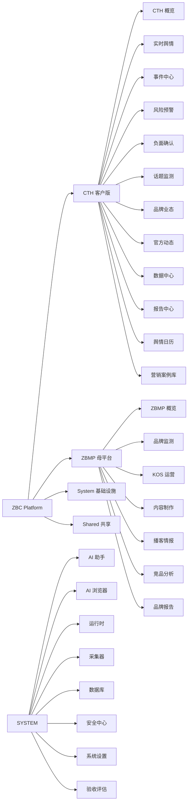

# ZBC Capability Map — 能力关系图

> 生成时间: 2026-09-07 19:37:46

## Mermaid: Feature → Provider → Implementation

```mermaid
graph TD
    cth_overview["CTH 概览"]
    cth_realtime["实时舆情"]
    cth_events["事件中心"]
    cth_risk["风险预警"]
    cth_negative["负面确认"]
    cth_topics["话题监测"]
    cth_brands["品牌业态"]
    cth_official["官方动态"]
    cth_data_center["数据中心"]
    cth_reports["报告中心"]
    cth_calendar["舆情日历"]
    cth_case_library["营销案例库"]
    zbmp_overview["ZBMP 概览"]
    zbmp_brand["品牌监测"]
    zbmp_kos["KOS 运营"]
    zbmp_content["内容制作"]
    zbmp_podcast["播客情报"]
    zbmp_competition["竞品分析"]
    zbmp_reports["品牌报告"]
    system_ai["AI 助手"]
    system_browser["AI 浏览器"]
    system_runtime["运行时"]
    system_collector["采集器"]
    system_database["数据库"]
    system_security["安全中心"]
    system_settings["系统设置"]
    system_evaluation["验收评估"]
    auth_cth_login["Auth Cth Login"] --> system_security
    auth_zbmp_login["Auth Zbmp Login"] --> system_security
    cth_brands["Cth Brands"] --> cth_brands
    cth_data_center["Data Center"] --> cth_data_center
    cth_dc_platform["Cth Dc Platform"] --> cth_data_center
    cth_events["Events"] --> cth_events
    cth_evidence["Cth Evidence"] --> cth_events
    cth_industries["Cth Industries"] --> cth_brands
    cth_kos["Cth Kos"] --> cth_brands
    cth_launch["Cth Launch"] --> cth_events
    cth_overview["Overview"] --> cth_overview
    cth_realtime["Real-time"] --> cth_realtime
    cth_reports["Reports"] --> cth_reports
    cth_risk["Risk"] --> cth_risk
    cth_topics["Topics"] --> cth_topics
    cth_xiaohongshu["Xiaohongshu"] --> cth_realtime
    sys_adaptive_demo["Sys Adaptive Demo"] --> system_ai
    sys_ai["AI"] --> system_ai
    sys_browser["Browser"] --> system_browser
    sys_collector["Collector"] --> system_collector
    sys_database["Database"] --> system_database
    sys_evaluation["Sys Evaluation"] --> system_evaluation
    sys_runtime["Runtime"] --> system_runtime
    sys_security["Security"] --> system_security
    sys_settings["设置中心"] --> system_settings
    sys_skill_store["Sys Skill Store"] --> system_ai
    zbmp_brand["Brand"] --> zbmp_brand
    zbmp_competition["Competition"] --> zbmp_competition
    zbmp_content["Content"] --> zbmp_content
    zbmp_evaluation["Zbmp Evaluation"] --> system_evaluation
    zbmp_intelligence["Zbmp Intelligence"] --> zbmp_brand
    zbmp_kos["KOS"] --> zbmp_kos
    zbmp_launch["Zbmp Launch"] --> zbmp_content
    zbmp_overview["Overview"] --> zbmp_overview
    zbmp_podcast["Podcast"] --> zbmp_podcast
    zbmp_reports["Reports"] --> zbmp_reports
    zbmp_risk["Risk"] --> zbmp_brand
    bp["AI 助手 API 能力 (bp)"] --> system_ai
    bp["实时舆情 API 能力 (bp)"] --> cth_realtime
    zbmp_bp["ZBMP 概览 API 能力 (zbmp"] --> zbmp_overview
    cth_bp["CTH 概览 API 能力 (cth_b"] --> cth_overview
    cth_bp["实时舆情 API 能力 (cth_bp)"] --> cth_realtime
    system_bp["系统设置 API 能力 (system_"] --> system_settings
    intelligencelibrary["未分类 API: GET /intell"] --> shared
    app["品牌业态 API 能力 (app)"] --> cth_brands
    app["内容制作 API 能力 (app)"] --> zbmp_content
    apisubject_classifierclassify["未分类 API: POST /api/s"] --> shared
    apisubject_classifiertypes["未分类 API: GET /api/su"] --> shared
    app["事件中心 API 能力 (app)"] --> cth_events
    apiv2marketingoverview["未分类 API: GET /api/v2"] --> shared
    apiv2global_biloverview["未分类 API: GET /api/v2"] --> shared
    app["安全中心 API 能力 (app)"] --> system_security
    app["CTH 概览 API 能力 (app)"] --> cth_overview
    unnamed["未分类 API: GET /"] --> shared
    faviconico["未分类 API: GET /favico"] --> shared
    apimetricscanonical["未分类 API: GET /api/me"] --> shared
    apiintelligencerefresh["未分类 API: POST /api/i"] --> shared
    app["AI 助手 API 能力 (app)"] --> system_ai
    apibrowsersessions["未分类 API: GET /api/br"] --> shared
    app["采集器 API 能力 (app)"] --> system_collector
    apiresidenthealth["未分类 API: GET /api/re"] --> shared
    apiresidentrecover["未分类 API: POST /api/r"] --> shared
    apideveloperrun["未分类 API: POST /api/d"] --> shared
    app["系统设置 API 能力 (app)"] --> system_settings
    apisearch["未分类 API: GET /api/se"] --> shared
    apifunction_map["未分类 API: GET /api/fu"] --> shared
    apitranslate["未分类 API: POST /api/t"] --> shared
    apinoteshistorical["未分类 API: GET /api/no"] --> shared
    apiplatform_health["未分类 API: GET /api/pl"] --> shared
    apinetworkstatus["未分类 API: GET /api/ne"] --> shared
    apinetworkreset["未分类 API: POST /api/n"] --> shared
    apicollect["未分类 API: POST /api/c"] --> shared
    apicollectstatustask_id["未分类 API: GET /api/co"] --> shared
    apianalyze["未分类 API: POST /api/a"] --> shared
    apinotenote_id["未分类 API: GET /api/no"] --> shared
    apihistorical_notes["未分类 API: GET /api/hi"] --> shared
    apibackup["未分类 API: POST /api/b"] --> shared
    app["实时舆情 API 能力 (app)"] --> cth_realtime
    apinotespublish_buckets["未分类 API: GET /api/no"] --> shared
    apidashboardchanges["未分类 API: GET /api/da"] --> shared
    apinoteslibrary["未分类 API: GET /api/no"] --> shared
    remote["未分类 API: GET /remote"] --> shared
    app["运行时 API 能力 (app)"] --> system_runtime
    app["播客情报 API 能力 (app)"] --> zbmp_podcast
    apiruntimeworkers["未分类 API: GET /api/ru"] --> shared
    apiruntimeworkersworker_idarch["未分类 API: POST /api/r"] --> shared
    apiruntimearchive_dead["未分类 API: POST /api/r"] --> shared
    apioverview["未分类 API: GET /api/ov"] --> shared
    apistatus["未分类 API: GET /api/st"] --> shared
    apirednotecollect["未分类 API: POST /api/r"] --> shared
    apialertsread["未分类 API: POST /api/a"] --> shared
    apialertsrefresh["未分类 API: POST /api/a"] --> shared
    apitestexport["未分类 API: GET /api/te"] --> shared
    app["风险预警 API 能力 (app)"] --> cth_risk
    app["报告中心 API 能力 (app)"] --> cth_reports
    apiengineering_metrics["未分类 API: GET /api/en"] --> shared
    apiofficial_info["未分类 API: GET /api/of"] --> shared
    apiofficial_infocollect["未分类 API: POST /api/o"] --> shared
    apispecial_reportgenerate["未分类 API: POST /api/s"] --> shared
    apiweeklysend_email["未分类 API: POST /api/w"] --> shared
    apistabilitystatus["未分类 API: GET /api/st"] --> shared
    apistabilityheartbeat["未分类 API: GET /api/st"] --> shared
    apistabilitycrash_log["未分类 API: GET /api/st"] --> shared
    apidashboardall["未分类 API: GET /api/da"] --> shared
    apibilibililogin_status["未分类 API: GET /api/bi"] --> shared
    apibilibilisearch["未分类 API: GET /api/bi"] --> shared
    apibilibiliclear_login["未分类 API: POST /api/b"] --> shared
    apidevrun_code["未分类 API: POST /api/d"] --> shared
    apiworkspacefile_tree["未分类 API: GET /api/wo"] --> shared
    apiworkspaceterm["未分类 API: POST /api/w"] --> shared
    apiworkspacefile["未分类 API: GET /api/wo"] --> shared
    apiauxiliarysources["未分类 API: GET /api/au"] --> shared
    apizbmp["未分类 API: GET /api/zb"] --> shared
    apicth["未分类 API: GET /api/ct"] --> shared
    systemsettings["未分类 API: GET /system"] --> shared
    systemskills["未分类 API: GET /system"] --> shared
    systemruntime["未分类 API: GET /system"] --> shared
    cthlogin["未分类 API: GET /cth/lo"] --> shared
    zbmplogin["未分类 API: GET /zbmp/l"] --> shared
    apiv4api_keys["未分类 API: GET /api/v4"] --> shared
    apiv4api_keysgenerate["未分类 API: POST /api/v"] --> shared
    apiv4api_keysrevoke["未分类 API: POST /api/v"] --> shared
    apisearchenhance["未分类 API: POST /api/s"] --> shared
    apilearningscan["未分类 API: POST /api/l"] --> shared
    apilearninghistory["未分类 API: GET /api/le"] --> shared
    apicookiesimport["未分类 API: POST /api/c"] --> shared
    apicookiesimportraw["未分类 API: POST /api/c"] --> shared
    notes_bp["实时舆情 API 能力 (notes_b"] --> cth_realtime
    events_bp["事件中心 API 能力 (events_"] --> cth_events
    reports_bp["报告中心 API 能力 (reports"] --> cth_reports
    ai_bp["AI 助手 API 能力 (ai_bp)"] --> system_ai
    collection_bp["采集器 API 能力 (collecti"] --> system_collector
    settings_bp["系统设置 API 能力 (setting"] --> system_settings
    web_bp["实时舆情 API 能力 (web_bp)"] --> cth_realtime
    architecture_bp["AI 助手 API 能力 (archit"] --> system_ai
    architecture_bp["安全中心 API 能力 (archite"] --> system_security
    architecture_bp["验收评估 API 能力 (archite"] --> system_evaluation
    architecture_bp["运行时 API 能力 (architec"] --> system_runtime
    auth_recovery_bp["安全中心 API 能力 (auth_re"] --> system_security
    badge_bp["运行时 API 能力 (badge_bp"] --> system_runtime
    content_bp["内容制作 API 能力 (content"] --> zbmp_content
    data_center_bp["数据中心 API 能力 (data_ce"] --> cth_data_center
    export_bp["报告中心 API 能力 (export_"] --> cth_reports
    ic_bp["事件中心 API 能力 (ic_bp)"] --> cth_events
    intelligence_library_bp["内容制作 API 能力 (intelli"] --> zbmp_content
    kos_bp["KOS 运营 API 能力 (kos_b"] --> zbmp_kos
    agg_bp["CTH 概览 API 能力 (agg_b"] --> cth_overview
    agg_bp["验收评估 API 能力 (agg_bp)"] --> system_evaluation
    agg_bp["系统设置 API 能力 (agg_bp)"] --> system_settings
    agg_bp["内容制作 API 能力 (agg_bp)"] --> zbmp_content
    agg_bp["KOS 运营 API 能力 (agg_b"] --> zbmp_kos
    lumenis_bp["CTH 概览 API 能力 (lumen"] --> cth_overview
    lumenis_bp["AI 助手 API 能力 (lumeni"] --> system_ai
    lumenis_bp["实时舆情 API 能力 (lumenis"] --> cth_realtime
    domain_api_bp["系统设置 API 能力 (domain_"] --> system_settings
    podcast_bp["播客情报 API 能力 (podcast"] --> zbmp_podcast
    pr_case_bp["内容制作 API 能力 (pr_case"] --> zbmp_content
    report_bp["报告中心 API 能力 (report_"] --> cth_reports
    report_bp["品牌业态 API 能力 (report_"] --> cth_brands
    system_ai_bp["AI 助手 API 能力 (system"] --> system_ai
    system_features_bp["安全中心 API 能力 (system_"] --> system_security
    system_features_bp["验收评估 API 能力 (system_"] --> system_evaluation
    system_features_bp["系统设置 API 能力 (system_"] --> system_settings
    system_features_bp["采集器 API 能力 (system_f"] --> system_collector
    system_health_bp["AI 助手 API 能力 (system"] --> system_ai
    system_health_bp["系统设置 API 能力 (system_"] --> system_settings
    trend_bp["CTH 概览 API 能力 (trend"] --> cth_overview
    viz_bp["CTH 概览 API 能力 (viz_b"] --> cth_overview
    API_apibrandslogos["/api/brands/logos"] -->|提供| cth_brands
    API_apicase_analysisdeta["/api/case-analysis/detail"] -->|提供| cth_events
    API_apievent_graphstats["/api/event-graph/stats"] -->|提供| cth_events
    API_apibrand_stats["/api/brand-stats"] -->|提供| cth_overview
    API_healthz["/healthz"] -->|提供| cth_overview
    API_apixhsruntime_check["/api/xhs/runtime-check"] -->|提供| cth_realtime
    API_apicollector_guardst["/api/collector-guard/status"] -->|提供| cth_realtime
    API_apiweeklyevents["/api/weekly/events"] -->|提供| cth_reports
    API_apispecial_reportche["/api/special-report/check-trig"] -->|提供| cth_reports
    API_apinegative_reviewst["/api/negative-review/stats"] -->|提供| cth_risk
    API_apialerts["/api/alerts"] -->|提供| cth_risk
    API_apixhsswitch_account["/api/xhs/switch-account"] -->|提供| cth_xiaohongshu
    API_apixhsaccounts["/api/xhs/accounts"] -->|提供| cth_xiaohongshu
    API_apiai_resource_packs["/api/ai-resource-packs/status"] -->|提供| sys_ai
    API_apiaiowasp["/api/ai/owasp"] -->|提供| sys_ai
    API_apiproxystatus["/api/proxy/status"] -->|提供| sys_collector
    API_apicollectorbrowser_["/api/collector/browser-mode"] -->|提供| sys_collector
    API_apisystemruntime["/api/system/runtime"] -->|提供| sys_database
    API_apisystemdatabase["/api/system/database"] -->|提供| sys_database
    API_apisystemacceptancej["/api/system/acceptance/judge"] -->|提供| sys_evaluation
    API_apisystemworkers["/api/system/workers"] -->|提供| sys_runtime
    API_apisystemdlq["/api/system/dlq"] -->|提供| sys_runtime
    API_apisystemsecurity["/api/system/security"] -->|提供| sys_security
    API_apisystemsecurityaud["/api/system/security/audit"] -->|提供| sys_security
    API_apiauthzbmp_entryunl["/api/auth/zbmp-entry/unlock"] -->|提供| sys_settings
    API_apibrand_industrybra["/api/brand-industry/brands"] -->|提供| zbmp_brand
    API_apicreativesocial_op["/api/creative/social-ops"] -->|提供| zbmp_content
    API_apiweb_topics["/api/web-topics"] -->|提供| zbmp_content
    API_apikosprofessionalst["/api/kos/professional/status"] -->|提供| zbmp_kos
    API_apireports["/api/reports"] -->|提供| zbmp_reports
    API_apinegativeconfirm["/api/negative/confirm"] -->|提供| zbmp_risk
    API_apinegativereject["/api/negative/reject"] -->|提供| zbmp_risk
    API_apiaistatus["/api/ai/status"] -->|提供| bp
    API_apiaitest["/api/ai/test"] -->|提供| bp
    API_apiweb_sentimentsear["/api/web-sentiment/search"] -->|提供| bp
    API_apiweb_sentimenthist["/api/web-sentiment/history"] -->|提供| bp
    API_overview["/overview"] -->|提供| zbmp_bp
    API_brands["/brands"] -->|提供| zbmp_bp
    API_overview["/overview"] -->|提供| cth_bp
    API_events["/events"] -->|提供| cth_bp
    API_xiaohongshu["/xiaohongshu"] -->|提供| cth_bp
    API_status["/status"] -->|提供| system_bp
    API_runtime_workers["/runtime-workers"] -->|提供| system_bp
    API_intelligencelibrary["/intelligence/library"] -->|提供| intelligencelibrary
    API_apibrand_knowledgest["/api/brand-knowledge/stats"] -->|提供| app
    API_apibrand_knowledgese["/api/brand-knowledge/search"] -->|提供| app
    API_apicase_analysisstat["/api/case-analysis/stats"] -->|提供| app
    API_apicase_analysislist["/api/case-analysis/list"] -->|提供| app
    API_apisubject_classifie["/api/subject-classifier/classi"] -->|提供| apisubject_classifierclassify
    API_apisubject_classifie["/api/subject-classifier/types"] -->|提供| apisubject_classifiertypes
    API_apievent_graphchaine["/api/event-graph/chain/<event_"] -->|提供| app
    API_apievent_graphtypes["/api/event-graph/types"] -->|提供| app
    API_apiv2marketingovervi["/api/v2/marketing/overview"] -->|提供| apiv2marketingoverview
    API_apiv2global_biloverv["/api/v2/global-bil/overview"] -->|提供| apiv2global_biloverview
    API_apiauthconfig["/api/auth/config"] -->|提供| app
    API_apisecurityscan["/api/security/scan"] -->|提供| app
    API_apivizoverviewstats["/api/viz/overview.stats"] -->|提供| app
    API_apivizriskactive["/api/viz/risk.active"] -->|提供| app
    API_unnamed["/"] -->|提供| unnamed
    API_faviconico["/favicon.ico"] -->|提供| faviconico
    API_apimetricscanonical["/api/metrics/canonical"] -->|提供| apimetricscanonical
    API_apiintelligencerefre["/api/intelligence/refresh"] -->|提供| apiintelligencerefresh
    API_apiaitasks["/api/ai/tasks"] -->|提供| app
    API_apiai_governancestat["/api/ai-governance/status"] -->|提供| app
    API_apibrowsersessions["/api/browser/sessions"] -->|提供| apibrowsersessions
    API_apicollectorbrowsers["/api/collector/browser/start"] -->|提供| app
    API_apicollectorbrowsers["/api/collector/browser/stop"] -->|提供| app
    API_apiresidenthealth["/api/resident/health"] -->|提供| apiresidenthealth
    API_apiresidentrecover["/api/resident/recover"] -->|提供| apiresidentrecover
    API_apideveloperrun["/api/developer/run"] -->|提供| apideveloperrun
    API_apisettings["/api/settings"] -->|提供| app
    API_apicachestatus["/api/cache/status"] -->|提供| app
    API_apisearch["/api/search"] -->|提供| apisearch
    API_apisearch["/api/search"] -->|提供| apisearch
    API_apifunction_map["/api/function-map"] -->|提供| apifunction_map
    API_apitranslate["/api/translate"] -->|提供| apitranslate
    API_apinoteshistorical["/api/notes/historical"] -->|提供| apinoteshistorical
    API_apiplatform_health["/api/platform-health"] -->|提供| apiplatform_health
    API_apinetworkstatus["/api/network/status"] -->|提供| apinetworkstatus
    API_apinetworkreset["/api/network/reset"] -->|提供| apinetworkreset
    API_apicollect["/api/collect"] -->|提供| apicollect
    API_apicollectstatustask["/api/collect/status/<task_id>"] -->|提供| apicollectstatustask_id
    API_apianalyze["/api/analyze"] -->|提供| apianalyze
    API_apinotenote_id["/api/note/<note_id>"] -->|提供| apinotenote_id
    API_apihistorical_notes["/api/historical-notes"] -->|提供| apihistorical_notes
    API_apibackup["/api/backup"] -->|提供| apibackup
    API_apiwebbrowser_discov["/api/web/browser-discovery"] -->|提供| app
    API_apiwebbrand_industry["/api/web/brand-industry/plan"] -->|提供| app
    API_apinotespublish_buck["/api/notes/publish-buckets"] -->|提供| apinotespublish_buckets
    API_apidashboardchanges["/api/dashboard/changes"] -->|提供| apidashboardchanges
    API_apinoteslibrary["/api/notes/library"] -->|提供| apinoteslibrary
    API_remote["/remote"] -->|提供| remote
    API_apihealth["/api/health"] -->|提供| app
    API_apipodcasttopics["/api/podcast/topics"] -->|提供| app
    API_apiruntimeworkers["/api/runtime/workers"] -->|提供| apiruntimeworkers
    API_apiruntimeworkerswor["/api/runtime/workers/<worker_i"] -->|提供| apiruntimeworkersworker_idarch
    API_apiruntimearchive_de["/api/runtime/archive-dead"] -->|提供| apiruntimearchive_dead
    API_apioverview["/api/overview"] -->|提供| apioverview
    API_apistatus["/api/status"] -->|提供| apistatus
    API_apirednotecollect["/api/rednote/collect"] -->|提供| apirednotecollect
    API_apialertsread["/api/alerts/read"] -->|提供| apialertsread
    API_apialertsrefresh["/api/alerts/refresh"] -->|提供| apialertsrefresh
    API_apitestexport["/api/test/export"] -->|提供| apitestexport
    API_apinegative_reviewno["/api/negative-review/<note_id>"] -->|提供| app
    API_apinegative_reviewno["/api/negative-review/<note_id>"] -->|提供| app
    API_apireportsexport["/api/reports/export"] -->|提供| app
    API_apireportsexport_all["/api/reports/export-all"] -->|提供| app
    API_apiengineering_metri["/api/engineering-metrics"] -->|提供| apiengineering_metrics
    API_apiofficial_info["/api/official-info"] -->|提供| apiofficial_info
    API_apiofficial_infocoll["/api/official-info/collect"] -->|提供| apiofficial_infocollect
    API_apispecial_reportgen["/api/special-report/generate"] -->|提供| apispecial_reportgenerate
    API_apiweeklysend_email["/api/weekly/send-email"] -->|提供| apiweeklysend_email
    API_apistabilitystatus["/api/stability/status"] -->|提供| apistabilitystatus
    API_apistabilityheartbea["/api/stability/heartbeat"] -->|提供| apistabilityheartbeat
    API_apistabilitycrash_lo["/api/stability/crash-log"] -->|提供| apistabilitycrash_log
    API_apidashboardall["/api/dashboard/all"] -->|提供| apidashboardall
    API_apibilibililogin_sta["/api/bilibili/login-status"] -->|提供| apibilibililogin_status
    API_apibilibilisearch["/api/bilibili/search"] -->|提供| apibilibilisearch
    API_apibilibiliclear_log["/api/bilibili/clear-login"] -->|提供| apibilibiliclear_login
    API_apidevrun_code["/api/dev/run-code"] -->|提供| apidevrun_code
    API_apiworkspacefile_tre["/api/workspace/file-tree"] -->|提供| apiworkspacefile_tree
    API_apiworkspaceterm["/api/workspace/term"] -->|提供| apiworkspaceterm
    API_apiworkspacefile["/api/workspace/file"] -->|提供| apiworkspacefile
    API_apiauxiliarysources["/api/auxiliary/sources"] -->|提供| apiauxiliarysources
    API_apizbmp["/api/zbmp"] -->|提供| apizbmp
    API_apicth["/api/cth"] -->|提供| apicth
    API_systemsettings["/system/settings"] -->|提供| systemsettings
    API_systemskills["/system/skills"] -->|提供| systemskills
    API_systemruntime["/system/runtime"] -->|提供| systemruntime
    API_cthlogin["/cth/login"] -->|提供| cthlogin
    API_zbmplogin["/zbmp/login"] -->|提供| zbmplogin
    API_apiv4api_keys["/api/v4/api-keys"] -->|提供| apiv4api_keys
    API_apiv4api_keysgenerat["/api/v4/api-keys/generate"] -->|提供| apiv4api_keysgenerate
    API_apiv4api_keysrevoke["/api/v4/api-keys/revoke"] -->|提供| apiv4api_keysrevoke
    API_apisearchenhance["/api/search/enhance"] -->|提供| apisearchenhance
    API_apilearningscan["/api/learning/scan"] -->|提供| apilearningscan
    API_apilearninghistory["/api/learning/history"] -->|提供| apilearninghistory
    API_apicookiesimport["/api/cookies/import"] -->|提供| apicookiesimport
    API_apicookiesimportraw["/api/cookies/import/raw"] -->|提供| apicookiesimportraw
    API_unnamed["/"] -->|提供| notes_bp
    API_note_id["/<note_id>"] -->|提供| notes_bp
    API_unnamed["/"] -->|提供| events_bp
    API_event_id["/<event_id>"] -->|提供| events_bp
    API_export["/export"] -->|提供| reports_bp
    API_daily["/daily"] -->|提供| reports_bp
    API_analyze["/analyze"] -->|提供| ai_bp
    API_providers["/providers"] -->|提供| ai_bp
    API_trigger["/trigger"] -->|提供| collection_bp
    API_status["/status"] -->|提供| collection_bp
    API_unnamed["/"] -->|提供| settings_bp
    API_apisettingsconfig["/api/settings/config"] -->|提供| settings_bp
    API_topics["/topics"] -->|提供| web_bp
    API_browser_discovery["/browser-discovery"] -->|提供| web_bp
    API_apiadaptivestatus["/api/adaptive/status"] -->|提供| architecture_bp
    API_apiadaptivecan_colle["/api/adaptive/can-collect"] -->|提供| architecture_bp
    API_apirecoveryhealth_ch["/api/recovery/health-check"] -->|提供| architecture_bp
    API_apirecoveryrun_cycle["/api/recovery/run-cycle"] -->|提供| architecture_bp
    API_apifeedbackanalyze["/api/feedback/analyze"] -->|提供| architecture_bp
    API_apifeedbacksuggestio["/api/feedback/suggestions"] -->|提供| architecture_bp
    API_apiarchitecturestatu["/api/architecture/status"] -->|提供| architecture_bp
    API_summary["/summary"] -->|提供| auth_recovery_bp
    API_tasks["/tasks"] -->|提供| auth_recovery_bp
    API_apibadgecounts["/api/badge/counts"] -->|提供| badge_bp
    API_apibadgenotification["/api/badge/notifications"] -->|提供| badge_bp
    API_types["/types"] -->|提供| content_bp
    API_generate["/generate"] -->|提供| content_bp
    API_platforms["/platforms"] -->|提供| data_center_bp
    API_platformplatform_id["/platform/<platform_id>"] -->|提供| data_center_bp
    API_apiexportpreview["/api/export/preview"] -->|提供| export_bp
    API_apiexportexcel["/api/export/excel"] -->|提供| export_bp
    API_alertconfig["/alert/config"] -->|提供| ic_bp
    API_alertrecords["/alert/records"] -->|提供| ic_bp
    API_asset_id["/<asset_id>"] -->|提供| intelligence_library_bp
    API_search["/search"] -->|提供| intelligence_library_bp
    API_overview["/overview"] -->|提供| kos_bp
    API_list["/list"] -->|提供| kos_bp
    API_apiintelligencemodel["/api/intelligence/models"] -->|提供| agg_bp
    API_apiagentsstatus["/api/agents/status"] -->|提供| agg_bp
    API_apievaluationstatus["/api/evaluation/status"] -->|提供| agg_bp
    API_apisystemrepository["/api/system/repository"] -->|提供| agg_bp
    API_apiproductionreports["/api/production/reports"] -->|提供| agg_bp
    API_apikosprofessionalen["/api/kos/professional/enable"] -->|提供| agg_bp
    API_apikosprofessionaldi["/api/kos/professional/disable"] -->|提供| agg_bp
    API_unnamed["/"] -->|提供| lumenis_bp
    API_apiintelligenceevide["/api/intelligence/evidence"] -->|提供| lumenis_bp
    API_apiskillsstatus["/api/skills/status"] -->|提供| lumenis_bp
    API_apiskillsinvoke["/api/skills/invoke"] -->|提供| lumenis_bp
    API_cthxiaohongshu["/cth/xiaohongshu"] -->|提供| lumenis_bp
    API_apidomainbrands["/api/domain/brands"] -->|提供| domain_api_bp
    API_apidomainrisk["/api/domain/risk"] -->|提供| domain_api_bp
    API_overview["/overview"] -->|提供| podcast_bp
    API_entities["/entities"] -->|提供| podcast_bp
    API_apiprcasesintcase_id["/api/pr/cases/<int:case_id>"] -->|提供| pr_case_bp
    API_apipract_principle["/api/pr/act-principle"] -->|提供| pr_case_bp
    API_apiv2report_centerpr["/api/v2/report-center/preview"] -->|提供| report_bp
    API_apireportdaily["/api/report/daily"] -->|提供| report_bp
    API_apibrand_reportgener["/api/brand-report/generate"] -->|提供| report_bp
    API_apibrand_reportexpor["/api/brand-report/export/<repo"] -->|提供| report_bp
    API_apiailogs["/api/ai/logs"] -->|提供| system_ai_bp
    API_apisecurityscan["/api/security/scan"] -->|提供| system_features_bp
    API_apisecuritybaseline["/api/security/baseline"] -->|提供| system_features_bp
    API_apievaluationrun["/api/evaluation/run"] -->|提供| system_features_bp
    API_apievaluationcollect["/api/evaluation/collection"] -->|提供| system_features_bp
    API_apilocal_aistatus["/api/local-ai/status"] -->|提供| system_features_bp
    API_apilocal_aianalyze["/api/local-ai/analyze"] -->|提供| system_features_bp
    API_apicollectorstart_cd["/api/collector/start-cdp"] -->|提供| system_features_bp
    API_apicollectorstop_cdp["/api/collector/stop-cdp"] -->|提供| system_features_bp
    API_apisystemhealthdetai["/api/system/health/detailed"] -->|提供| system_health_bp
    API_apisystemhealthsumma["/api/system/health/summary"] -->|提供| system_health_bp
    API_apisystemhealthmodul["/api/system/health/module/<mod"] -->|提供| system_health_bp
    API_apitrendnotes["/api/trend/notes"] -->|提供| trend_bp
    API_apitrendevents["/api/trend/events"] -->|提供| trend_bp
    API_registry["/registry"] -->|提供| viz_bp
    API_function_name["/<function_name>"] -->|提供| viz_bp
```

## Mermaid: Domain Overview

