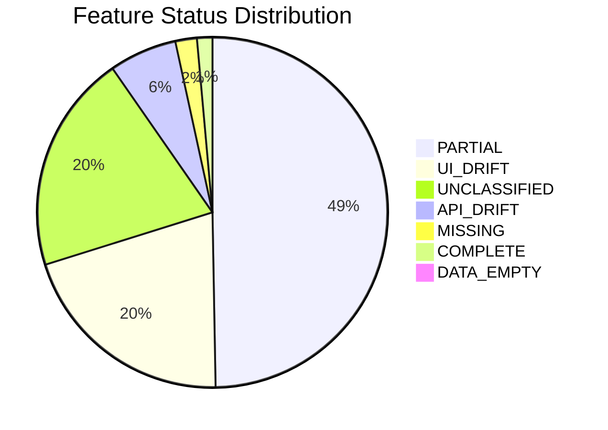

# ZBC Feature Governance Report — 功能治理报告

> 生成时间: 2026-09-07 19:37:46
> 扫描基线: scan_ui (37页/1039组件/110 API) + scan_api_service (263文件/567 API/3758 Service/33 Blueprint) + scan_db_collector (128表/8 Migration/216 Collector) + scan_agent_skill_ai (127 Agent/10 Skill/19 Provider/204 AI Feature)

## 一、总览统计

- **总 Feature 数**: 354
- **L2 模块数**: 27 (cth 12 / zbmp 7 / system 8)
- **层级分布**: L0=1, L1=4, L2=27, L3=168, L4=154, L5=0
- **类型分布**: CORE_BUSINESS=128, UNCLASSIFIED=71, ANALYSIS=52, SYSTEM=45, SETTINGS=28, AI=21, DATA=9
- **Status 分布**: PARTIAL=175, UI_DRIFT=72, UNCLASSIFIED=71, API_DRIFT=22, MISSING=7, COMPLETE=5, DATA_EMPTY=2
- **Domain 分布**: cth=13, system=9, zbmp=8, shared=1
- **去重关系**: 79 条 (API URL 重叠 44 个)
- **错误归属**: 0 条
- **孤儿功能**: 0 条
- **未分类功能**: 71 条
- **API Drift** (UI调用但scan_api无定义): 72
- **UI Drift** (有UI无API): 18
- **Dead Feature** (无任何实现): 0

## 二、P0 治理项（影响核心业务链路）

- **Auth Cth Login** (`feat.system_security.auth_cth_login`): 有 UI 入口但无对应 API 端点
- **Auth Zbmp Login** (`feat.system_security.auth_zbmp_login`): 有 UI 入口但无对应 API 端点
- **Data Center** (`feat.cth_data_center.cth_data_center`): 有 UI 入口但无对应 API 端点
- **Cth Dc Platform** (`feat.cth_data_center.cth_dc_platform`): 有 UI 入口但无对应 API 端点
- **Events** (`feat.cth_events.cth_events`): 有 UI 入口但无对应 API 端点
- **Overview** (`feat.cth_overview.cth_overview`): 有 UI 入口但无对应 API 端点
- **Real-time** (`feat.cth_realtime.cth_realtime`): 有 UI 入口但无对应 API 端点
- **Reports** (`feat.cth_reports.cth_reports`): 有 UI 入口但无对应 API 端点
- **Topics** (`feat.cth_topics.cth_topics`): 有 UI 入口但无对应 API 端点
- **Xiaohongshu** (`feat.cth_realtime.cth_xiaohongshu`): 有 UI 入口但无对应 API 端点
- **AI** (`feat.system_ai.sys_ai`): 有 UI 入口但无对应 API 端点
- **Collector** (`feat.system_collector.sys_collector`): 有 UI 入口但无对应 API 端点
- **Database** (`feat.system_database.sys_database`): 有 UI 入口但无对应 API 端点
- **Runtime** (`feat.system_runtime.sys_runtime`): 有 UI 入口但无对应 API 端点
- **Security** (`feat.system_security.sys_security`): 有 UI 入口但无对应 API 端点
- **设置中心** (`feat.system_settings.sys_settings`): 有 UI 入口但无对应 API 端点
- **Brand** (`feat.zbmp_brand.zbmp_brand`): 有 UI 入口但无对应 API 端点
- **Competition** (`feat.zbmp_competition.zbmp_competition`): 有 UI 入口但无对应 API 端点
- **Content** (`feat.zbmp_content.zbmp_content`): 有 UI 入口但无对应 API 端点
- **KOS** (`feat.zbmp_kos.zbmp_kos`): 有 UI 入口但无对应 API 端点

## 三、P1 治理项（Agent/Skill 归属、类型/层级错误）

- **类型未分类**: `feat.unclassified.api.intelligencelibrary` (未分类 API: GET /intelligence/library)
- **类型未分类**: `feat.unclassified.api.apisubject_classifierclassify` (未分类 API: POST /api/subject-classifier/classify)
- **类型未分类**: `feat.unclassified.api.apisubject_classifiertypes` (未分类 API: GET /api/subject-classifier/types)
- **类型未分类**: `feat.unclassified.api.apiv2marketingoverview` (未分类 API: GET /api/v2/marketing/overview)
- **类型未分类**: `feat.unclassified.api.apiv2global_biloverview` (未分类 API: GET /api/v2/global-bil/overview)
- **类型未分类**: `feat.unclassified.api.unnamed` (未分类 API: GET /)
- **类型未分类**: `feat.unclassified.api.faviconico` (未分类 API: GET /favicon.ico)
- **类型未分类**: `feat.unclassified.api.apimetricscanonical` (未分类 API: GET /api/metrics/canonical)
- **类型未分类**: `feat.unclassified.api.apiintelligencerefresh` (未分类 API: POST /api/intelligence/refresh)
- **类型未分类**: `feat.unclassified.api.apibrowsersessions` (未分类 API: GET /api/browser/sessions)
- **类型未分类**: `feat.unclassified.api.apiresidenthealth` (未分类 API: GET /api/resident/health)
- **类型未分类**: `feat.unclassified.api.apiresidentrecover` (未分类 API: POST /api/resident/recover)
- **类型未分类**: `feat.unclassified.api.apideveloperrun` (未分类 API: POST /api/developer/run)
- **类型未分类**: `feat.unclassified.api.apisearch` (未分类 API: GET /api/search)
- **类型未分类**: `feat.unclassified.api.apifunction_map` (未分类 API: GET /api/function-map)
- **类型未分类**: `feat.unclassified.api.apitranslate` (未分类 API: POST /api/translate)
- **类型未分类**: `feat.unclassified.api.apinoteshistorical` (未分类 API: GET /api/notes/historical)
- **类型未分类**: `feat.unclassified.api.apiplatform_health` (未分类 API: GET /api/platform-health)
- **类型未分类**: `feat.unclassified.api.apinetworkstatus` (未分类 API: GET /api/network/status)
- **类型未分类**: `feat.unclassified.api.apinetworkreset` (未分类 API: POST /api/network/reset)

## 四、P2 治理项（未分类、隐藏功能、死代码）

- **未分类**: `feat.unclassified.api.intelligencelibrary` — API URL无法映射: GET /intelligence/library (blueprint=app)
- **未分类**: `feat.unclassified.api.apisubject_classifierclassify` — API URL无法映射: POST /api/subject-classifier/classify (blueprin
- **未分类**: `feat.unclassified.api.apisubject_classifiertypes` — API URL无法映射: GET /api/subject-classifier/types (blueprint=ap
- **未分类**: `feat.unclassified.api.apiv2marketingoverview` — API URL无法映射: GET /api/v2/marketing/overview (blueprint=app)
- **未分类**: `feat.unclassified.api.apiv2global_biloverview` — API URL无法映射: GET /api/v2/global-bil/overview (blueprint=app)
- **未分类**: `feat.unclassified.api.unnamed` — API URL无法映射: GET / (blueprint=app)
- **未分类**: `feat.unclassified.api.faviconico` — API URL无法映射: GET /favicon.ico (blueprint=app)
- **未分类**: `feat.unclassified.api.apimetricscanonical` — API URL无法映射: GET /api/metrics/canonical (blueprint=app)
- **未分类**: `feat.unclassified.api.apiintelligencerefresh` — API URL无法映射: POST /api/intelligence/refresh (blueprint=app)
- **未分类**: `feat.unclassified.api.apibrowsersessions` — API URL无法映射: GET /api/browser/sessions (blueprint=app)
- **未分类**: `feat.unclassified.api.apiresidenthealth` — API URL无法映射: GET /api/resident/health (blueprint=app)
- **未分类**: `feat.unclassified.api.apiresidentrecover` — API URL无法映射: POST /api/resident/recover (blueprint=app)
- **未分类**: `feat.unclassified.api.apideveloperrun` — API URL无法映射: POST /api/developer/run (blueprint=app)
- **未分类**: `feat.unclassified.api.apisearch` — API URL无法映射: GET /api/search (blueprint=app)
- **未分类**: `feat.unclassified.api.apifunction_map` — API URL无法映射: GET /api/function-map (blueprint=app)
- **未分类**: `feat.unclassified.api.apitranslate` — API URL无法映射: POST /api/translate (blueprint=app)
- **未分类**: `feat.unclassified.api.apinoteshistorical` — API URL无法映射: GET /api/notes/historical (blueprint=app)
- **未分类**: `feat.unclassified.api.apiplatform_health` — API URL无法映射: GET /api/platform-health (blueprint=app)
- **未分类**: `feat.unclassified.api.apinetworkstatus` — API URL无法映射: GET /api/network/status (blueprint=app)
- **未分类**: `feat.unclassified.api.apinetworkreset` — API URL无法映射: POST /api/network/reset (blueprint=app)

## 五、架构图

### 5.1 Domain → Module → Feature 分层

```mermaid
graph TD
    ZBC["ZBC L0"] --> CTH["CTH L1"]
    ZBC --> ZBMP["ZBMP L1"]
    ZBC --> SYS["System L1"]
    ZBC --> SHARED["Shared L1"]
    CTH --> cth_overview["CTH 概览"]
    CTH --> cth_realtime["实时舆情"]
    CTH --> cth_events["事件中心"]
    CTH --> cth_risk["风险预警"]
    CTH --> cth_negative["负面确认"]
    CTH --> cth_topics["话题监测"]
    CTH --> cth_brands["品牌业态"]
    CTH --> cth_official["官方动态"]
    CTH --> cth_data_center["数据中心"]
    CTH --> cth_reports["报告中心"]
    CTH --> cth_calendar["舆情日历"]
    CTH --> cth_case_library["营销案例库"]
    ZBMP --> zbmp_overview["ZBMP 概览"]
    ZBMP --> zbmp_brand["品牌监测"]
    ZBMP --> zbmp_kos["KOS 运营"]
    ZBMP --> zbmp_content["内容制作"]
    ZBMP --> zbmp_podcast["播客情报"]
    ZBMP --> zbmp_competition["竞品分析"]
    ZBMP --> zbmp_reports["品牌报告"]
    SYSTEM --> system_ai["AI 助手"]
    SYSTEM --> system_browser["AI 浏览器"]
    SYSTEM --> system_runtime["运行时"]
    SYSTEM --> system_collector["采集器"]
    SYSTEM --> system_database["数据库"]
    SYSTEM --> system_security["安全中心"]
    SYSTEM --> system_settings["系统设置"]
    SYSTEM --> system_evaluation["验收评估"]
```

### 5.2 Runtime Contract 状态分布

## 六、关键发现与建议

### 关键发现
1. **27 个 L2 模块**是唯一归属锚点，所有 L3/L4 功能均已挂载到对应模块下
2. **API 去重**: UI 扫描与 API 扫描有 44 个 URL 重叠，统一以 scan_api_service 为 canonical 来源
3. **AI/Agent/Skill 治理**: 204 个 AI Feature、127 个 Agent、10 个 Skill 全部作为 PROVIDER/CALLER 挂载，未复制为独立业务功能
4. **DB 表归属**: 128 张表按 table_domain_index + 表名关键词映射到模块，shared 域 72 张表为跨域共享
5. **Runtime Contract**: 仅同时满足 UI+API+Service+DB+Schema+Runtime+数据+交互的功能标记为 COMPLETE

### 建议
1. **P0**: 优先修复 API_DRIFT 功能（UI 调用了未在后端定义的端点）
2. **P1**: 对 UNCLASSIFIED 功能进行人工审计，确认归属后补充映射规则
3. **P1**: 审查 Agent/Skill 是否有被误注册为独立 Feature 的情况，确保 OWNER 始终是业务模块
4. **P2**: 清理 DEAD_FEATURE（无任何实现绑定的注册项）或补充实现
5. **持续**: 将 feature_registry.json 纳入 CI，每次代码变更后重新扫描验证归属一致性
